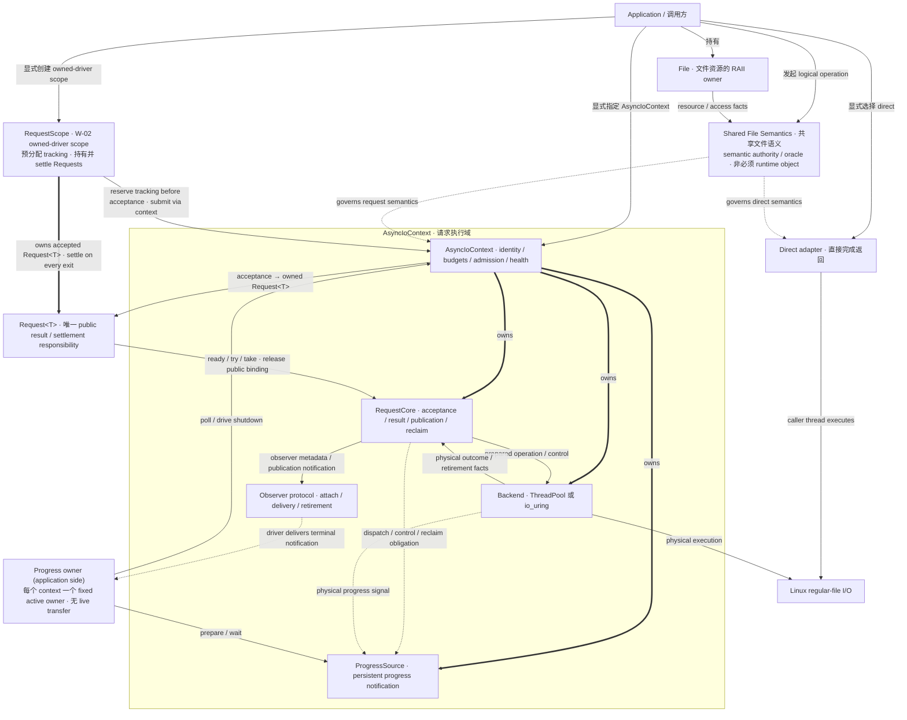

# Sluice

Sluice is a C++20 explicit file-I/O library: one File contract, explicit
direct and request execution, bounded progress, and no host runtime in the
supported surface.

[中文说明](README.zh-CN.md)

## Design authority

**[Sluice v2 Architecture and Contract](docs/explicit-io-contract.md)**
(revision v2-r1) is the sole normative root. It defines the vocabulary, File
semantics, invocation forms, request and observer lifetime, progress,
shutdown, threading, resource bounds and acceptance criteria. The former v1
root and its ledger are superseded; Git history retains them.

ADRs derive implementation choices from its requirement IDs. Code establishes
current behavior; tests and models establish scoped evidence. None
independently changes the target contract.

- [v2 conformance ledger](docs/roadmap/v2-conformance.md) — implementation
  state and evidence against the v2 root, including the release-gate status.
  Adopting the specification does not certify the code.
- [docs/README.md](docs/README.md) — documentation map: active records versus
  `docs/archive/` historical records.
- [AGENTS.md](AGENTS.md) — repository working rules.
- [Current-code architecture snapshot](docs/archive/architecture/architecture.md) — dated historical
  implementation view, not a v2 target diagram.
- [Retained research conclusions](research/RESULTS.md) — rationale and evidence.

The principles remain: minimal necessary semantics, clear boundaries, explicit
authority, named bounds, replaceable execution and minimum justified mechanism.

## Target architecture

A canonical `File` owns the native resource and access facts. Shared operation
semantics apply to direct completed-return calls and explicit outstanding
requests.

Direct execution needs no request table or runtime. An explicit
`AsyncIoContext` owns a bounded RequestCore, one backend and a progress
source; a move-only
Request represents outstanding responsibility. The backend seam is internal:
v2 ships exactly the ThreadPool and io_uring backends, and user-authored
backends are not a supported configuration. The stackful host and its
fiber/cancel kit are outside v2 and physically removed; bounded
pipelines use the owned-driver `RequestScope` instead.

Request publication, result consumption and slot reclamation are separate.
Wait cancellation does not end a buffer borrow. Execution shutdown retains
unconsumed results, and context destruction requires public bindings to be
gone. See the root specification for the complete contracts and Linux scope.

The diagram below is an informative view of the v2 architecture. It mirrors
`ARCH-01` / `ARCH-02` / `PROG` and the owned-driver scope of the root's
section 16; if wording here ever differs from the root specification, the
root specification wins.



## Current implementation

The current tree contains the canonical File/blocking operations, the
Request/AsyncIoContext request core with ThreadPool and io_uring backends,
and the RequestScope for W-02. The optional stackful-host candidate was
outside v2 and has been physically removed (owner decision D1); no host
runtime exists in the tree. Implementation state, open gaps and the release
gate are tracked in
the [v2 conformance ledger](docs/roadmap/v2-conformance.md); the v1
convergence campaign (phases M/F) is completed history and binds nothing.

The previous mission, ADR-0001/0002, visual companion and
[old conformance roadmap](docs/archive/explicit-file-roadmap/explicit-file-conformance.md) are superseded
historical records. Their earlier CLOSED/CONFORMANT claims apply only to the
baselines and contracts they originally examined; the same now holds for the
superseded v1 root and its ledger.

## Applications

- [sluice-copy](apps/sluice-copy/README.md)
- [sluice-hash](apps/sluice-hash/README.md)
- [sluice-grep](apps/sluice-grep/README.md)
- [sluice-tail](apps/sluice-tail/README.md)

## Build

Sluice uses [Xmake](https://xmake.io) and requires a C++20 compiler.

```bash
git clone https://github.com/jnhu76/Sluice.git
cd Sluice
xmake f -m release -y
xmake
```

`xmake.lua` and `xmake/` define the targets that currently exist. The tested
compiler, kernel and liburing configurations are recorded in the
[v2 release acceptance evidence](docs/evidence/v2-release-acceptance-20261017/);
configurations outside that record are untested.

## License

Sluice is licensed under the [MIT License](LICENSE).
