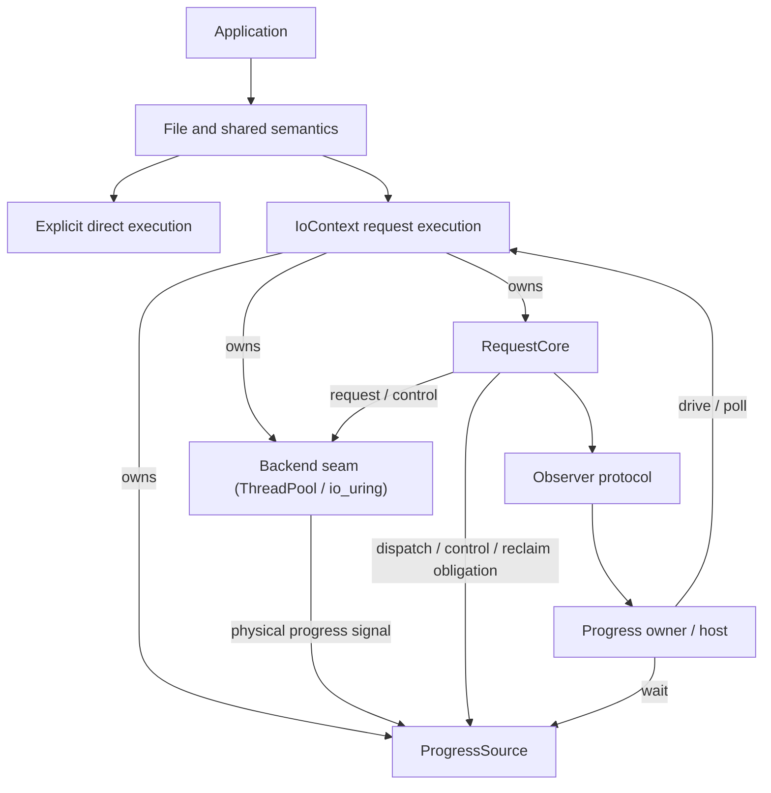
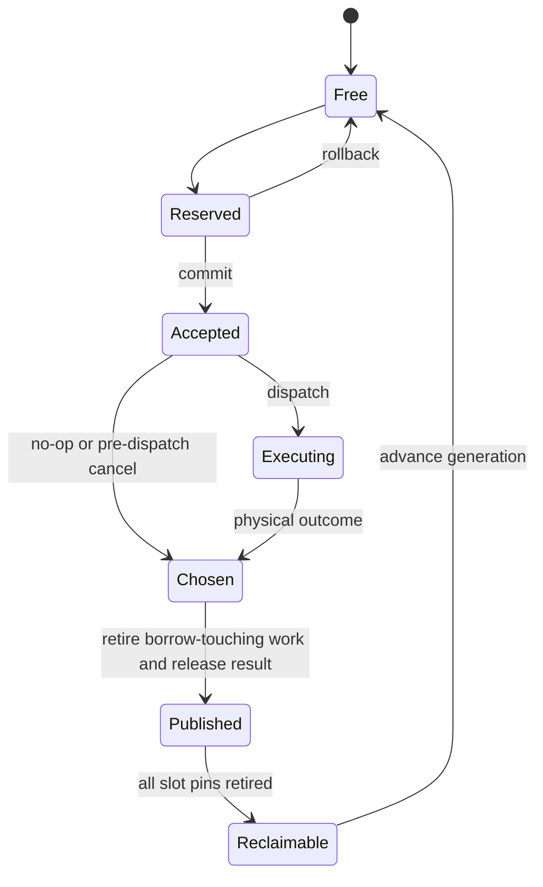
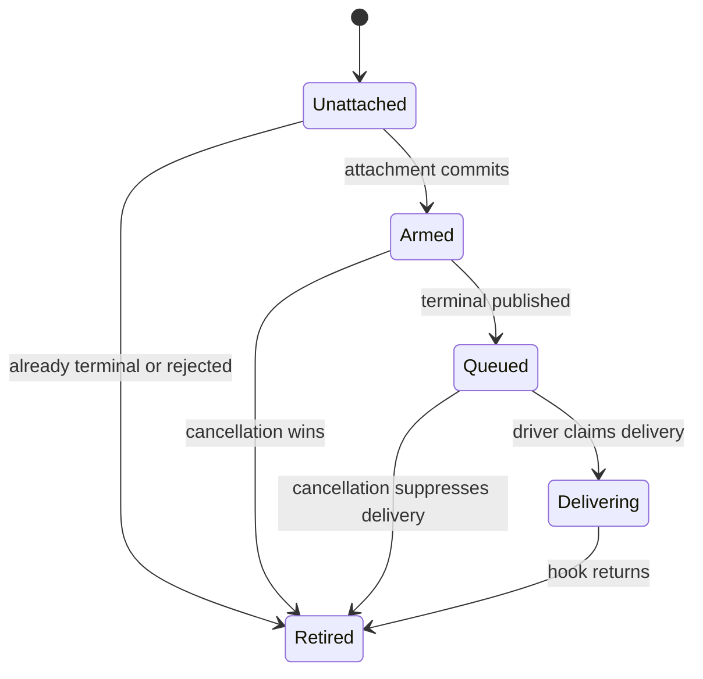
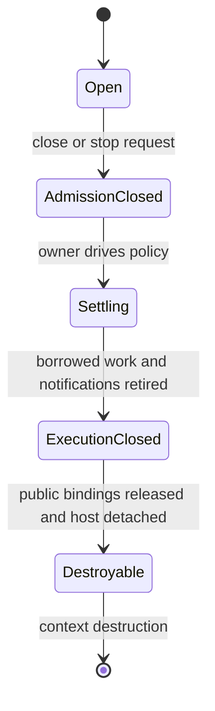

# Sluice v2 Architecture and Contract

| Document field | Value |
|---|---|
| Revision | v2-r1 (first adopted revision; see the revision record in §24) |
| Status | **Adopted on merge.** This revision becomes the sole normative root when its adopting PR merges into `master`; see GOV-05. Until that merge completes, it is the adoption candidate under review and v1-r4 remains the adopted root. Editing this file, opening the PR, or approving it does not by itself make this revision adopted. The v2-c4 candidate beneath this revision cleared three independent review rounds (DESIGN_READY_WITH_FINDINGS, then two REVISE_BEFORE_ADOPTION rounds); v2-r1 adds only the owner's adoption decisions; see §24 |
| Role | Normative root for Sluice product scope, public behavior, responsibility boundaries, lifetime rules, and acceptance obligations |
| Canonical source | `jnhu76/Sluice` / `docs/explicit-io-contract.md` |
| Supersedes | `docs/explicit-io-v1-final-decision.md` (v1-r4) — superseded with this revision's adoption; the adopting PR removes that file from the active tree (no archive copy is created; Git history retains it). ADR-0003 is likewise superseded with no surviving design or implementation authority (§16). The v1 conformance ledger and v1 formal evidence map are replaced by the v2 conformance ledger (GOV-03) |
| Implementation baseline | The C++ described here is `master` at `b870a7c0` (PR #536's G1 optimization squash-merged as `dd83595d`, then PR #543's io_uring owed-delivery report fix; #536's one-time evidence directories are not in the tree). The adopting PR's base `c001bb1e` differs from `b870a7c0` by documentation changes only, so the implementation facts below are unchanged by adoption. §23.1 records which obligations the baseline meets and which remain open |
| Conformance | Tracked by the v2 conformance ledger, `docs/roadmap/v2-conformance.md`, established by the same adopting PR. This root defines targets; the ledger records implementation and evidence state against them |

This document is a **replacement architecture and contract**, not a rename of v1.
It re-derives the Sluice contract from the code and evidence that now exist,
carries forward every correctness guarantee that has earned its place, and
removes the scaffolding that existed only to manage the v1 convergence campaign
(migration phases, gap-bookkeeping machinery, and compatibility procedures for
mechanisms that the tree no longer contains). Requirement IDs are stable across
the v1→v2 boundary wherever the requirement is carried forward unchanged;
changed and new requirements are listed with before/after in section 23.

## Reading and lookup

| Question | Start here | Requirement family |
|---|---|---|
| What wins when documents disagree? | [0. Authority](#0-authority-and-change-control) | GOV |
| What is the product and supported scope? | [1. Product](#1-product-and-release-scope), [3. Workloads](#3-reference-workloads) | PROD, W |
| What does a term mean? | [2. Dictionary](#2-contract-dictionary) | TERM |
| Who owns which responsibility? | [4. Architecture](#4-architecture-and-authorities) | ARCH |
| How are execution and waiting chosen? | [5. Invocation](#5-execution-and-invocation) | INV |
| What does each File operation mean? | [6. File semantics](#6-canonical-file-semantics) | SEM |
| What can fail, and with what effects? | [7. Results and errors](#7-results-errors-and-partial-effects) | ERR |
| When may a buffer, handle, or slot be released? | [8. Requests](#8-requestcore-and-admission), [9. Handles](#9-request-handles-and-raii), [12. Lifetime](#12-file-and-binding-lifetime) | REQ, HANDLE, LIFE |
| How do notification and progress work? | [10. Observation](#10-observation-protocol), [11. Progress](#11-progress-and-external-host-integration) | OBS, PROG |
| Which concurrent calls are legal? | [13. Threading](#13-threading-and-reentrancy) | THREAD |
| How do cancellation and shutdown finish safely? | [14. Cancellation](#14-cancellation-and-timeouts), [17. Shutdown](#17-shutdown-and-context-destruction) | CANCEL, SHUT |
| What do backends implement, and what is not contract? | [15. Backends](#15-backends-and-the-internal-seam) | BACKEND |
| What evidence permits a release to close? | [18. Bounds](#18-resource-bounds), [19. Evidence](#19-verification-and-acceptance) | BOUND, VERIFY |
| What changed from v1? | [20. Completed retirements](#20-completed-retirements-and-steady-state-evolution), [22. v1→v2 contract diff](#22-v1v2-contract-diff), [23. Decision tables](#23-decision-tables) | — |

Function/type names below are conceptual unless a rule explicitly freezes an
observable behavior. The numbered examples and pseudocode are not claims of
existing C++ APIs.

# 0. Authority and change control

## GOV-01 Sole normative root

This file owns Sluice product scope, public behavior, responsibility
boundaries, lifetime rules, and acceptance obligations. MUST / MUST NOT denote
requirements; MAY denotes a permitted choice. SHOULD denotes a default whose
documented deviation must still satisfy every MUST. Sections 0–21 are
normative unless text is labeled **Rationale** or **Example**. Sections 22–24
are decision records and informative material.

No omitted public contract may be invented by a backend, implementation PR,
test, model, issue, or ADR. An omission that changes caller-visible behavior
requires an amendment here before or in the same PR as its implementation.
Local representation choices explicitly delegated by ADR-01 do not require
amendments.

## GOV-02 Authority versus evidence

| Artifact | Authority and limits |
|---|---|
| This root specification | Defines the product target and resolves technical contract conflicts |
| New ADR | Derives an implementation decision from named requirements; cannot override the root |
| `AGENTS.md` | Gives repository working instructions consistent with this target |
| C++ headers and implementation | Establish what a particular commit actually does; discrepancies are conformance gaps |
| Tests, executable models, TLA+, Lean, measurements | Supply scoped evidence; neither select product scope nor amend semantics |
| Conformance ledger (`docs/roadmap/`) | Tracks implementation/evidence by requirement and commit; cannot relax requirements |
| README and architecture views | Navigation or explicitly dated summaries |
| Issues, PR reports, external references | Discussion, rationale, or evidence; no independent normative force |

The root does not certify an implementation by describing it. A conformance
ledger must distinguish `NOT_ASSESSED`, `GAP`, `IMPLEMENTED_UNVERIFIED`,
`VERIFIED`, and `DEFERRED_OUT_OF_SCOPE`; a required feature cannot use the
last status.

## GOV-03 Supersession

| Earlier source | Status |
|---|---|
| `docs/explicit-io-v1-final-decision.md` (v1-r4) | Superseded by this revision's adoption. The adopting PR deletes the file from the active tree and does not recreate it under `docs/archive/`; its text remains recoverable from Git history (adopted via PR #488 and its predecessor revisions). v1-r4 and earlier contracts no longer define the product: no v1 migration gate, phase requirement, or historical compatibility rule can constrain the v2 product or override this root. Their carried semantic requirements live on in sections 5–19 with stable IDs |
| `docs/roadmap/v1-conformance.md` (v1 conformance ledger) | Superseded: the adopting PR replaces it with `docs/roadmap/v2-conformance.md`. Its phase records are dated campaign evidence retained in Git history; none of its statuses transfers to v2 without the new ledger's correspondence checks |
| `docs/roadmap/v1-formal-evidence-map.md` | Superseded as an active governance entrypoint: the adopting PR removes it from the active tree. Living-model scope and coverage limits now live in VERIFY-06 and the v2 ledger's formal-evidence group; its per-asset dispositions are dated evidence |
| ADR-0001, ADR-0002 and its visual companion | Historical rationale; superseded as normative architecture |
| ADR-0003 (narrow stackful host) | Superseded by owner decision D1 (§23.4): the stackful host bundle is outside v2 and is physically removed by PR B. The ADR file is retired from the active tree with the adoption; Git history is its provenance. It grants no surviving design or implementation authorization; re-introducing a host requires a fresh root amendment (§16), not resurrection of this ADR |
| ADR-0004 (shutdown state contract) | Carried forward as a subordinate implementation decision: its state contract is restated in section 17; it derives from this root and adds no scope |
| `docs/archive/**` | Superseded history; retained for traceability under their own banners |
| v1-era conformance roadmap slices, Phase M/F/G gate records, issues #390–#543 process records | Historical evidence for the convergence campaign; they do not bind v2 except where this document cites them as evidence for a carried requirement |
| Earlier revisions of this file (v2-c1..v2-c4) | Replaced by the current committed revision; Git preserves decision history |

Historical documents keep their old text under an explicit supersession
banner. No historical clause is silently incorporated by reference. If a rule
must govern the product, it appears in this document.

## GOV-04 Amendment and traceability

Requirement IDs are stable and MUST NOT be reassigned within this document's
lifetime. A substantive change increments the revision and records changed
IDs, reason, compatibility impact, migration, and required evidence in the
revision record (section 24). Editorial fixes that do not change an allowed
behavior need no new architecture decision.

Every architecture-changing PR identifies: affected IDs; behavior
before/after; implementing owner; workload; tests/model/fault evidence;
remaining limitations; ledger update. A new ADR lists its parent IDs and
delegated choices. Any new public guarantee first enters this root. Evidence
references must name a commit/configuration; a green test run alone is not a
claim of universal correctness.

## GOV-05 Canonical revisions and portable snapshots

The canonical source is this path in `jnhu76/Sluice`, under repository version
control. The revision adopted on `master` governs current repository
convergence; a published release remains interpretable against its recorded
specification revision. An open PR is a proposed amendment until merged. Work
reviewing or implementing a proposed amendment must identify that candidate
explicitly rather than describe it as already adopted.

Local exports, uploaded Markdown/PDF files, chat quotations, issue copies and
paper material are portable snapshots or derived explanations, not
independently maintained authorities. Corrections return through a PR to the
canonical file. A distributed snapshot must identify the repository, source
path, full source commit SHA, document revision, and whether that commit is
adopted, released, or a PR candidate. Do not insert the current commit's own
hash into the canonical file. The canonical Markdown is UTF-8; a corrupted
preview or lossy copy must not overwrite the canonical source.

# 1. Product and release scope

## PROD-01 Purpose

Sluice is a C++20 explicit **file-I/O library**. It exposes the resource,
operation, execution choice, observation contract, lifetime obligation,
resource bound, and settlement responsibility needed for safe use.

Its enduring principles are: minimal necessary semantics; clear boundaries;
explicit authority; named bounds; replaceable execution; minimum justified
mechanism. Information does not grant permission to fuse, reorder, atomically
admit, or optimize operations beyond their contract. Group membership is not
group-admission authority. A backend capability is not a new File semantic.
Derived summaries and diagnostics are conveniences, never independent
semantic authorities.

Sluice adopts Zig's explicit execution dependency and distinction between
operation concurrency and function/task concurrency. It does not provide
transparent suspension of arbitrary C++ call stacks. C++ resource ownership
remains deterministic.

## PROD-02 Supported configurations

| Configuration | Status | Obligation |
|---|---|---|
| C++20, Linux, ordinary regular-file data I/O | Required release domain | File semantics and W-01–W-03 |
| Direct completed-return execution | Required | No runtime/request-core dependency |
| ThreadPool request execution | Required | Complete required operation set and progress integration |
| io_uring request execution | Required supported backend, conditional on runtime availability | Full shared contract when construction succeeds; explicit unavailable outcome otherwise |
| External Linux event-loop integration | Required | Non-busy, pollable progress source for each usable request backend |
| Stackful single-owner I/O host and cooperative-cancel kit | **Outside v2; physically removed by PR B** (owner decision D1). See section 16 and W-04 | Target disposition: not installable, not shipped, not retained in-tree as an inactive experiment; until PR B the residual bundle is uncontracted tree residue (§16); no core dependency on it |
| Windows, macOS, multi-worker task host, coroutine adapter, user-authored backends | Unsupported | No portability or correctness claim inferred from Linux evidence |

A release must list tested compiler, architecture, kernel/liburing and
filesystem configurations in its release evidence. This document does not
invent unmeasured minimum versions. A configuration outside that matrix is
unverified. Selection of a named backend must fail explicitly if unavailable;
trying alternatives is permitted only under an explicit application-selected
fallback policy, with the selected backend observable.

Regular-file guarantees do not extend to sockets, devices, FIFOs, directory
data I/O, or special pseudo-files. `file_info` may identify other kinds; it
grants no promise that ordinary-file data operations work on them. Setup must
validate any kind restriction it claims to enforce without hiding blocking
metadata calls in nonblocking submission.

## PROD-03 Scope limits

No general task-runtime product, public synchronization primitive suite,
networking, process management, global resource registry, universal provider
affinity, stable plugin ABI, or global optimization planner exists or is
required. Registered resources, vectored I/O, direct I/O, preallocation,
zero-copy, and arbitrary callbacks are not admitted because a platform
supports them.

A capability enters the product through an accepted workload or a named
correctness/resource obligation, with its cost and evidence, by amendment of
this root.

# 2. Contract dictionary

## TERM-01 Distinct concepts

| Term | Meaning | Does not imply |
|---|---|---|
| Logical operation | File effect/result governed by SEM rules | A backend or invocation spelling |
| Execution capability | Explicitly selected direct provider or request domain | A task scheduler or security sandbox |
| Invocation | How initiation returns or suspends | Physical backend choice |
| Acceptance | Commit point transferring settlement responsibility to the request core | Dispatch, execution, success, or immediate return |
| Rejection | Initiation did not accept work | A failed operation after acceptance |
| Borrow | Permission to use caller-owned resource/storage for an accepted operation | Ownership transfer or automatic pinning |
| Terminal chosen | Immutable logical outcome selected once | Borrow ended or public visibility |
| Borrow-touching reference | Work/reference capable of accessing File/buffer or changing the result | Every bookkeeping reference |
| Control reference | Internal completion/cancel bookkeeping which may retain a slot | Permission to access caller memory after publication |
| Public terminal / publication | Result immutable and release-published after borrow-touching work retires | Notification delivered or slot reusable |
| Observed terminal | Caller has acquired publication, directly or through documented synchronization | Result consumed |
| Public binding | Move-only ownership of the right to consume/discard the stored result | An OS handle or observer subscription |
| Observer attachment | A generation-identified subscription for a terminal notification | Request ownership or operation cancellation |
| Delivery retirement | No pending or executing delivery can access its callback/host state | Operation terminal unless separately established |
| Result consumption | Move the result out and release the public binding | Immediate slot reclamation |
| Settlement | Public terminal acquired and relevant cleanup obligations discharged for the stated scope | A fixed deadline or successful I/O |
| Reclaim | Reuse slot storage after all pinning references retire | Merely observing `ready()` |
| Progress available | Driver has work or control state to inspect | Any particular request terminal |
| Progress owner | Exclusive active driver of one context | The only thread allowed to submit |
| Progress pass | One bounded nonblocking drive step with a post-pass factual report | A completion guarantee or a wait |
| Progress pass boundary | The finite execution budget and cutoff condition that bound what one pass, or one bounded phase of it, may process | A lock state, a queue identity, or any single mandated algorithm; an entry snapshot is one backend's implementation of the boundary, not its definition |
| Shutdown complete | Execution resources quiescent/closed, accepted operations settled | All public results discarded or context destroyed |
| Context destruction | Release context and slot storage after all external bindings end | Safe survival of stale handle objects |
| Deadline | Time bound on waiting, unless another contract explicitly says otherwise | Bound on physical cancellation/settlement |
| Backend seam | The internal interface between request core and shipped backends | A public extension surface or plugin ABI |
| Derived summary | A maintained convenience copy of an authority's facts (e.g. outstanding count) | A second semantic authority; settlement or admission decisions may not rest on it |

# 3. Reference workloads

## W-01 Ordinary utility

Open a regular file; inspect minimal metadata; read/write; explicitly
synchronize durability when needed; report close errors if important; use
RAII otherwise. This must work using direct execution without allocating an
`IoContext`, worker, request table, or progress source.

## W-02 Bounded pipeline

Submit up to a chosen bound of positional operations, tolerate short I/O and
admission failure, observe independent results, cancel best-effort, and
settle every accepted operation on success, early return, and exception. The
example must cover failure of the second submission while the first remains
outstanding, plus result retention exhausting slots.

## W-03 External event loop

The application owns its loop and progress owner. It integrates a pollable
progress source, submits and reaps bounded work, handles interruption, and
shuts down without periodic busy polling. An external-host example must run
with ThreadPool and with a successfully constructed io_uring backend. A
condition variable alone is insufficient.

## W-04 Sequential I/O host — **UNSUPPORTED**

The stackful host is outside v2: W-04 is not a v2 workload and not a required
release workload, the host bundle is physically removed from the repository by
PR B, and no inactive or non-installed experimental host implementation is
retained for potential future use (section 16 records the disposition and
re-admission conditions). No configuration may be documented, packaged, or
measured as fulfilling W-04. Sequential-looking task execution over file I/O
is achieved with the direct form (W-01) or the explicit request forms
(W-02/W-03).

# 4. Architecture and authorities

## ARCH-01 Dependency structure



The `owns` edges denote IoContext lifetime ownership. Backend signals and
core dispatch/control/reclaim obligations feed the context-owned
ProgressSource; the progress owner drives the context and waits through that
source under PROG.

Direct operations share semantic rules but do not traverse RequestCore.
Request execution depends on the core and a shipped backend. The backend seam
is internal: v2 ships exactly the ThreadPool and io_uring backends, and no
user-authored backend is a supported configuration (BACKEND-01).

## ARCH-02 Responsibility table

| Owner | Owns | Must not own |
|---|---|---|
| `File` | Native resource ownership, access facts, explicit close | Backend selection, progress, hidden shared ownership |
| Shared semantic layer | Validation, operation meaning, result/error and durability rules | Worker counts, scheduling, host routing |
| Direct provider | Immediate execution of validated operations on caller thread | Request-core admission or task semantics |
| `IoContext` | One backend, RequestCore, ProgressSource, identity, budgets, admission/health | Arbitrary user-task lifetime |
| `RequestCore` | Acceptance, IDs, terminal arbitration, result storage/publication, observer metadata, reclaim | OS dispatch or task scheduling; a second copy of backend queue state treated as authority |
| Backend seam | Physical execution, internal queues, physical cancellation, reference retirement, progress events | File legality, public identity allocation, observer delivery |
| Host adapter (application side) | Wait/suspend/resume policy, observer and task resources, scoped cleanup | Additional File semantics |
| Public `Request<T>` | Unique result/settlement responsibility binding | Ownership of borrowed File/buffer |

A logical layer is an authority boundary, not a requirement for another
vtable or generic class. An initial core mutex is permitted; proof obligations
belong to the protocol, not a specific enum or lock count.

# 5. Execution and invocation

## INV-01 Explicit selection

A direct adapter call explicitly selects the direct provider, by named
API/module or an explicit lightweight capability value. It does not create or
consult a hidden global context. The canonical direct provider is allowed to
be stateless; a heap-owned provider interface is not required.

A request submission explicitly names an `IoContext`. File objects never
store a blocking/async mode. API names may change without changing these
selection rules.

| Invocation | Uses request slot | Progress owner | Return guarantee | Caller-thread blocking |
|---|---:|---|---|---|
| Direct completed-return | No | Caller executes operation | Final result; no internal borrow | Permitted and explicit |
| Outstanding submission | Yes, including logical no-op | Chosen context driver | Rejection or owned `Request<T>` | No wait for I/O/slot capacity; bounded local synchronization permitted |
| Owned-driver scoped wait | Uses existing requests | Caller owns driver role | Selected requests settled | Explicit blocking wait permitted |

(v1's host completed-return row is withdrawn with the host: section 16.)

## INV-02 Initiation and fallback

Submitting may perform finite bookkeeping, acquire internal locks, and
arrange dispatch. It MUST NOT wait for request capacity, execute the
requested blocking filesystem call on the submitter, or wait for its result.
It is not a hard real-time or lock-free guarantee.

The same restriction applies to request-path metadata and cancellation
initiation. A blocking backend path must use offload or fail explicitly;
unavailable asynchronous capability cannot silently call a filesystem syscall
on an event-loop owner. io_uring configurations whose submission path can
block must be audited and constrained/offloaded as necessary before claiming
this profile.

An operation may complete before submission returns, but acceptance still
returns its responsibility. Post-accept failure cannot escape as an ordinary
initiation error without the Request. Completion speed does not change the
API contract.

# 6. Canonical File semantics

## SEM-01 Operation matrix

| Operation | Direct | Request | Basis |
|---|---:|---:|---|
| open / explicit close | Required | Deferred | W-01 resource lifetime |
| positional read / write | Required | Required | W-01, W-02, W-03 |
| shared-cursor read / write | Required | Deferred | W-01; request ordering not admitted |
| sync_data / sync_all | Required | Required | Explicit durability for W-01/W-02 |
| file_info / size | Required | Required | Runtime metadata without blocking W-03 owner |
| resize | Required | Deferred | W-01 observable state |
| read_exact / write_all composition | Required direct conveniences; no compound low-level request | Safe repeated primitive use; SEM-05 |

`size` may be a projection of `file_info`; no duplicate metadata operation is
required. Same-file comparison uses the bounded identity in SEM-07 and does
not authorize a registry. Namespaces, rename, directory synchronization and
transactional copy are outside this matrix.

## SEM-02 Open and close

Open has three independent choices: access (`read_only`, `write_only`,
`read_write`); existence (`open_existing`, `create_if_missing`, `create_new`);
initial contents (`preserve`, `truncate`). Defaults are
read-only/open-existing/preserve. All enum values are validated before OS
effects.

| Access / contents | Existing | Create if missing | Create new |
|---|---|---|---|
| read_only + preserve | Legal | Legal | Legal |
| read_only + truncate | invalid_argument | invalid_argument | invalid_argument |
| writable + preserve | Legal | Legal | Legal |
| writable + truncate | Legal | Legal | Legal; truncation redundant on a new file |

`create_new` fails if the target exists; `open_existing` fails if absent.
Merely requesting write access does not truncate. A failed OS open is an
operation failure, not a claim that no namespace effects could have occurred.
Embedded NUL in a path is rejected rather than silently truncating the name.

The Linux baseline uses close-on-exec descriptors and creation mode 0644
filtered by the process umask; this is an explicit platform default, not a
permissions-management API. A later configurable permission surface needs an
amendment.

Explicit close consumes ownership on the first native close attempt,
including an error. The File becomes closed and MUST NOT retry that same
native descriptor, including after EINTR on the Linux profile. Closing an
already closed or moved-from File succeeds as a no-op. Destruction is
`noexcept` best-effort close and cannot report durability or close success.
Closing a resource still borrowed violates LIFE-01.

## SEM-03 Legality and validation precedence

| Operation | read_only | write_only | read_write |
|---|---|---|---|
| read / read_at | Legal | invalid_argument | Legal |
| write / write_at | invalid_argument | Legal | Legal |
| file_info / size | Legal | Legal | Legal |
| resize | invalid_argument | Legal | Legal |
| sync_data / sync_all | Legal | Legal | Legal |

For data/state operations, validation follows the following precedence. Close
and open use SEM-02. Caller preconditions such as valid memory, race freedom,
and supported resource kind are not generally dynamically detectable.

1. Closed File: `invalid_state`.
2. Access illegality: `invalid_argument`.
3. Identify a zero-length data operation as a logical no-op; skip data
   offset/range checks for it.
4. For other operations, reject invalid offset/size/range as
   `invalid_argument`.
5. On request paths, check context admission/health and context-specific
   resource compatibility.
6. Check execution support/restrictions, then reserve request capacity if
   needed.
7. Commit acceptance or execute direct operation.

A direct no-op returns successful zero after steps 1–3, without an OS call.
An explicit request no-op still requires an open healthy context, compatible
resource provenance, support for that operation kind, and one slot: once
accepted, it is immediately published and returned ready. It never dispatches
a data syscall. Request capacity full therefore rejects even a no-op. This is
an invocation-level resource rule, not a different meaning of zero bytes.

Internal reservation may occur earlier for implementation reasons only if
rollback and caller-visible precedence are equivalent. A race with admission
close is resolved at the acceptance linearization point. Invalid
File/access/range retains the precedence above; for an otherwise valid
request, context closure/poison wins over capacity.

## SEM-04 Offset, length and position

A positional operation does not read or modify the shared file cursor. Hidden
seek-plus-read/write is not a conforming lowering. Offsets and resize sizes
are nonnegative integers; their native representation and checked arithmetic
must not overflow. For nonempty requests, validate the starting offset and
the last addressed byte without overflowing; supported length/range
restrictions are disclosed by the selected execution.

Exceeding a mathematically/native-invalid range is `invalid_argument`; a
stricter declared execution limit is `not_supported`, before acceptance. A
primitive may return a short count due to an execution transfer limit but
must not wrap/truncate the requested range or secretly promise
all-or-nothing transfer.

Shared-cursor operations use the native open-file-description cursor on
Linux, including its sharing through native duplication. Sluice promises no
cross-call serialization order. Callers needing an order must establish it.
Overlapping file writes and concurrent resize have no additional
atomicity/snapshot guarantee; disjoint memory buffers do not establish
file-effect ordering.

## SEM-05 Short I/O, EOF and composition

| Primitive outcome | Meaning |
|---|---|
| Empty data request | Success, 0; no EOF observation |
| Nonempty read returns 0 | EOF at the observed position; primitive success |
| Read/write returns 0 < n <= requested | Successful progress of n bytes; short count is allowed |
| Nonempty write returns 0 without error | Successful zero progress at primitive level; composition must stop with no-progress failure |
| OS error | Terminal failure; retain native detail and effect uncertainty under ERR-02 |

A primitive does not loop to satisfy an exact/all promise. It may retry EINTR
only when the underlying attempt reports interruption without a successful
byte count; it must not replay known completed bytes. Cancellation checks may
end such retry loops. No finite latency guarantee is inferred from repeated
interruption.

`read_exact` stops on full success, EOF before full, error, or cancellation.
`write_all` stops on full success, zero progress, error, or cancellation.
Each reports accumulated confirmed bytes on failure, separately from the
failure reason; EOF-before-full and write-no-progress are distinguishable.
Compositions advance buffer/offset by confirmed bytes, check arithmetic,
never spin on zero progress, and do not grant atomicity or rollback. They
settle each internally accepted request before returning or throwing.

## SEM-06 Durability

`sync_data` success guarantees durability of the confirmed bytes of writes
whose successful direct completion or acquired public terminal completion
happens-before the sync initiation, plus file state necessary to retrieve
those bytes (including necessary file length). It does not guarantee writes
merely submitted before sync. For request sync, initiation is its acceptance
point; for direct sync, it is the call's operation initiation after
validation.

For the Linux regular-file profile, `sync_data` also covers a successfully
completed file-size mutation from `resize`/`ftruncate` whose completion
happens-before sync initiation, even without a covered write. Both shrinking
and extending the file are included. Successful resize alone does not
establish durability.

`sync_all` includes all `sync_data` coverage and adds the file's broader
metadata, such as supported permissions/ownership/timestamps, whose completed
mutation happens-before sync initiation. Caller-observed external operations
may contribute to this ordering; Sluice creates no global order across
processes, descriptors, or filesystems.

Coverage is not a snapshot. A later conflicting write, resize, or metadata
mutation can supersede an earlier covered state before synchronization
establishes durability. Callers needing exact recoverable bytes/state must
prevent such supersession. Neither sync operation guarantees directory
entries, rename results, or new-file name reachability.

Success relies on documented OS/filesystem/storage guarantees, not
independent proof of hardware power-loss behavior. Failure means the
requested guarantee was not established or cannot be confirmed; it does not
mean nothing reached storage. Cancellation grants no positive or negative
durability fact. A backend must never fabricate successful synchronization.

## SEM-07 Minimal metadata and identity

`FileInfo` contains kind, current size where meaningful for the kind, and an
explicitly available/unavailable same-file identity. `size` is the
regular-file length in bytes at observation, not a reservation or immutable
snapshot. Separate fields/calls need not form a transaction against
concurrent external mutations. Growing regular files exposes zero-valued
extended bytes under the supported filesystem contract; shrinking discards
the removed region. Resize does not set the shared cursor.

Identity comparison is valid for concurrently live resources within the
documented platform domain; Linux device/inode identity is a permitted
representation. A retained value does not prove identity after all relevant
handles close and identifiers can be reused. Paths are not identity. Unknown
identity returns an explicit unknown/unsupported outcome, never a fabricated
same/different answer. `file_info` and positional I/O do not move the cursor.

# 7. Results, errors and partial effects

## ERR-01 Error domains

| Domain | Examples | Responsibility after return |
|---|---|---|
| Semantic rejection | closed File, illegal access, invalid range | No accepted request |
| Admission rejection | admission closed, capacity exhausted, unsupported execution | No accepted request, no retained borrow/background effect |
| Operation result | short success, EOF, EIO, canceled | Request accepted; terminal/publication obligations still apply |
| Observation outcome | pending, timeout, interrupted, registration unavailable | Does not dispose of the Request |
| Context health | poisoned backend, progress failure | Does not by itself publish outstanding requests |
| Construction/setup | worker/ring/progress-source creation failure | Roll back partially owned setup resources |

Public types must preserve these distinctions even if they share an error
payload. `pending` is not an I/O failure. Capacity exhaustion is distinct
from filesystem no-space. Unsupported capability is distinct from transient
capacity. Context health is separate from the per-request outcome.

Canonical categories include `invalid_state`, `invalid_argument`,
`not_supported`, `not_found`, `permission_denied`, `no_space`, `would_block`,
`interrupted`, `canceled`, and `backend_error`; admission/observer
dispositions are separately tagged. Numeric enum layout is delegated. On
Linux preserve the native errno when present; ENOENT/ENOTDIR map to
not_found, EACCES/EPERM to permission_denied, ENOSPC/EDQUOT to no_space,
EINTR to interrupted, and EAGAIN/EWOULDBLOCK to would_block. Errors not given
a canonical mapping retain backend_error plus native detail. A later public
mapping change amends this rule.

## ERR-02 Progress and effects

Data results must distinguish confirmed byte progress from an error/cancel
reason. A successful primitive count is exact progress for that operation;
composition failure retains the confirmed prefix from successful steps. If a
failed/canceled physical attempt may have modified data but supplies no
trustworthy count, report effects as **unknown**, not zero. A known lower
bound from earlier completed steps may coexist with an unknown remainder.

No error implies rollback. Retrying an uncertain write as if it had no
effects is an application policy, not a library guarantee. A cancel request
racing a completed successful byte count must not erase that count into an
unqualified canceled result. A pre-execution cancel which proves no
dispatch/effect may report canceled with known zero effects.

For scalar/void operations, the result similarly distinguishes success from
error without inventing a byte count. Result payloads are bounded value types
and can be moved/destroyed without throwing.

# 8. RequestCore and admission

## REQ-01 Identity and storage

The bounded core owns a slot table containing generation, operation
description, borrow facts, lifecycle, backend/control references, terminal
result, publication state, public binding, observer attachment, and reclaim
eligibility. These are conceptual responsibilities, not mandatory field
names.

`RequestId = {context identity, slot index, generation}` or an equivalent
representation. Context identities and live generation values must not alias
within their valid domain. Reuse advances generation; counter exhaustion
retires the slot/context or fails explicitly before wrap can make an old
identity valid. Large counters alone are not a proof of non-aliasing.

A copied ID is a lookup/cancel token while its context lives, not ownership
of storage and not permission to consume a result. An ID after public release
reports stale/not-found for public lookup/cancel even if internal control
references still pin the old slot. A raw context address alone is not
sufficient identity across destruction/recreation.

## REQ-02 Acceptance transaction

Submission has one linearization point at which it commits acceptance and
establishes the public binding plus a guaranteed path to settlement.
Validation, resource reservation, backend capacity accounting and
construction of the movable return value must be arranged so that no throwing
allocation or recoverable initiation error can hide work after this point.

Before acceptance, rollback restores slot/backend reservations and retains no
caller borrow after return. Preparing a descriptor must not initiate data
I/O. Backend dispatch cannot make an irreversible effect and then classify
the operation as rejected. A backend dispatch failure after acceptance
becomes a terminal operation/health result on the returned Request.

The initiating operation descriptor itself may be temporary.
Acceptance copies/moves all needed scalar and resource-provenance facts into
core/backend-owned bounded storage; it does not retain a pointer to a caller's
temporary descriptor or original File object. Only the explicitly declared
File/native-resource and buffer borrows escape initiation.

Admission close races with acceptance under the same serialized authority:
either the request joins the finite accepted set or returns admission-closed
with no effect. A pending slot reservation is not acceptance.
Accepted-but-not-dispatched requests remain discoverable to
progress/shutdown and cannot be stranded by a second queue becoming full.

## REQ-03 Lifecycle as constrained dimensions



A backend may not expose a distinct executing state.
Cancellation/control completions, observer state, and public binding are
separate dimensions. The diagram constrains semantic order, not the number of
enums.

A request has at most one immutable terminal result. A cancel acknowledgment
is not necessarily that result. Publication follows terminal selection and
retirement of every reference capable of accessing borrowed state or mutating
the result. Internal control records may outlive publication only if
incapable of both; they still pin storage until retired.

## REQ-04 Publication and borrow boundary

Public terminal publication is a release boundary. `ready() == true`,
successful terminal lookup, and terminal notification observation use acquire
semantics or an equivalent synchronized path. The backend-to-core handoff
must also establish visibility of its writes; a release store by an unrelated
thread without a preceding handoff is insufficient.

Borrow logically ends at publication. A caller may reuse memory/close the
File only after acquiring that publication, or receiving a documented
synchronized handoff from someone who acquired it. Physical completion or a
cancel response alone is insufficient.

After publication, neither backend, cancel control, core cleanup nor observer
delivery may access borrowed buffers/File or revise the result. A notification
carries identity/readiness, not a license to keep touching operation buffers.

## REQ-05 Reclaim predicate

A slot may be reused only when all of these hold:

- it is public-terminal;
- its public result binding has been consumed/discarded;
- no backend or internal control reference can access the slot;
- no queued/executing observer delivery can access the slot;
- result payload destruction is complete.

Handle release may occur before internal references retire. In that case the
slot remains pinned; reclamation is deferred without blocking the releasing
caller. Capacity therefore measures retained responsibility/storage, not
only physical in-flight I/O. Slot reuse must reinitialize the publication
state under the generation discipline.

## REQ-06 Settlement liveness

Under continued driver service, terminating internal delivery hooks, and
eventual completion or documented retirement of each physical/control
operation, accepted requests eventually publish. Every control record
retained beyond publication needs its own retirement path. These assumptions
do not guarantee that a kernel operation on a stalled filesystem responds in
bounded time.

Neither fail-fast nor finite state exploration proves progress. No timeout,
backend poison flag, or teardown request may be treated as evidence that
borrowed memory is safe to free.

# 9. Request handles and RAII

## HANDLE-01 Handle state and operations

| State | `ready` / result probe | Cancel | Move / consume / destruction |
|---|---|---|---|
| Empty or moved-from | Empty/invalid disposition, no context dereference | invalid_state | No-op destruction; movable |
| Accepted, not published | Not ready / pending | CANCEL-01 disposition | Movable; destruction is a contract violation |
| Published, bound | Acquire terminal; immutable result available | already-terminal | Consume/discard releases public binding without waiting for other pins |
| Consumed/discarded | Empty | invalid_state | No-op destruction |

`try_result` may return an immutable view valid only while this handle
remains bound and no consume/move/destruction races it. It must distinguish
pending from an operation error. `take_result` is nonblocking: pending leaves
the handle unchanged; a terminal outcome moves out exactly once and empties
the handle. The result's own operation failure still counts as successful
consumption. Exact return-type spelling is delegated.

Move construction/assignment are `noexcept` and transfer responsibility.
Overwriting a nonterminal destination is the same contract violation as
destroying it; a terminal destination first discards its binding. Self-move
must not abandon work. These rules do not make the same handle object
concurrently mutable.

## HANDLE-02 Destruction policy

Low-level Request destruction MUST NOT silently detach borrowed work or wait
for I/O. A valid bound Request can be destroyed once public terminal is
established, even while internal control/delivery references still pin its
slot. Destruction discards only the public binding and defers reclaim under
REQ-05.

Destroying/overwriting a known nonterminal Request is an always-on fail-fast
contract violation, including release builds. A debug-only assertion
followed by unsafe release is not conforming. This diagnostic does not claim
safety for unrelated undetectable misuse such as a caller freeing a raw
buffer early.

**Rationale:** a joinable low-level responsibility with an explicit
precondition is compatible with C++ ownership rules. Arbitrary-host
destructors cannot safely choose a blocking/suspending policy.

## HANDLE-03 Context and result lifetime

All Request objects and observer/registration bindings require their context
to remain alive. Moving a Request across threads is allowed with external
synchronization. Context shutdown does not invalidate ready Requests or
discard their results. Context destruction while any public binding exists is
forbidden, including ready-but-unconsumed handles.

There is no global registry, shared control block, or post-destruction
safe-handle promise. A context ID prevents cross-context identity confusion
while contexts are valid; it does not make dereferencing destroyed context
storage safe.

# 10. Observation protocol

## OBS-01 Attachment ownership

Polling `ready()` needs no observer allocation. At most one active
terminal-notification registration per request is required to be supported;
polling may coexist with it subject to the handle threading rules. Multiple
registrations on the same request return an explicit occupied disposition.
Different requests may have different observers.

A registration has its own generation and a bounded slot pin. A public
general callback framework is not required; the protocol supports host
adapters, while an external loop may simply inspect its Requests after
progress. A registration never exposes backend-internal identity to another
backend.

Attachment atomically resolves with publication: either it returns
already-terminal with acquire visibility, or it installs a registration
entitled to one future terminal event. It cannot miss publication between
checking readiness and registering. Resource failure leaves the accepted
request owned and observable by polling.

## OBS-02 Delivery and cancellation



Delivery is at most once per registration generation. The driver runs a
bounded, nonthrowing adapter hook after publication and outside all
core/backend locks. It is never invoked inline by submission or by a backend
worker. The hook may enqueue a host wake but does not run an unbounded user
task on the I/O driver.

Observer cancellation distinguishes **retired** (no future or running hook
can access observer state) from **delivery in progress** (the caller must
retain that state until retirement is acquired). A generic canceled
acknowledgment is not proof of retirement. The registration's resources may
be released only after retirement; a generation check cannot justify
dereferencing freed observer state.

Once a delivery is copied into an external host queue, that host owns the
queued wake's lifetime and stale-token validation. No raw pointer may outlive
its owner merely because the core's hook returned. This ownership is part of
the adapter's shutdown contract.

## OBS-03 Cross-invariants and delivery progress

- Registration failure, observer cancellation, and wait timeout do not cancel
  the operation or end its borrow.
- Releasing a terminal Request binding is legal while a delivery remains
  pinned. Delivery cannot consume a released result or touch operation
  buffers; a lookup using a released public ID may return stale.
- A host that wants to consume the result on notification must retain the
  Request independently until it consumes/cancels that path.
- An armed registration on an eventually published request is eventually
  delivered if not canceled, the driver continues service, and the hook
  terminates.
- A canceled/in-progress registration eventually retires under continued
  driver/hook progress.

# 11. Progress and external-host integration

## PROG-01 Driver contract

One fixed progress owner is selected when the context is attached to a
driver. Only that owner calls poll, prepare/wait, and driving shutdown. Live
ownership transfer and nested polling are not supported. Other threads may
submit, cancel, or request stop under THREAD-01.

A progress pass performs bounded nonblocking work and reports post-pass facts
about the context: whether completions were consumed, whether immediately
actionable work remains, whether accepted work remains, and context health.
It does not wait for I/O. It may dispatch queued work, reap physical results,
publish terminal results, and deliver bounded hooks. Work needed to dispatch
a newly accepted request is itself a progress obligation; the driver must not
wait for a completion of an operation it has not dispatched.

A pass's processing work must have a stated finite bound: the pass must
return without waiting for the arrival of further events, and no continued
arrival of new work may defer the return without limit. Backends may choose
different bounded algorithms — an entry snapshot of the queued publications
and deliveries, or separately bounded phases with a capacity-bounded
delivery sweep — provided every phase's work is finite at the moment that
phase begins. Work a producer creates while the pass runs may be delivered
by that pass or deferred to a later one; the return must never wait on it.
The post-pass report must state actionable residue honestly: work the
pass's boundary left behind — queued publications, a published result
whose delivery event is still owed, and dispatch or retry work the
progress owner itself must perform — is immediate work, and the report
MUST NOT depend on periodic polling to surface it. Work already handed
to an autonomous execution resource (for example a worker draining its
dispatch queue) is pending accepted work, not immediate driver work: it
is reported through the accepted-work fact, and classifying it as
immediate would have the owner spin on work it cannot advance.

Progress available and request public-terminal are different events. Waking
the driver is not a completion guarantee. A health/control event also wakes
the owner even if no data I/O completes.

## PROG-02 No-lost-wake contract

A progress token identifies a notification epoch, not the count of
outstanding requests. Epoch reuse must not alias an active wait; reset is
allowed only under a quiescent documented protocol, or exhaustion closes
admission and wakes the owner before aliasing. Notifications may coalesce or
be spurious; a backend may suppress a redundant physical wake only while a
pending unread wake stands and readiness remains asserted — suppression is a
physical-write optimization under this contract, never a second drain
authority and never a lost obligation. Every transition which creates
actionable work/control state must either leave persistent observable
readiness or race safely with the sleep handshake so the owner cannot miss
it.

A wait may block only after the driver has established all of:

1. the notification mechanism is armed;
2. stale notification state is acknowledged before the final actionable-work
   check;
3. no actionable work remains after a bounded progress pass, or a further
   pass is explicitly scheduled;
4. no relevant notification/control transition occurred between the recorded
   token and the final check;
5. work arriving after that check will make the armed wait return.

An owned-driver wait condition must combine token/epoch checking with an
atomic wait-registration or equivalent persistent readiness protocol.
Sampling a fresh token *after* observing an empty queue and waiting for its
next change is forbidden as a complete protocol.

**Example: conceptual owner loop, not a mandatory implementation**

```text
arm progress source
acknowledge stale readiness
record token
poll with budget
if actionable work remains: schedule/perform another pass
else if token changed or control is pending: repeat
else: wait_if_unchanged(token, deadline)
```

The backend adapter proves the last step for its source. It may use a
condition variable with a protected predicate, or a persistent native
readiness source with a final recheck. A token alone is not that proof. A
kernel-driven source need not update a user-space counter on every
completion, but its readiness and wait checks must implement the same
no-lost-wake obligation.

## PROG-03 Linux external loop

Every usable request backend supplies a pollable notification handle,
normally an eventfd-based adapter. This is required for W-03, not optional
merely because an owned-driver condition variable exists. The handle is
borrowed from the context; the host may register it with its event loop but
must not close, independently drain, or repurpose it. Draining/rearming is
owned by the documented source-level acknowledge operation; the notification
descriptor is never a second drain authority.

For edge-triggered integration, an adapter must drain/recheck until quiescent
or arrange a persistent/self-scheduled continuation when its budget is
exhausted. Draining an eventfd while leaving unadvertised queued work is
invalid. Signal coalescing/saturation is allowed only when readiness remains
asserted and no work obligation disappears. A failed notification path
becomes an observable health event with a documented recovery/retirement
path, not silent sleep.

Before context teardown closes the notification handle, the external host
must detach its event-loop registration and retire callbacks that might use
the context. File-descriptor integer reuse must not route an old event to a
new context.

## PROG-04 Wait outcomes and control

Owned-driver waiting distinguishes progress, interrupted/control, deadline
expired, and health failure. It uses a monotonic clock; an expired deadline
does not cancel I/O. Interruption is sticky until the owner
observes/acknowledges the control request, rather than a transient wake that
can be cleared before inspection.

`request_stop(policy)` closes admission and signals the owner.
`close_admission()` alone stops new acceptance and wakes a potentially
sleeping owner so shutdown policy can be applied. Neither call assumes a
driver will run without the caller's environment servicing it. No missed-wake
claim may depend on periodic polling masking a protocol defect.

# 12. File and binding lifetime

## LIFE-01 Borrow contract

The File/native resource is valid during initiation and remains open through
acquired public terminal for accepted work. A write source remains readable
and unmodified; a read destination is exclusively available to the operation.
Callers must prevent overlapping memory access by other operations/threads
when it would race. Buffers need not be owned by Sluice.

Moving the File owner is permitted if the native resource remains
continuously owned and valid and the move does not race initiation/access to
the object. Closing, destroying, or move-assigning over a still-borrowed
resource is forbidden. The core captures the required resource/access facts
at initiation and must not depend on the address of the original File object
remaining fixed.

No public terminal may be manufactured to allow early buffer/File
destruction. For immediate no-op publication there is no retained borrow
after initiation returns; normal handle/capacity rules still apply. After
acquired terminal, result consumption is not a prerequisite for
resource/buffer reuse.

## LIFE-02 Native interop

`native_handle()` returns a borrow, never transfers ownership or extends
lifetime. Foreign code must not close it, mutate conflicting access/offset
assumptions, or race operations contrary to the documented resource
contract. Adopting foreign handles, if exposed later, must preserve
access/provenance and ownership rules; raw-fd-only operations are explicitly
noncanonical interop and cannot become the default path.

Provider compatibility is checked before acceptance when a binding is
required. Ordinary Linux File is execution-neutral; this does not promise
every future platform handle works with every provider.

## LIFE-03 Registered resources

Registered-file/buffer optimization is outside the required surface. If
retained experimentally, it uses a separate provider-affine RAII binding;
ordinary File does not acquire provider ownership. Such bindings must not be
described as conforming without a root amendment defining their capacity,
access, lifetime, retirement and shutdown rules.

A binding cannot unregister while physical work can use it, or outlive its
context without a separately proven ownership mechanism. An asynchronous
retirement need cannot be hidden behind a universally nonblocking destructor.
This is a constraint on future design, not a mandate to implement
registration.

# 13. Threading and reentrancy

## THREAD-01 Public concurrency matrix

| Operation | Concurrent with other context operations? | Restrictions |
|---|---|---|
| submit from different threads | Yes | File/buffers valid and race-free; serialized acceptance |
| request cancel / ID cancel | Yes with submit, poll, admission close | Context alive; same mutable handle not raced with move/consume |
| readiness/result const probe | Yes with backend publication | No concurrent mutation/destruction of the same handle |
| consume/move/discard handle | Different handles: yes | Same handle requires caller exclusion; immutable views end before mutation |
| observer attach/cancel/retirement query | Yes via valid registration ownership | One attachment per request; registration object mutation externally serialized |
| close_admission / request_stop | Yes | Idempotent; linearized against acceptance |
| poll / prepare / driver wait | No concurrent or recursive calls | Fixed progress owner only |
| driving shutdown | Owner only | Not from inside poll/delivery; other threads request_stop |
| context destruction | No | Exclusive owner; no external bindings/calls/host registrations |
| File move/close/destruction | Caller serialization | No outstanding borrow of the native resource |

One progress owner does not mean only one producer. A single mutable handle
is not automatically thread-safe because its context has a mutex. Copying an
ID and using context-level cancel is allowed under REQ-01, with explicit
context lifetime.

## THREAD-02 Locking and delivery

A simple serialized core authority initially protects slot structure,
generations, acceptance, terminal arbitration, observer transitions and
reclaim. Backend-private queues/rings have private synchronization. Host
hooks never run under core/backend locks; backend locks never invoke host or
scheduler code. Multi-lock paths document ordering and no inversion before
introduction.

Delivery hooks may enqueue a wake or use separately documented non-driving
APIs; they may not recursively poll, drive shutdown, destroy the context,
block waiting for the same driver, or throw across the core boundary.
Arbitrary user work is scheduled after the hook. A lock-free readiness path
must obey REQ-04 and protect against reuse, not merely read an atomic
boolean.

# 14. Cancellation and timeouts

## CANCEL-01 Operation cancel

| Immediate cancel disposition | Meaning |
|---|---|
| won-before-execution | No execution/effect occurred; canceled outcome selected, publication still follows retirement |
| requested | Best-effort cancellation initiated/coalesced; operation may still succeed or fail normally |
| already-terminal | Terminal outcome already selected/published; no rewrite |
| stale/not-found | No live public request binding for that identity |
| physical interruption unsupported | Running operation continues; this is not a completed cancellation |

If required cancel-control capacity is temporarily unavailable, return an
explicit retryable disposition without changing request ownership, or retain
a bounded sticky intent guaranteed to be serviced. Never report `requested`
and silently discard the intent. Repeated cancel is idempotent/coalesced and
cannot allocate an unbounded number of control records.

Pre-dispatch cancellation may win only while it can prove no
dispatch/effect. Once execution can have effects, the core waits for physical
outcome/retirement; an intent alone cannot select a fictitious zero-effect
canceled result. A successful physical count is preserved even when cancel
raced it. Cancellation never rolls back partial writes or proves durability.

## CANCEL-02 Observation deadlines

Wait timeout/interruption ends that wait attempt. Observer cancellation ends
only that registration under OBS-02. Operation cancellation is a separate
explicit action. None alone authorizes buffer reuse.

A scoped adapter which cannot return a Request must settle before exit even
after its wait deadline expires. Such a deadline bounds initial waiting, not
total return latency. If the application needs a prompt timeout return, it
must retain the outstanding Request and its borrowed resources. Sluice
promises no hard operation-cancellation deadline on regular files.

# 15. Backends and the internal seam

## BACKEND-01 Closed seam

The request core provides validated prepared operations and internal request
keys to the backend. The backend provides physical outcomes,
reference-retirement facts, capability/health information and progress
availability. The core owns public terminal arbitration/publication. Physical
result production does not permit backend mutation of an already published
result.

The backend seam is an **internal** interface. v2 ships exactly two backends
— ThreadPool and io_uring — and a backend capability is not a user extension
surface: there is no stable plugin ABI, no documented third-backend contract,
and no support obligation for out-of-tree backend authors (PROD-03). Types
that exist only to serve the seam (request keys, prepared-operation and
reservation records, ready-sink and observer-protocol vocabulary, fail-fast
helpers, the progress port) are implementation headers. Their evolution is
governed by this root's change control but their installed visibility is not
a compatibility promise; section 23/Appendix B records the target install
surface.

Backend submission, progress, cancellation and teardown are mechanism
interfaces, not public operation semantics. File/access validation cannot be
delegated to eventual OS failure. Backends may differ in completion order,
short counts, cancellation strength and physical traces while refining the
same allowed result/effect set.

## BACKEND-02 Required profiles and capability checks

Capabilities expose supported operation kinds, range/length restrictions,
cancellation strength, progress integration, and availability. Successfully
constructing a named profile establishes its mechanism support for the
required request set, including metadata and sync.

ThreadPool offloads physical blocking operations to bounded workers.
io_uring owns its ring/queues and may use an explicitly configured offload
fallback for operations/configurations that cannot meet INV-02 directly. Such
a hybrid is disclosed, bounded and tested; it cannot be marketed or measured
as pure io_uring execution without that qualification. A missing required
mechanism capability causes setup failure rather than silently weakening the
profile.

Backend state which affects acceptance is reserved/checked in the core
admission transaction. Later queue pressure is handled by a bounded core-owned
pending set, a reserved queue slot, or a terminal failure on the accepted
Request. It cannot orphan work or hide unbounded queues.

## BACKEND-03 Reference accounting and fault paths

Each backend documents which actions acquire/release borrow-touching
references and which retain only control/slot references. A cancel completion
is not proof that the original operation's buffer is no longer reachable.
ThreadPool cancellation cannot interrupt an arbitrary running syscall merely
by marking a flag.

io_uring evidence must cover partial submission, interrupted/no-progress
submission, original versus cancel/control CQEs, delayed completions,
overflow/lost-completion health paths, and shutdown/poison. A negative submit
return must not be assumed to prove that every prepared operation is
invisible to the kernel. Per-operation ownership must be resolved before
reclaiming memory.

On backend poison, close admission, wake the owner and preserve the accepted
set. Publish terminal errors only after backend-specific retirement proves
borrowed memory inaccessible. If safe retirement cannot be established, keep
the resources alive and report pending/failed health, or fail-fast as an
unrecoverable invariant failure. Never return a falsely settled state to
reclaim memory. These rules do not promise bounded recovery from every
kernel/device failure.

## BACKEND-04 Mechanism, not contract

The following are implementation mechanisms of the shipped backends. They
MUST NOT be treated as public contract, semantic authority, or portability
promises, and their details may change within a reviewed commit:

- worker pool sizing internals, dispatch rings, publication-pending batches,
  delivery records, and pass-snapshot stores;
- progress-notification physical details (eventfd adapter, write
  suppression while a pending wake stands, saturation handling);
- derived summaries (for example maintained outstanding counts) —
  conveniences over an authority; settlement, shutdown and destruction
  decisions must consult the authoritative scan, not the summary;
- io_uring ring depths, registration choices, submission batching, kernel
  feature probes;
- test seams, fault-injection hooks, and mutation defines.

# 16. Optional host — outside v2, hard-removed

Stackful I/O Host, fiber context switching and the associated cooperative
Cancel kit are outside v2. By owner decision D1 (section 23.4) their physical
implementation is deleted from the repository by PR B; no inactive or
non-installed experimental host implementation is retained merely for
potential future use. ADR-0003 is superseded and grants no surviving design
or implementation authorization. The W-04 workload is not a v2 workload and
not a required release workload (W-04).

Disposition obligations:

- nothing may document, package, install, or measure the bundle as a
  supported surface; between this root's adoption and PR B's merge, the
  remaining bundle code is uncontracted tree residue pending deletion, not a
  retained option, and documentation must not describe it as available;
- PR B's deletion must retire the bundle's in-tree consumers (its own tests
  and seams) and record the consumer/external-use audit like any retirement;
- re-introducing a host requires a fresh root amendment with new
  justification and the full W-04 acceptance evidence: task failure while
  another I/O task is outstanding, stop during suspension, observer setup
  failure, cleanup after wait timeout, and closure of the recorded
  `bad_alloc`→`no_space` conflation debt. ADR-0003 and the v1-era D2/F6
  records do not resurrect automatically; they may serve only as prior art
  for a new proposal;
- a core-only build must compile/link without the host's headers or objects.

The hard-removal choice does not relax RequestScope W-02 or the cancellation
obligations of retained request execution: those live in their own sections.

Scoped bounded pipelines remain a required capability through the owned-driver
request scope (W-02): it owns accepted Requests and a preallocated tracking
budget, reserves tracking before acceptance, settles every accepted request
on normal exit, early return, and exception, and cannot steal a driver owned
by an external loop. External-host pipelines use explicitly retained state
with an asynchronous stop/settle phase before destruction. Its cleanup may
block without a finite bound; this policy is selected when constructing the
scope, not hidden in low-level Request destruction.

# 17. Shutdown and context destruction

## SHUT-01 States and ownership



`ExecutionClosed` retains RequestCore storage for ready, unconsumed results.
It accepts no new operations or observers. Existing terminal handles can
query/consume/discard results; those actions may finish slot reclamation.
Shutdown does not wait for arbitrary user result consumption. Here closing
the context does not close the application-owned Files.

Only the progress owner drives shutdown. Cross-thread code calls
`request_stop(policy)` and waits using its own synchronization for the
owner's shutdown outcome. Calling driving shutdown from inside poll/delivery
or destroying the context from a nonowner active host is a contract
violation. No ownership handoff is implicit.

## SHUT-02 Ordered obligations

1. Linearize admission close and retain every previously accepted request.
2. Apply the selected `drain` or `cancel_then_drain` policy; existing
   explicit close may be upgraded to cancellation by stop, never reopened.
3. Close new observer attachment. Existing registrations remain eligible for
   terminal delivery unless their owners explicitly cancel them under
   OBS-02. Do not suppress wakes needed by settling tasks. Notify the host
   control path that stop is underway; it continues servicing existing
   scoped cleanup.
4. Continue dispatch/cancel/reap until each request has a chosen terminal
   result and all borrow-touching references retire; then publish that
   result. Request/observer axes may interleave subject to their constraints.
5. Retire remaining backend/control slot references and all core delivery
   hooks. Coordinate the host so external queued wakes and wait-handle
   registrations no longer reference the context before their owners
   disappear.
6. Close/join remaining backend workers/ring resources. Backend retirement
   may require earlier resource-close actions, but each such action must
   establish its documented retirement guarantee before
   publication/storage destruction.
7. Detach external wait registrations, finish active driver waits, and close
   ProgressSource. Mark execution closed and report shutdown outcome.
8. Preserve slots with public result bindings; reclaim only those satisfying
   REQ-05. Context destruction follows only after the final public/host
   binding is released.

## SHUT-03 Observable completion and failure

`shutdown(policy)` is idempotent on an already execution-closed context. Its
result distinguishes shutdown completion from pending/failed health and from
individual operation errors. Completion means physical execution and
notification references are retired, even if some retained request results
are errors. A report of health failure alone does not imply completion or
permit File/buffer destruction.

The canonical driving shutdown has no finite timeout guarantee. A future
bounded shutdown/polling helper may return pending with the context and
requests still alive; it may not silently downgrade the obligations. Under a
finite accepted set, continued progress, eventual physical/control retirement
and terminating hooks/host cleanup, execution shutdown converges without
requiring public result consumption. Context destruction additionally
requires caller release of all bindings.

Driving shutdown is an explicitly potentially blocking lifecycle operation.
W-03 guarantees nonblocking submission/progress during normal service, not
arbitrary nonblocking construction/final teardown. A host that must keep
servicing its loop requests stop, continues ordinary nonblocking progress
while accepted work settles, and performs final driving shutdown at its
designated teardown boundary; it must not call it recursively inside the
progress callback. A fully asynchronous final teardown API would require its
own contract and evidence.

## SHUT-04 Destructor

`~IoContext()` is `noexcept`. Its preconditions are: no live public
Request/observer binding, no external API calls or host registrations, and a
valid exclusive owner teardown position. Violation of detectable
live-binding/driver preconditions fails fast in all builds. It must not
dereference live handles to "invalidate them safely" after freeing their
slots.

With those preconditions met, the destructor performs remaining deterministic
owned-resource cleanup and may block to join/retire internal execution
resources. Explicit shutdown is the path for observing errors. Omitting it
does not authorize leaking owned workers/rings/notification handles. A
destructor cannot manufacture safe retirement when the environment has not
supplied it.

# 18. Resource bounds

## BOUND-01 Named budgets

| Resource | Owner / bound | Exhaustion behavior |
|---|---|---|
| Request slots and terminal results | Context `request_capacity` | Pre-accept admission rejection; published retained results still occupy slots |
| Pending dispatch and backend queue/ring entries | Backend/core setup configuration | Reserved or bounded pending path; no orphaned accepted work |
| Cancel/control records | Backend/core, bound derived from capacity/config | Coalesced intent or explicit retryable cancel disposition |
| Observer metadata/delivery records | Core, separately disclosed bounded allocation | Attach failure; bounded recovery |
| Progress notification | Context, bounded persistent signal state | Coalescing without lost obligation; health handling on failure |
| Scope tracking | Scope capacity chosen before acceptance | Reject before submitting beyond tracking budget |

Construction validates capacities and rolls back partial setup on failure.
Invalid zero/overflowing capacities are setup errors. Setup allocation may
fail normally; runtime allocation policy and worst-case retained storage must
be documented. A claim of bounded requests is not a claim of bounded total
memory unless all other retained queues are accounted for. Progress-pass
accounting storage must be resource-bounded for the whole accepted lifetime:
whatever a pass reads or batches must come from storage whose bound was
established before acceptance commits, and an allocation failure on that
path must be an owned, observable outcome rather than an accepted-work
hazard. Whether that storage is preallocated at setup, indexed into
per-slot arrays, or otherwise laid out is a backend mechanism choice
(BACKEND-04).

## BOUND-02 Capacity visibility and reclamation

Configuration exposes request capacity, backend worker/ring configuration and
progress integration policy. It also exposes any independent budget whose
exhaustion changes public behavior. Exact field spelling is delegated.
Diagnostic counts may be snapshots, but acceptance/rejection and available
capacity must obey the serialized contract.

Retaining all ready results can prevent further admission; this is documented
behavior, not evidence that physical I/O remains outstanding. Consuming a
result may not immediately free a slot if a control/delivery pin remains.
Once all pins retire, the slot becomes reusable without requiring an
unrelated future I/O. Deferred reclamation must itself be driven/signaled as
progress when necessary.

# 19. Verification and acceptance

## VERIFY-01 Evidence rules

Semantic tables are the oracle. Both backends run the same public conformance
cases while permitting the different traces declared in BACKEND-01. Exact
byte counts, cancel winners and completion order need not match; allowed
outcomes, borrow rules and publication must match. A backend-specific
expected-output file must not redefine the common contract.

Tests and models are introduced with the slice they protect, before or
together with the changed protocol. Current behavior can be captured as
characterization evidence but must be labeled when it differs from this
target. Current C++ does not become the oracle merely because a test
reproduces it.

| Risk | Required evidence class |
|---|---|
| Open/access/closed/no-op/range/error precedence | Exhaustive semantic tables and consumer-facing tests |
| Short I/O, EOF, exact/all, partial effects | Reference byte model and property tests |
| Admission/rollback/generation/terminal/reclaim | Executable protocol model and deterministic interleavings |
| Observer attach/cancel/deliver and progress sleep | Executable race cases; safety and conditional-liveness model obligations |
| C++ memory publication | Handoff/memory-order review; race instrumentation and TSan where supported; litmus tests for disputed ordering |
| Backend physical ownership | Shared conformance plus backend fault injection |
| io_uring kernel interaction | Real-kernel stress plus partial-submit/control-completion fault evidence |
| Shutdown and scope exception cleanup | Deterministic failures and lifetime/teardown checks |
| Progress pass bounding and notification suppression | Deterministic discriminators that distinguish the bounded implementation from the unbounded/suppressed-loss behavior; allocation-free hot-path oracles where the invariant demands it |
| Build/public boundary | Standalone consumer compile/link, including core-only build |

TLA+ is appropriate for protocol safety and explicitly conditional liveness;
Lean may later establish parameterized invariants/refinement for stable
protocols. Neither is required for every enum, header, or ordinary table.
Finite TLC establishes only the explored instances. TSan passing is not a
weak-memory proof, and assertions do not establish absence of their
triggering paths.

## VERIFY-02 Safety obligations

| ID | Obligation |
|---|---|
| S1 | Rejected submissions retain no borrow and cause no background operation effect |
| S2 | Accepted work has at most one immutable terminal result |
| S3 | Stale generation/context/public IDs cannot affect reused slots |
| S4 | Public terminal is visible only after result/buffer handoff and borrow-touching retirement |
| S5 | Caller reuse follows acquired terminal; wait/cancel outcomes alone cannot release a borrow |
| S6 | Reclaim requires terminal, public release and retirement of all slot pins |
| S7 | Observer failure and exceptions cannot orphan accepted work |
| S8 | Shutdown cannot destroy any owner still referenced by backend/observer/host state |
| S9 | A completed poll/arm/wait cycle cannot sleep past an unadvertised actionable obligation |
| S10 | A reported successful durability operation meets SEM-06, without invented snapshot guarantees |

Safety model actions explicitly map to implementation transitions. Separate
variables represent public binding, borrow-touching refs, control refs,
observer generation/state, and progress readiness; collapsing them requires a
proved refinement, not similar enum names.

## VERIFY-03 Conditional liveness

| ID | Property | Explicit assumptions |
|---|---|---|
| L1 | Accepted request eventually publishes | Driver services enabled work; physical/control paths eventually answer/retire; internal work terminates |
| L2 | Progress owner eventually observes an actionable event | Persistent/no-lost-wake protocol plus host schedules the runnable owner |
| L3 | Uncanceled registration eventually delivers; canceled one retires | Terminal eventually publishes, driver/hook service continues |
| L4 | Execution shutdown converges | Finite accepted set after closure; L1; finite hooks and host detachment/cleanup |
| L5 | Released terminal slot eventually reclaims | All remaining pin owners eventually retire and enabled reclaim is serviced |

Do not assume "request eventually completes" to prove L1. Environment
assumptions identify physical events and scheduler obligations. L4 does not
require consuming retained results; destruction requires the separate
HANDLE-03 precondition.

## VERIFY-04 Named acceptance scenarios

| Case | Schedule / condition | Required observation |
|---|---|---|
| V01 | Closed File plus zero buffer | invalid_state before admission |
| V02 | Illegal access plus zero buffer | invalid_argument, no effect |
| V03 | Zero request with full table | Admission rejection; same direct operation returns 0 |
| V04 | Acceptance races admission close | Exactly accepted-with-Request or rejected-without-effect |
| V05 | Dispatch fails after acceptance | Terminal error on the returned Request |
| V06 | Completion before/during observer attach | Already-terminal or one eventual notification; never lost |
| V07 | Cancel registration races queued/running delivery | Suppressed-and-retired or in-progress then retired; no use-after-free |
| V08 | Terminal handle consumed while delivery/control remains | Binding released; slot pinned; no buffer access after publication |
| V09 | Slot reused; old ID cancel/result query arrives | New operation unaffected; old ID stale |
| V10 | Completion between empty poll and sleep | Owner wakes/rechecks without another completion |
| V11 | Budget expires after native readiness drain | Remaining work has a scheduled/persistent progress obligation |
| V12 | Submit accepted on otherwise sleeping owner | Dispatch progresses without waiting for a nonexistent completion |
| V13 | Partial io_uring submit or cancel CQE before original retirement | No early borrow end or slot reclaim |
| V14 | Cancel races successful short write | Confirmed count preserved; no invented rollback |
| V15 | Unknown-effect write failure | Unknown effects exposed; no false zero-byte claim |
| V16 | Write submitted, then sync submitted before write observed | No guaranteed durability coverage for that outstanding write |
| V17 | Write or resize observed, then sync, with conflicting mutation | Coverage distinguished from exact-state preservation |
| V18 | Second pipeline submission fails / throws during surrounding work | Scope settles first request before buffers unwind |
| V19 | Wait timeout with I/O still running | Outstanding responsibility preserved or cleanup continues before return |
| V20 | Shutdown with ready unconsumed results | Execution closes; results remain consumable; no consumption deadlock |
| V21 | Context destruction with live binding | Always-on contract failure, not silent invalidation |
| V22 | Backend poison while buffers may still be accessed | No fabricated public terminal; safe retirement or explicit unresolved health |
| V23 | Host detaches notification fd and descriptor is later reused | Old events cannot access destroyed/new context |
| V24 | Generation/token exhaustion model boundary | No stale alias or sleep lost through unmodeled wrap |
| V25 | Core-only standalone consumer | No host-candidate link or include dependency |
| V26 | Request handles released but final control pin retires later | Slot reclaim progresses without unrelated new I/O |
| V27 | Completed direct resize, then successful sync without conflicting mutation | File-size change covered on direct and request sync paths; resize alone grants no durability |
| V28 | Continuous zero-op submission against a driving owner | Every pass returns within its stated finite bound while new work keeps arriving; continued driving delivers every produced event and retires every control reference — no lost delivery, no residue that only periodic polling would surface. Which pass delivers concurrently produced work is a backend scheduling choice under PROG-01; the exact entry-snapshot delivery oracle is the ThreadPool discriminator (`threadpool_progress_pass_bound_test`), not a cross-backend requirement |
| V29 | Zero-op publication lands after the pass's delivery sweep, before its report | The pass report lists the owed delivery as immediate work; a wait spanning the landing serves the delivery instead of returning a zero-completion progress verdict over it; the standing notification alone is not a sufficient report |

## VERIFY-06 Formal evidence scope

Four living protocol models are the formal evidence base; each is a bounded
TLA+ model with an explicit correspondence map:

| Model | Covers | Does not cover |
|---|---|---|
| `RequestCore` | Accept/terminal/publication/reclaim protocol, identity/generation discipline, cancel arbitration; safety invariants plus conditional liveness L1/L5 within the modeled identity domain | Backend physical behavior, C++ memory ordering, unbounded identity domains, wall-clock progress |
| `ObserverCore` | Attach/deliver/retire/cancel protocol, at-most-once delivery, registration liveness floor | Host callback internals, kernel notification timing |
| `ProgressSource` | Epoch/token park-wake handshake, saturation, and coalescing: the model's readiness is a single boolean with documented write-saturation and read-drain semantics, so a suppressed physical write is observationally equivalent to a written one *because the modeled counter stays non-zero* — the equivalence argument, not a modeled suppression action | Physical eventfd failure modes beyond modeled verdicts; the model text predates the C1 mechanism, so it contains no suppression-specific action and must not be cited as if it did |
| `ShutdownCore` | Five-state lifecycle, cancel/drain policy, execution-closed vs destroyable | Host-specific teardown, application consumption timing |

A model PASS establishes the explored finite instances under its stated
fairness assumptions — nothing more. A model change requires re-running the
affected gates; an implementation change that does not alter a modeled
transition may cite a precise correspondence-preservation argument instead,
naming the untouched transitions. Mutation-seam mirrors (compile-time
protocol mutations that named invariants must flag) are the standing
correspondence check between models and C++; a surviving documented mutant
must have its scope recorded, never silently dropped.

# 20. Completed retirements and steady-state evolution

The v1 campaign retired the following surfaces from the shipped tree. v2
records them as **completed history** — they are absent from the code, must
not be re-admitted without a PROD-03 workload amendment, and their migration
records are retained as evidence: legacy Reader/Writer/FileReader/FileWriter
and the legacy native-file `IoContext`; the public blocking-I/O pool / task
pool; the multi-worker ApplicationRuntime/Scheduler/Fiber product runtime and
its public dormant synchronization primitives; the legacy vectored
readv/writev and WAL/copy/buffer/observed-stream helpers; caller-owned
`Completion<T>` as a canonical result authority; `RequestArena` /
`RequestHandle` spellings; backend `WaiterToken`/`RoutingLease` host
vocabulary; busy-poll helpers; legacy Memory/Fault test-double surfaces.

There are no migration phases in v2. Surface evolution follows GOV-04: an
amendment for public behavior, one reviewable slice per change, evidence with
the slice, ledger updated. Compatibility mechanisms require a named owner and
a recorded retirement condition at introduction; an unowned compatibility
facade is a defect, not a feature.

# 21. Delegated decisions and rejected alternatives

## ADR-01 What a derived ADR may choose

| Choice delegated to ADR/implementation | Boundary it must preserve |
|---|---|
| Namespace, function spelling, internal file layout | Explicit selection and same public outcomes |
| Templates, type erasure, concrete provider types | No mandatory generic vtable; ARCH responsibilities |
| Slot representation/result union/counter widths | Bounded storage, no aliasing, immutable publication |
| Mutex versus refined synchronization | THREAD rules and established memory ordering |
| Exact Linux notification adapter | PROG no-lost-wake and pollable W-03 behavior |
| Backend queue/ring lowering | Admission, nonblocking invocation profile, retirement |
| Test/model implementation | Named obligations, scope and source correspondence |

New operation kinds, public error meanings, blocking guarantees, cancellation
semantics, ownership changes, accepted workloads, supported platforms, live
driver transfer, reopening the backend seam to user authors, and public
general task runtime are root amendments. A practical implementation
obstacle is evidence for an amendment, not permission to diverge silently.

## ADR-02 Rejected directions and rationale

| Direction | Reason |
|---|---|
| Permanent separate blocking/async File contracts | Invocation and mechanism are independent; semantic oracle is shared |
| Literal Zig API/runtime copy | C++ suspension and destruction need explicit host/lifetime rules |
| All direct calls routed through RequestCore | Adds request budget/driver dependencies to W-01 without necessity |
| Scheduler as backend dependency | Prevents W-03 and duplicates observation authority |
| Caller Completion as final canonical storage | Exposes duplicate lifetime/result authority |
| File permanently bound to a provider | Ordinary Linux resource ownership is independent |
| Auto-detach borrowed Request | Abandons resource/buffer obligations |
| Every Request destructor blocks | Hidden invocation change; can deadlock an external host |
| Shutdown frees every slot unconditionally | Destroys retained results/public bindings |
| Reopening the backend seam to user-authored backends without a plugin contract | Breaks PROD-03's no-stable-ABI rule; support burden without a workload |
| Promoting derived summaries (outstanding counts, queue depths) to settlement/admission authority | Duplicate authority drift; summaries are non-authoritative by BACKEND-04 |
| Unbounded progress passes or reliance on periodic polling to surface residue | Violates PROG-01/PROG-04 and S9; starves shutdown and external loops |

# 22. v1→v2 contract diff

Carried forward **unchanged in meaning** (stable IDs): SEM-01–07, ERR-01–02,
REQ-01–06, HANDLE-01–03, OBS-01–03, LIFE-01–03, THREAD-01–02, CANCEL-01–02,
SHUT-01–04, BOUND-01–02, VERIFY-01–03 and the S1–S10 / V01–V27 acceptance
sets. Editorial only: W-03 drops the vestigial Scheduler mention; INV-01
drops the host-completed row; CANCEL-02 speaks of scoped adapters generally;
OBS-01 drops the "v1" self-reference; BOUND-01 gains the progress-storage
resource bound. **ID stability across the boundary:** v1-r4's VERIFY-04
("Mandatory counterexample suite") keeps its number and meaning here, and
the new formal-evidence-scope section takes **VERIFY-06**, so no VERIFY ID
changes meaning across the v1→v2 boundary and older records citing
"VERIFY-04" remain readable without re-basing. VERIFY-04 adds V28 and V29
and keeps the V01–V27 set otherwise unchanged, but drops v1's disclaimer
that the scenarios are named acceptance targets rather than existing tests
— the disclaimer is load-bearing and is restated here: V28's discriminator
exists at the baseline (`threadpool_progress_pass_bound_test`, merged in
`dd83595d`), V29's exists at the baseline (`tests/uring_owed_residue_test.cpp`,
merged with the report fix by PR #543 in `b870a7c0`), and no other
V-scenario test is claimed to exist at the baseline.

Changed or new:

| ID | v1-r4 | v2-c1 | Why |
|---|---|---|---|
| GOV-03 | v1 supersession table | Adds v1-r4 as superseded-on-adoption; retires MIG/F0 machinery into history | The convergence campaign is over; its scaffolding must not govern steady state |
| GOV-04 | v1 ID stability + amendment | Same, minus phase gates | Steady-state change control |
| PROD-01 | "explicit file-I/O library with optional control-flow adapters" | "...explicit file-I/O library with an optional bounded-pipeline scope and no control-flow adapter in the normative surface" | Follows the §16 host disposition: the adapters were the host bundle's control-flow layer, and PROD-02 no longer promises one |
| PROD-02 | Windows/macOS/multi-worker task host/coroutine adapter = **Deferred** | **Unsupported** | Deferred implied a future obligation this candidate does not carry; saying "unsupported" is the honest disposition for a target that has no plan and no evidence for them. Re-admission requires an amendment |
| PROD-02 | Stackful host = optional build profile; W-04 conditional | Host bundle out of normative surface; W-04 UNSUPPORTED | `OPTIONAL_W04_SUPPORTED=NO` with the F6 negative package proof; keeping an unsupported optional profile installed invites misdocumentation |
| PROD-02 | — | User-authored backends explicitly unsupported | Closes the de-facto installed extension surface (BACKEND-01) |
| TERM-01 | — | Adds progress pass / pass boundary / backend seam / derived summary | Names for rules this document now states explicitly |
| PROG-01 | "reports whether immediate work remains…" (informal) | Adds the finite pass bound and honest post-pass residue reporting as requirements, with the bounded algorithm left to the backend | Codifies the pass-boundary discipline whose defects PR #536 found on one backend and the second review generalized: the pass bound is a budget requirement, not one mandated algorithm, and residue honesty explicitly includes published-but-undelivered events (V29), whose uring omission the deterministic oracle now named `tests/uring_owed_residue_test.cpp` confirmed and the minimal report fix (merged by PR #543 at `b870a7c0`) closed |
| PROG-02 | Coalescing/spurious allowed | Adds the suppression rule: a suppressed physical wake is allowed only while a pending unread wake stands; never a second drain authority | Codifies the C1 mechanism boundary proven by PR #536 |
| BOUND-01 | Named budgets | Adds the resource-bounded progress-storage requirement with owned allocation-failure outcomes | Codifies the budget requirement behind the PR #536 publication-batch fix without freezing the allocation scheme |
| GOV-05 | Snapshot provenance rules (commit-over-timestamp, sidecar placement, byte-preserving copies, repair procedure) | Keeps the self-identification and UTF-8 rules; drops the distribution-hygiene detail | The dropped text regulates how snapshots are distributed, not product behavior; an adopter who needs it should re-import it in the same amendment as the install contraction |
| BACKEND-01 | Internal seam (while detail headers shipped de-facto contract) | Seam explicitly closed; shipped backends enumerated; seam types are implementation headers | Removes the un-owned compatibility surface; no external backend authors exist with a contract |
| BACKEND-04 | — | New: enumerated mechanism-not-contract list including derived summaries | Single-source-of-truth enforcement learned from C1/C2 evidence |
| W-04 | Conditional workload | UNSUPPORTED with re-admission conditions | Prevents documentation from outrunning evidence |
| §16 HOST | Optional host rules (HOST-01–03) | Replaced by the out-of-scope disposition; scoped-pipeline obligations restated without the host | Same scope, minus the unsupported profile |
| §20 MIG | Phase A–G sequence, current-to-target map, release gate | Completed-retirement record; steady-state evolution | The map's work is done; the release gate's substance lives in VERIFY and the ledger |
| VERIFY-06 | (none — evidence map lived outside the root) | In-root formal evidence scope table with explicit non-coverage | Prevents model-scope overclaim |
| V28 | — | New: continuous zero-op adversarial pass bound | The discriminator that distinguishes bounded from unbounded passes; implemented by `threadpool_progress_pass_bound_test` at the baseline |
| V29 | — | New: zero-op publication after the delivery sweep | The discriminator that distinguishes an honest immediate residue from a false quiescence report; implemented by `tests/uring_owed_residue_test.cpp`, merged with the report fix by PR #543 at the baseline |
| OBS-04 | Post-accept adapter failure: a completed-return adapter reserves observation/cleanup resources before acceptance or retains the accepted request on a guaranteed settlement path; it cannot return a wait/allocation error or throw while hiding accepted borrowed work, and fallback settlement cannot secretly block an external event loop | **Retired ID**, with its substance restated under live owners: OBS-01 ("resource failure leaves the accepted request owned and observable by polling"), BOUND-01 (bounded recovery for observer metadata/delivery records; no post-acceptance re-allocation on the progress path), §16 (the bounded scope settles every request it accepts) and S7 (observer-failure orphaning) | Its subjects were *adapter* invocation contracts, and the adapters it constrained were the host bundle's. With the host out of the normative surface, the adapter-side property has no live subject; the surviving obligations are restated above rather than left implicit, and no live requirement is removed by retiring the ID |

# 23. Decision tables

## 23.1 Domain decisions

**Reading the "Current code" column.** The C++ described there is `master` at
the document's implementation baseline `b870a7c0` (PR #536's G1 optimization
squash-merged as `dd83595d`, then PR #543's io_uring owed-delivery report
fix). The C1 notification-suppression bit, the bounded entry-snapshot
progress pass for the ThreadPool backend, and the derived
`outstanding_summary()` all merged in `dd83595d`; the io_uring backend's
post-pass report of owed delivery events — whose omission the deterministic
oracle now named `tests/uring_owed_residue_test.cpp` confirmed — merged in
PR #543. No obligation of this document rides an open branch: PROG-01's
pass bound, PROG-02's suppression rule, and BOUND-01's resource-bound
requirement are met at the baseline by the ThreadPool implementation, and
the uring backend satisfies the generalized bound through separately
bounded phases and the owed-residue honesty requirement through the merged
report fix.

| Domain | Current code | v1 rule | v2 decision | Breaking change | Evidence | Remaining gap |
|---|---|---|---|---|---|---|
| File resource authority | `sluice::File` sole RAII owner (`file_resource.hpp`); `NativeFileRef` borrow only | SEM/LIFE | KEEP — single authority; no second File type exists | None | A1/A2 records; F1 clean-room probes | None known |
| Direct vs request boundary | `sluice::blocking::*` + direct path without context | INV-01 | KEEP | None | W-01 VERIFIED (A2, F1) | None |
| Shared semantic layer | `detail/file_semantics.hpp` shared by blocking and request paths | SEM | KEEP semantics; header reclassified internal (Appendix B) | Install-surface only | semantic conformance 0 divergences | Install contraction executes in PR B |
| RequestCore authority | acceptance/terminal/publication/reclaim in `detail/request_core.*`; the derived `outstanding_summary()` merged in `dd83595d`; `occupancy()` is the settlement/teardown authority in both states | REQ | KEEP; the derived `outstanding_summary()` is non-authoritative where it exists; `occupancy()` is the settlement/teardown authority in both states | None | RequestCore TLC safety+liveness PASS (re-run at `64e3241b`; the modeled sources are byte-identical in `dd83595d`); C2 A/B; PR #536 reviewer finding C5 | Identity-domain debt (uring enforces, core/TP admission does not) carried as standing ledger item |
| Request<T> / RequestId | `request.hpp` move-only handle | HANDLE/REQ-01 | KEEP | None | B2 records; public_request 13/13 | None |
| Observer lifecycle | generation-armed at-most-one registration | OBS | KEEP | None | ObserverCore model + C1 campaign | None |
| ProgressSource | eventfd, saturating epochs; the C1 suppression bit merged in `dd83595d` | PROG | KEEP; suppression formalized in PROG-02; fd never a second drain authority | None | C1 negative-oracle classes N1–N6; ProgressSource model (its correspondence header pins the pre-#536 implementation, so the suppression rule's model coverage is the equivalence argument in PROG-02, not a new model action) | io_uring settlement-notification oracle remains structural-only (standing ledger debt); suppression rule met at the baseline |
| Progress pass | ThreadPool: entry-snapshot publications + entry-snapshot owed deliveries + bounded store, merged in `dd83595d`; io_uring: bounded phases with full-capacity delivery sweep, owed-delivery residue report merged by PR #543 | PROG-01 (now explicit) | KEEP with generalized finite-bound + honest residue requirement | None | PR #536 negative/positive oracles (pre-fix failures recorded); `threadpool_progress_pass_bound_test` at the baseline; `tests/uring_owed_residue_test.cpp` merged in `b870a7c0` | Bound and residue honesty met by both shipped backends at the baseline |
| ThreadPool backend | merged-lock pass, bounded rings, delivery records | BACKEND | KEEP mechanism; details non-contract (BACKEND-04) | None | G1 A/B + full suite + mutation campaign | ThreadPool evidence does not extend to other backends (scoped by record); owed-event residue is reported by both shipped backends at the baseline |
| io_uring backend | ring + eventfd registration, transport/completion split; owed-delivery report fix merged by PR #543 | BACKEND-02/03 | KEEP mechanism; conditional availability; details non-contract | None | E1/B1-C/C2-C records; real-kernel WSL2 evidence; `tests/uring_owed_residue_test.cpp` at the baseline | The LeakSanitizer report on the poisoned-shutdown path (`tests/shutdown_lifecycle_test.cpp`, `poison_with_in_flight_cqe`) is a known test-side finding whose classification rests on the #536 commit records — recorded as release-validation debt, not a v2 specification design defect and not a regression of the merged residue fix; before the first v2 release it must be either fixed or granted a formal exception |
| Backend extensibility | public `AsyncBackend` + 7 installed detail headers as de-facto contract | BACKEND-01 (stated internal, shipped public) | SIMPLIFY — seam closed to shipped backends; detail headers reclassified internal; install contraction to the 11-header target executes in PR B (owner decision D2) | Install-surface break for hypothetical external backend authors; unknown external use flagged, not assumed absent | F1 package records; consumer census | PR B contraction slice + external-use disclosure in release documentation |
| Optional stackful host + cancel kit | shipped + tested, `IMPLEMENTED_UNVERIFIED`, W-04 unsupported | PROD-02 optional profile | REMOVE — outside v2; hard removal (owner decision D1): PR B deletes the code and its in-tree consumers; no experimental retention; ADR-0003 superseded | Public headers `fiber/fiber_ctx/stackful_io_host/cancel` leave install set by deletion | D2 record; F6 `N/A_WITH_NEGATIVE_PACKAGE_PROOF`; consumers = host tests only | PR B executes the physical removal |
| RequestScope (W-02) | owned-driver bounded scope | HOST-02 substance without the host | KEEP | None | D1 record, six killed mutants | None |
| measurement/effect/result/error vocabulary | shipped, diagnostic + ERR vocabulary | ERR/BOUND | KEEP as non-authoritative diagnostics | None | F1 classification | None |
| Legacy surfaces | absent from tree | MIG-02 | Completed retirement; no re-admission without amendment | Already broken in v1 campaign | F2–F6 records | External use of retired surfaces UNKNOWN (standing disclosure) |
| Formal evidence | 4 living TLA+ models + mutation mirrors | (evidence map, non-root) | KEEP as scoped evidence; VERIFY-06 scope table is normative honesty | None | G1 formal receipts; 171-gate shutdown run | Full campaign is campaign-scale, not per-commit; the 71/72 mutation record and the owed-residue oracle rest on code merged at the baseline (`dd83595d` and `b870a7c0` respectively) |

## 23.2 Special checks (mission-mandated)

1. **Second File/resource authority:** none. `sluice::File` is the only
   resource owner; `NativeFileRef` is a borrow; the semantic layer is shared
   oracle, not a second owner.
2. **Ownerless compatibility facade:** none found in code (the retired
   surfaces are gone). Two adjacent items are dispositioned: the optional
   host bundle (outside v2; physical deletion owned by PR B under owner
   decision D1) and a stale `libraries.lua` comment referencing retired
   symbols (cleanup item with no semantic weight, assigned to PR B/C under
   owner decision D6).
3. **RequestCore vs backend duplicate state authority:** none. The core is
   the sole logical authority; backend queues are physical mechanisms;
   `occupancy()` is the settlement/teardown authority in every state. The
   derived `outstanding` summary merged in `dd83595d`; it is computed under
   the same critical sections and answers only reporting/probes — a second
   authority would require it to decide settlement, which it does not.
4. **ProgressSource sole notification/acknowledge owner:** yes. All drains go
   through the source-level acknowledge; the fd is never a second drain
   authority. The suppression rule and its mutex-consistent bit merged in
   `dd83595d`; the bit is set only where a write succeeded or the counter is
   saturated and is cleared only where the counter is provably zero, under
   the same mutex as every counter transition.
5. **Backend mechanism, not public contract:** pass-boundary snapshot stores,
   dispatch/publication rings, delivery records, worker internals, eventfd
   suppression, ring depths/probes, derived outstanding summaries, test
   seams/mutation defines (BACKEND-04).
6. **W-04:** **UNSUPPORTED.** `OPTIONAL_W04_SUPPORTED=NO`; F6 gate
   `W04_EXTERNAL=N/A_WITH_NEGATIVE_PACKAGE_PROOF`; the bundle is physically
   removed by PR B (owner decision D1). No v2 document may claim otherwise.
7. **Formal model coverage:** exactly the VERIFY-06 table — bounded protocol
   instances of core/observer/progress/shutdown. No model proves C++ memory
   ordering, unbounded domains, kernel behavior, or wall-clock progress. The
   historical 71/72 mutation record's survivor is the documented F2
   path-dependent case (guard-caught, not assertion-caught) — recorded in the
   F2 authority-contraction evidence under `docs/evidence/` and restated in
   the final receipt comment on PR #536, not in this tree; its scope is
   unchanged by later slices.

## 23.3 Retained-authority → C++ owner → evidence map

| Retained authority | C++ owner | Tests / model mapping |
|---|---|---|
| Resource ownership + open/close semantics | `include/sluice/file_resource.hpp`, `src/file_resource.cpp` | semantic tables suite; V01; file_move_borrow oracle |
| Shared validation oracle | `include/sluice/detail/file_semantics.hpp` | semantic conformance suite (0 divergences both backends) |
| Direct execution (W-01) | `include/sluice/blocking/file.hpp`, `src/blocking_file.cpp` | `direct_w01_consumer_probe`, clean-room `w01_direct` |
| Acceptance/publication/reclaim | `src/async/detail/request_core.cpp` | request core protocol/publication/ownership suites; `RequestCore.tla` |
| Public handle | `include/sluice/async/request.hpp` | `public_request_test`; B2 records |
| Bounded scope (W-02) | `include/sluice/async/request_scope.hpp` | scope/pipeline oracles; V18/V19 |
| Observation protocol | core observer phases + `observer_protocol.hpp` | `ObserverCore.tla`; C1 campaign |
| Progress authority | `include/sluice/async/detail/progress_source.hpp` | `ProgressSource.tla`; progress ownership suites; no-lost-wake matrices |
| Pass bound + suppression mechanism | `src/async/threadpool_backend.cpp`, `uring_backend.cpp` | PR #536 oracles merged in `dd83595d`; suppression test; V28 discriminator at the baseline; V29 discriminator (`tests/uring_owed_residue_test.cpp`) merged by PR #543 |
| Backend seam | `AsyncBackend` + `threadpool_backend.*`, `uring_*.cpp` | backend core-integration suites; cross-backend contract conformance; `ShutdownCore.tla` |
| Shutdown lifecycle | `src/async/async_io_context.cpp` | `shutdown_lifecycle_test` (9 TP / 17 uring scenarios); `ShutdownCore.tla` |

## 23.4 Owner decisions — resolved

The v2-c1..c4 candidates carried an unresolved owner-decision table whose
items happened to be labeled D1–D6. The repository owner has now decided all
six; the table below records each binding decision, its disposition, and the
earlier open question it settles. No item remains owner-pending, and the old
conservative defaults (keep-installed host headers, ledger stays on v1-r4,
no install change by the document alone) are expired by these decisions.
Today's D1–D6 are the owner decisions recorded here; they are **not** the
same-numbered unresolved questions of v2-c4, whose mapping onto these
decisions is the rightmost column.

| # | Owner decision (binding) | Disposition | Execution |
|---|---|---|---|
| D1 `HARD_REMOVE` | Stackful/Fiber/Cancel optional-host implementation is deleted | The host bundle (Stackful I/O Host, fiber context switching, cooperative Cancel kit) is outside v2; PR B deletes the code and its in-tree consumers; no inactive or non-installed experimental retention; ADR-0003 is superseded and retired from the active tree. Settles old-D1 (hard removal vs non-installed retention) in favor of hard removal; W-02 scope and retained-request cancellation obligations are unaffected (§16) | PR B |
| D2 `CONTRACT_TO_V2` | Target exactly 11 installed public headers | The 11 KEEP headers of Appendix B are the target public surface; every other installed header is internalized or removed; the public `AsyncBackend` seam and internal-type leakage close; `AsyncBackend` is not a public extension protocol, and backend selection must not require the caller to construct an internal backend object or include an internal detail header. Selection remains an explicit caller choice; the factory spelling is deliberately not frozen before the implementation review. The current install surface is 25 headers — a recorded fact, distinct from the target; nothing claims 11 headers are already installed. Settles old-D2 (which SIMPLIFY headers internalize and when the host headers leave) — all of them, in PR B | PR B |
| D3 `ACCEPT_BREAKING_CHANGE` | No v1 compatibility obligations | The v2 adoption authorizes the breaking changes required to converge on this contract. No compatibility layer, legacy forwarding wrapper, type alias, hidden bridge, or double public API is required for v1 users. External use of old installed headers may be unknown: that uncertainty is disclosed rather than assumed absent, and it is not a veto on this owner-approved change. Authorization to break is not permission to break builds: internal consumers are removed safely, and the newly supported API is verified. The compatibility impact is recorded for the release documentation. Settles old-D3 (external-use disclosure) — disclose and proceed | PR B (execution); release notes (disclosure) |
| D4 `ADOPT_V2_ONLY` | This document is the sole normative specification | Effective when the adopting PR merges (GOV-05). v1-r4 and earlier contracts are superseded; historical PRs, commits, issues, and evidence are provenance only; no v1 migration gate or historical compatibility rule can constrain the v2 product; ADRs and tests are subordinate to this root. Settles old-D4 (adoption of the candidate) | This PR |
| D5 `REBASE_AND_REPLACE` | One compact, evidence-backed v2 conformance ledger | The v1 ledger is deleted and replaced by `docs/roadmap/v2-conformance.md`, organized around v2 obligations with statuses re-derived under GOV-02 and no historical status inflation; the v1 formal evidence map ceases to be an active governance entrypoint (living-model scope moves to VERIFY-06 and the ledger). Settles old-D5 (ledger re-base) — replaced, not rebased in place | This PR |
| D6 `REMOVE_STALE_SURFACE` | Stale v1/R0/H1-era active references removed | Active navigation and working instructions point only to v2 after the adopting PR; v1/R0/H1 and Phase M/F/G are no longer the current development process and no phase gate carries forward. Repository-wide code/build/historical cleanup — including the stale `libraries.lua` comments (old-D6) — belongs to PR B/C with this root as the only contract | PR B/C |

**Breaking-change disclosure (D3).** Consumers of the retired v1-era surfaces
and of headers leaving the install set (the four host/cancel headers, the
seven seam/detail headers being internalized, `sluice/detail/*`) may exist
outside this repository; the repository cannot enumerate them. The first v2
release notes must state the removed/internalized headers, the closed
extension seam, and the absence of compatibility shims, so external consumers
can pin a v1 release or migrate. This disclosure is an obligation on release
documentation, not a rollback lever: owner decision D3 stands.

## Appendix B — Installed-surface classification (25 installed headers at baseline `b870a7c0`)

| Header | v2 disposition |
|---|---|
| `sluice/effect.hpp` | KEEP installed (ERR-02 vocabulary) |
| `sluice/error.hpp` | KEEP installed (ERR-01) |
| `sluice/file_resource.hpp` | KEEP installed (File authority) |
| `sluice/measurement.hpp` | KEEP installed (non-authoritative diagnostics) |
| `sluice/result.hpp` | KEEP installed |
| `sluice/blocking/file.hpp` | KEEP installed (W-01) |
| `sluice/detail/file_semantics.hpp` | SIMPLIFY → internal (uninstall in seam-contraction slice; shared oracle stays in-tree) |
| `sluice/detail/posix_retry.hpp` | SIMPLIFY → internal |
| `sluice/detail/uring_submit.hpp` | SIMPLIFY → internal |
| `sluice/async/async_io_context.hpp` | KEEP installed (context/progress/observation public API); its `detail::`-typed seam members follow the seam contraction |
| `sluice/async/request.hpp` | KEEP installed (HANDLE) |
| `sluice/async/request_scope.hpp` | KEEP installed (W-02) |
| `sluice/async/threadpool_backend.hpp` | KEEP installed (backend selection API) |
| `sluice/async/uring_backend.hpp` | KEEP installed (backend selection API) |
| `sluice/async/cancel.hpp` | REMOVE — physically deleted with the host bundle by PR B (D1; only consumers are the bundle's own tests/seams) |
| `sluice/async/fiber.hpp` | REMOVE — physically deleted with the host bundle by PR B (D1) |
| `sluice/async/fiber_ctx.hpp` | REMOVE — physically deleted with the host bundle by PR B (D1) |
| `sluice/async/stackful_io_host.hpp` | REMOVE — physically deleted with the host bundle by PR B (D1) |
| `sluice/async/detail/request_key.hpp` | SIMPLIFY → internal (seam type) |
| `sluice/async/detail/ready_sink.hpp` | SIMPLIFY → internal (seam type) |
| `sluice/async/detail/reference_ready_sink.hpp` | SIMPLIFY → internal (seam type) |
| `sluice/async/detail/observer_protocol.hpp` | SIMPLIFY → internal (seam type) |
| `sluice/async/detail/fail_fast.hpp` | SIMPLIFY → internal (seam type) |
| `sluice/async/detail/request_core.hpp` | SIMPLIFY → internal (seam type) |
| `sluice/async/detail/progress_source.hpp` | SIMPLIFY → internal (seam type) |

The table's 25 rows are the headers the two install rules actually ship
(`sluice/*.hpp`, `sluice/blocking/*.hpp` and `sluice/detail/*.hpp` from
`sluice_core`; `sluice/async/*.hpp` and `sluice/async/detail/*.hpp` from
`sluice_async`, minus the explicitly removed `context_identity.hpp`). A 26th
header exists in the tree, `sluice/async/detail/context_identity.hpp`, and is
deliberately not installed (`remove_headerfiles` in `xmake/libraries.lua`): no
installed header includes it, so it is entirely internal already and needs no
disposition row.

Target install surface: **11 headers** — the 11 KEEP rows (6 core, counting
`blocking/file.hpp`, plus 5 async public). The current install surface is the
table's 25 rows: that count is a recorded as-built fact, not a target claim,
and nothing in this appendix asserts the 11-header target is already
installed. The physical contraction executes in PR B under owner decision D2:
it requires the seam-type refactor for `AsyncIoContext`/backend signatures,
deletion of the host bundle (owner decision D1), an installed-header/build
audit, and the external-use disclosure (D3). Until PR B merges, the 25
installed headers remain installed, with the `detail/` headers and the host
bundle documented as implementation surface, not contract.

# 24. Revision record

| Revision | Change | Compatibility / evidence impact |
|---|---|---|
| v2-c1 (PROPOSED) | Re-derives the contract as a steady-state root: carries forward all proven semantic/lifetime/progress/shutdown requirements with stable IDs; retires v1 migration machinery; declares W-04 and the stackful-host bundle UNSUPPORTED/out-of-surface; closes the backend seam and classifies all 25 installed headers; codifies progress-pass bounding, suppression rules, and derived-summary non-authority learned from PR #536; adds V28 and the formal-evidence scope table | No adopted behavior changes by itself. On adoption: install surface changes require the recorded follow-up slices; documentation must not describe the host bundle or user backends as supported; the ledger re-base onto this root is an adoption obligation |
| v2-c2 (PROPOSED) | Independent-review response: §23.1 states the two baselines and annotates the rows whose obligation only the open PR #536 carries; PROG-01's rationale is corrected (bounded-but-rescanning pass that absorbed produced work and allocated in-pass, not an "unbounded" pass); OBS-04 gets an explicit retirement row with its substance mapped to live owners; GOV-05's shortening, PROD-01's wording and PROD-02's Deferred→Unsupported change get §22 rows; VERIFY-04's ProgressSource row states the equivalence argument instead of claiming a suppression action; the 71/72 record's location and this candidate's non-coverage of it are named; the VERIFY-04/05 renumbering is disclosed with v1's disclaimer restated; Appendix B's target count corrected to 11; §23.4 gains D5 and D6 | No requirement is added or removed beyond v2-c1 except OBS-04's explicit retirement (whose substance is restated) and the newly recorded PROD-01/PROD-02 wording. The review's blocker-class finding was the baseline-honesty one, now stated in §23.1 |
| v2-c3 (PROPOSED) | Second independent-review response: implementation baseline updated to `dd83595d` (#536 merged), removing all "PR #536 candidate only" annotations; PROG-01 generalized from a mandated entry-snapshot algorithm to a finite-bound + honest-residue invariant that explicitly covers owed delivery events; BOUND-01 generalized from setup-time allocation to a resource-bound + owned-allocation-failure requirement; VERIFY-04 restored to v1's meaning (named acceptance scenarios), the formal-evidence scope table moves to VERIFY-06, and V29 is added; the io_uring owed-residue report gap is discriminated by `tests/uring_owed_residue_test.cpp` on the open `codex/uring-owed-residue-report` branch; the known LeakSanitizer finding on the uring poisoned-shutdown path is reproduced at `dd83595d` and recorded as a standing adoption item; `docs/performance/methodology.md` is corrected to allow non-authoritative derived runtime state | No requirement is added or removed beyond v2-c2. The owed-residue fix is a behavior refinement on a shipped backend that the v2 root already obliges; it closes the uring residue-report gap identified in §23.1. The LSan finding remains an open adoption item, not a new regression |
| v2-c4 (PROPOSED) | Third independent-review response: implementation baseline moved to `b870a7c0` — PR #543's uring owed-delivery residue report and its discriminator `tests/uring_owed_residue_test.cpp` are merged, no obligation of this document rides an open branch, and `dd83595d` remains only the #536 freeze-evidence SHA (§23.1 preamble and rows, §22, §23.3, Appendix B); TERM-01's progress pass boundary is redefined as the finite execution budget plus cutoff condition, naming the entry snapshot as one backend implementation rather than the definition; V28's oracle is aligned with PROG-01 — per-pass finite bound, no lost delivery, continued driving completes obligations — with the exact entry-snapshot delivery expectation moved to the ThreadPool discriminator; PROG-01's residue classification now distinguishes dispatch/retry work the progress owner must perform from work already handed to an autonomous execution resource, which is pending accepted work; §23.4 D1 states the four host/cancel headers as CURRENT_INSTALLED with uninstalled as the contraction slice's target; `docs/performance/methodology.md` joins the continuously maintained documents in `docs/README.md`; the uring LeakSanitizer report is recorded as a known test-side finding and release-validation debt that must be fixed or formally excepted before the first v2 release | No requirement is added or removed beyond v2-c3. The revision closes the factual staleness and cross-section contradictions the third review found (baseline state, TERM-01/PROG-01/V28 budget-and-delivery alignment, dispatch-residue classification); it changes no merged behavior and creates no new obligation |
| v2-r1 (this revision — first adopted revision) | Adopts the reviewed v2-c4 candidate as the sole normative root together with the owner's six binding decisions (§23.4: D1 `HARD_REMOVE`, D2 `CONTRACT_TO_V2`, D3 `ACCEPT_BREAKING_CHANGE`, D4 `ADOPT_V2_ONLY`, D5 `REBASE_AND_REPLACE`, D6 `REMOVE_STALE_SURFACE`; the mapping onto v2-c4's same-numbered unresolved questions is recorded there). §16 and W-04 restate the host bundle as hard-removed by PR B with ADR-0003 superseded and retired from the active tree; PROD-02's host row follows; Appendix B assigns the 25→11 install contraction to PR B and keeps the current surface distinct from the target; breaking changes are authorized with no v1 compatibility layer and an explicit external-use disclosure obligation (D3); GOV-03 records the v1 root, v1 ledger, and v1 formal evidence map as superseded and removed from the active tree by this adopting PR, which also establishes `docs/roadmap/v2-conformance.md`. Adoption is effective on the merge of this PR (GOV-05); the adopting PR is documentation-only | No requirement of v2-c4 is added, removed, or weakened: S1–S10, L1–L5, and V01–V29 are unchanged, and sections 5–15, 17–22 are unchanged text. Changes are confined to the host disposition (§16, W-04, one PROD-02 row), governance and decision records (GOV-03, §23, Appendix B framing), and this revision record. The implementation baseline is unchanged: the C++ at the adopting PR's base is identical to `b870a7c0` |

Subsequent entries identify specific changed requirement IDs; the full
before/after remains in Git.

# 25. Informative design references

- [Zig 0.16 release notes](https://ziglang.org/download/0.16.0/release-notes.html):
  explicit execution dependency and operation/task distinction; not an
  implementation claim.
- [WG21 P2300R10](https://www9.open-std.org/JTC1/SC22/WG21/docs/papers/2024/p2300r10.html):
  C++ execution/completion composition; not an adoption requirement.
- [Linux eventfd manual](https://man7.org/linux/man-pages/man2/eventfd.2.html):
  pollable counter notification; Sluice additionally requires PROG's race
  protocol.
- [Linux fsync manual](https://man7.org/linux/man-pages/man2/fsync.2.html):
  file/data synchronization boundary.
