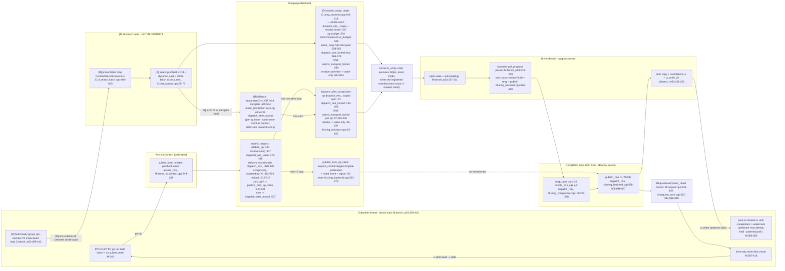
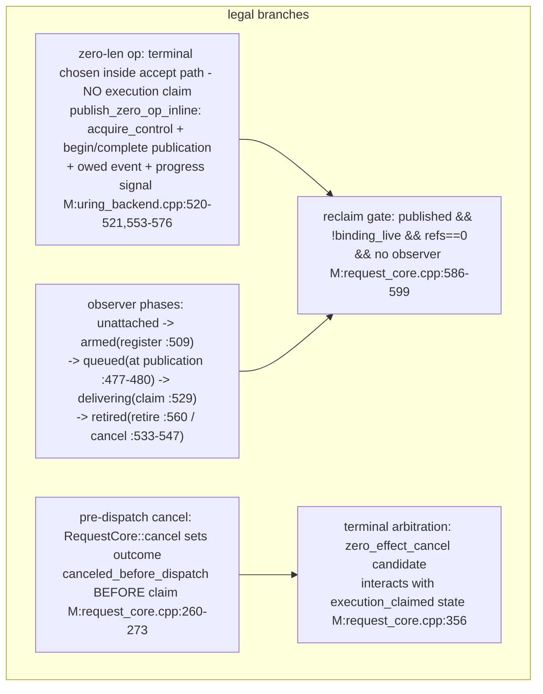
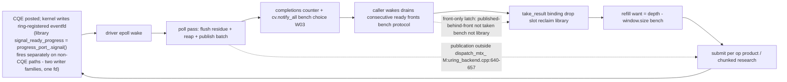

# #595 Flow Audit — 完整执行流程、反馈回路与机器工作审计（R1–R6 复核修订版）

Round `flow-audit`, 2026-11-07; this revision fixes review findings R1–R6
(see CORRECTIONS.md). Anchor conventions: `M:path:line` =
PRODUCT master `271b81bf`; `C:path:line` = RESEARCH R_cleanup `b191bb89`
(R_original `f3b25329` 行号见 PR #630 CALL_PATTERNS.md §7，结构未变);
`W03/W02` = BENCH。实线边为 SOURCE_VERIFIED（本轮在标注树直接读取）；
标 HYPOTHESIS/UNMEASURED 的虚线除外。

## 0. 主要结论（先行，R2 修订）

1. **结构事实（与根因主张分开）**：PRODUCT 只有一条提交路径（逐 op
   `ctx.submit_read`）；R/S/C 族的批量入口 `submit_ready_reads`、adapter
   `r3_ready_batch.hpp`、TestAccess seam、决策表是 research-branch-only
   代码，master 从未包含（master 是所有研究分支祖先，见 BASELINE.md）。
   研究路径确有额外工作：seam 三重校验+整批 `access_mtx_`/`dispatch_mtx_`
   临界区、每呈现 DecisionRecord+计数器、呈现循环本身。
   **这些额外工作对 singleton 退化与 d16 p99 差的贡献尚未由单因素
   反事实独立识别**——现有证据既不能证明产品整体架构有问题，也不能
   排除产品共享路径、完成服务或调用者反馈的作用。"不在 master 中"
   ≠"无产品价值"：任何产品化批量入口仍必须承担准入、生命周期与并发
   责任。
2. **净效应已知（R5 指定形状、过程 CPU 口径）**：R/C−A0 CPU −22%、
   吞吐 +28%、d16 p99 +18%（FAIL）、浅队列格 FAIL、d4 全改善。批量
   减少提交调用的机制有证据；但 R−A0 之差同时含研究路径多项变化，
   **成本节约尚未完全归因到 enter 调用本身**（H7）。
3. **p99 差数值（机器复算，替代已撤回的"≈20µs"推论）**：MAIN 运行级
   p99 均值差 C−A0 **9.52µs** / R−A0 **10.71µs**；逐块相对效应均值
   +17.97%/+20.14%；合并逐请求 p99 不可得。三种口径不得互换。
   F5 位置条件尾风险（0-7≈1.2% vs 8-15≈9.0%，cw8≈26%）保持
   PERTURBED lead，非 p99 分解，也不能证明量子 8 是根因。
4. **感知策略的落点（R3 修订）**：撤回"输入全是 harness 状态""感知
   无产品落点""产品唯一自由度是 flush"。决策表的输入多数有产品侧
   权威来源（见 §1 R3 表），但**当前策略仅在研究路径实现，接入产品
   的净收益未证明**；已有信息是否值得用于策略，需具体机制与成本
   证据。本轮不据此建议任何新 timestamp/hint/全局计数器/runtime。
5. **观察端**：front-only drain 是 BENCH 协议不是库机制；库按请求独立
   publish（publication 循环在 `dispatch_mtx_` 外，`M:uring_backend.cpp:
   640-657`）。observe 均值差（A0 24.9µs vs R 10.4µs，PERTURBED）跨的
   是**不同 tail set**，不能据此排除 H3 主导差值（HYPOTHESES H3 修订）。
6. **CPU 口径（R4 修订）**：主指标 = measured 相位 CLOCK_PROCESS_
   CPUTIME_ID（三窗口分离见 BASELINE.md）；"−22%" 是过程口径，非全
   系统；io-wq CPU 是否在子进程 rusage 内 **UNRESOLVED**（采样归类
   份额 A0≈40% / R/C≈48% 仅限 sampled-classified ticks）。

## 1. R3 — 决策输入的信息来源表

"策略在研究 harness 中实现"与"输入由 harness 凭空制造"是两回事：

| 信息 | 原始生产者 | 产品已有？ | 缓存/转交 | 语义 | 读取成本证据 | 足以证明策略价值？ |
|---|---|---|---|---|---|---|
| `outstanding()` | 库：`AsyncIoContext::outstanding()`（`M:async_io_context.cpp:837-840`），权威在 `RequestCore::outstanding_`（accept++ `:202`，publish-- `:473`） | 是（公共 API） | 无缓存，每次活读（`access_mtx_`+core 锁两锁） | accepted∧未 published 的 drain 检测器；**不是** kernel inflight | 结构已知；两锁/读的 ns 未测 | 否——语义可得的成本/新鲜度折衷未测 |
| owner-pass facts | 库：`poll_progress()` 返回 `ProgressPass`（`M:async_io_context.hpp:66-78`：completed/immediate_work_remains/accepted_work_remains/**dispatch_retry_remains**/health_failed，"Authoritative result of one bounded pass"） | 是（每次 pass 的返回值） | 产品**不跨 pass 保存**；W03 的 SharedLoop 由 bench 保存并转交（`M:bench_w03:231-243`） | 单 pass 后的 backend 状态事实 | pass 边界免费（本来就是返回值）；跨 pass 聚合的成本在 bench | 否——产品内无跨 pass 消费者，聚合价值未证 |
| ready span / `caller_window` | 调用者：bench 在组构建时提供 `ready` 数组；`caller_window = window.size()` 在每次 submit 组构建时取一次（`C:bench_w03:415`，组内常量——F5 v1 误读已撤回） | 否（产品无 span 呈现概念） | adapter 呈现该 span；`window` 本身是 bench 的在窗 deque | 调用者实际提供的集合与在窗占用 | 构建即得；span 呈现是研究增量 | 否——仅证明研究臂有此输入 |
| SQ 空间 | backend：`io_uring_sq_space_left(&ring)`（产品 dispatch 路径 `M:uring_transport.cpp`；研究批内在锁下读 `C:uring_backend.cpp:534`） | 是（backend 内部） | 无 | 用户态 SQE 分配余量的内核权威值 | 每次读取为 /proc 级系统调用？否——liburing 内存读，廉价 | 否 |
| dispatch ledger / bounded ring | backend：`dispatch_` 环+ledger（`M:uring_transport.cpp:130-209`；master `271b81bf` 消除运行时取模） | 是 | 无 | 传输记账/身份/路由权威 | 结构已知，ns 未测 | 否 |
| control/residue | backend：`dispatch_retry_remains_locked_()`（`M:uring_transport.cpp:211`）+ `ProgressPass.dispatch_retry_remains`（产品字段）+ `signal_ready_progress()`（`M:uring_backend.hpp:297` = `progress_port_.signal()`，**只唤醒不 flush**） | 是（PROG-01 义务载体） | 无 | 已接受未达内核工作的存在信号 | 结构已知 | 否 |

结论：撤回 v1 的"感知无产品落点"。正确表述：**输入多数有产品权威
来源；缺的是"这些信息在产品路径上换什么"的机制与净收益证据**。

## 2. 图 A — 提交路径对照：普通路径 / 批量路径 / size==1 回退（R5 修订）

三条边族按冻结源码实际函数画出；锁范围以边框标注。产品普通路径与
研究批量路径**不复用彼此的顶层入口**（批内循环的是共享的 `admit_`/
`dispatch_one_locked`/`submit_transport_locked` 底层函数，不是
`submit_request`）。



对照表（关键边源码）：

| 边 | PRODUCT `271b81bf` | RESEARCH 增量 `b191bb89` |
|---|---|---|
| 调用者→提交 | 逐条 `ctx.submit_read` `M:bench_w03:349`；T0=submit 返回后 `:355-356` | 整组构建+组内逐成员 T0 `C:bench_w03:399-413`；A0 臂 T0=各 op 自己 submit 前（臂内同源） |
| 呈现 | 无此层 | loop `C:r3:468-605`；DecisionRecord+计数器；`outstanding()` 读仅 budgeted 臂 `C:r3:498` |
| seam | 无 | precheck×≤8 + `dynamic_cast` + 整批 `access_mtx_` `C:test_access.hpp:55-77` |
| 批量入口 | 无 | `submit_ready_reads` `C:uring_backend.cpp:443-619`：size==1/首员不合格回退 `:479-504`（admit_+per-op enter）；否则整批 `dispatch_mtx_`、limit=min(size,8,sq_budget) `:535`、每呈现恰 1 enter `:580` |
| admit | `submit_request` `M:uring_backend.cpp:423-530` | 同一 `admit_` 底层函数在批内循环（不经 `submit_request` 顶层） |
| enter | 正常非零读每 op 1 次（`dispatch_after_accept`→`submit_transport_locked` `M:uring_transport.cpp:87,218-235`）；zero-op/inline/retry/control 路径不满足 1:1 | 每呈现 1 次（≤8 SQE）；回退路径仍 per-op enter |
| 完成/发布/观察 | 相同源码（`request_core/uring_completion/request.hpp` 两树逐字节相同） | 相同 |

## 3. 图 B — W02 自驱动 vs W03 external driver（执行者/同步）

```mermaid
flowchart TB
  subgraph W2["W02 pipeline - ONE thread"]
    A2["submitter == consumer == progress owner<br/>RequestScope M:bench_w02:321-362"]
    B2["scope.wait_for front ticket<br/>potential park inside ctx.wait_one M:request_scope.cpp:103"]
    C2["wait_one: pass first, then park on eventfd via wait_if_unchanged M:async_io_context.cpp:573-696"]
    D2["take frees slot LIFO free_slots M:bench_w02:330-339"]
    A2 --> B2 --> C2
    C2 -->|"same thread drives reap publish"| D2
    D2 -->|"refill 1 typical steady state"| A2
  end
  subgraph W3["W03 external loop - TWO threads"]
    A3["submitter: fill / park / drain M:bench_w03:339-418"]
    B3["driver: claim owner, epoll, bounded passes M:bench_w03:172-258"]
    S3["SharedLoop mutex cv completions M:bench_w03:142-155"]
    A3 -->|"potential park: cv.wait_for watermark :368-385<br/>(predicate may already hold - not guaranteed block)"| S3
    B3 -->|"publish completions cv.notify_all :231-243"| S3
    B3 -->|"poll_progress takes access_mtx_ then dispatch_mtx_"| A3
  end
  K["notifications: kernel writes ring-registered eventfd on CQE;<br/>library progress_port_.signal() on non-CQE paths (zero-op inline,<br/>residue, owed sweep) - same fd, two writer families, event count != request count"]
```



- W02 稳态每次只补 1（consume-1-refill-1），研究批策略在 W02 稳态
  永不触发（PR #630 ⚠X1；本轮在 master W02 结构再确认）。
- W02 无跨线程锁竞争；W03 的真实竞争点：submitter（整批/逐 op 的
  `dispatch_mtx_`）vs driver 每 CQE 的 `dispatch_mtx_`
  （`M:uring_completion.cpp:100`），及 `access_mtx_`。等待幅度 UNMEASURED。
- W02 的等待直达库 eventfd；W03 submitter 等的是 driver 聚合的 per-pass
  完成计数（粒度=一个 pass 的聚合，BENCH 选择）。

## 4. 图 C — Request 生命周期：主图（正常非零读）+ 补充分支（R5 修订）

主图只覆盖**正常非零读**这一条链；补充分支图给出其余合法路径。

```mermaid
stateDiagram-v2
  direction LR
  [*] --> Reserved: reserve (core mutex) M:request_core.cpp:165-181
  Reserved --> Accepted: accept outstanding++ M:184-209
  Reserved --> RolledBack: rollback on accept failure M:uring_backend.cpp:515-517
  Accepted --> ExecutionClaimed: claim_execution M:367-378
  ExecutionClaimed --> TerminalChosen: offer_terminal (first result wins) M:346-365
  TerminalChosen --> BorrowRetired: release_execution M:393-409
  BorrowRetired --> PublicationPending: push FIFO M:uring_completion.cpp:92
  PublicationPending --> Published: begin+complete publication outstanding-- M:uring_backend.cpp:578-608 M:request_core.cpp:438-484
  Published --> Consumed: take_result binding drop M:request.hpp:146-159 M:request_core.cpp:323-344
  Published --> Discarded: no-consumer path same conditions
  Consumed --> SlotReclaimed: published && !binding_live && refs==0 && no observer M:request_core.cpp:586-599
  Discarded --> SlotReclaimed: same conditions
  SlotReclaimed --> [*]: generation++ LIFO free list
```



补充分支（各自独立的合法路径，不在主图线性链上）：



- 线性化点：accept（提交序）、terminal_chosen（首结果胜出）、
  published（观察可见）、consume/discard（binding 释放）。
  `outstanding_` = accepted∧未 publish（drain detector）；≠ kernel
  inflight，≠ 已发布未收集（C4 结论两树一致）。
- **borrow 契约端点（REQ-04）**：库内部在 `release_execution` 全额退休
  borrow-touching 引用（早于 publication，`M:uring_completion.cpp:89-92`）；
  但**调用者可复用缓冲区的可观察条件是获得 publication**
  （`ready()==true`/terminal lookup/notification 的 acquire 语义）——
  "物理完成或 cancel 响应单独不足"（docs/explicit-io-contract.md REQ-04）。
  内部引用归零是必要前置，不是调用者复用的充分条件。
- 观察端点：`ready()`/`try_result()` 按请求独立（`M:request.hpp:130-144`）；
  库不要求顺序消费（顺序观察是 BENCH 协议）。

## 5. 图 D — 一个完整 refill 的顺序（W03；enter 1:1 限定于已核验形状）

```mermaid
sequenceDiagram
  autonumber
  participant S as Submitter
  participant D as Driver
  participant K as Kernel
  Note over S: drain k fronts in-order take frees slots M:bench_w03:387-418
  Note over S: refill builds k ops, fill loop below depth M:339-358
  loop PRODUCT A0 - per op i in 0..k (normal non-zero reads)
    S->>S: ctx.submit_read precheck->reserve->accept M:async_io_context.cpp:249 M:uring_backend.cpp:423-530
    S->>K: ONE io_uring_submit per op M:uring_transport.cpp:87,231<br/>(1:1 verified for this shape only; zero-op/retry/control differ;<br/>liburing call count != syscall count)
  end
  Note over S,K: R-only fork: whole span in ONE adapter submit, ceil(k/8) presentations each 1 enter C:r3:468-605 C:uring_backend.cpp:580 - back ops wait earlier presentations (size==1 refills use the per-op fallback :479-504)
  S->>S: park attempt: cv.wait_for completions > watermark M:368-385<br/>(predicate may already hold - no guaranteed block)
  K-->>D: CQEs; kernel writes ring-registered eventfd
  D->>D: epoll wake acknowledge bounded passes: residue flush + reap + publish M:197-229 M:uring_backend.cpp:616-689
  Note over D: driver MAY run between any two product submits too - each submit releases access_mtx_ dispatch_mtx_ - interleaving is OS scheduling UNMEASURED
  D-->>S: completions++ cv.notify_all M:231-243
  S->>S: drain consecutive ready fronts take M:387-418
```

"允许发生"vs"实际发生"：driver 在 fill 循环两个 submit 之间获取
`dispatch_mtx_` 是源码允许的；实际频率未测。R 呈现的块边界同样只是
窗口而非 yield（C5；研究树再确认）。

## 6. 图 E — 反馈回路：completion → observation → window → refill → submit



三类必要依赖 vs 选择：
- 应用必要：数据正确性（verify）、槽位互斥（seq%depth 安全三条件）、
  unique terminal/publication、borrow 退休先于发布（REQ-04）。
- BENCH 选择：front-only drain、watermark cv 等待、T0 起点、k-op refill
  聚合、driver per-pass 事实聚合。
- 产品要求：acceptance→eventual dispatch（PROG-01 residue）、
  publication 完整性、消费门控回收、锁序 access→dispatch→core。

## 7. 六环节必答要点（R2/R5 修订）

**7.1 调用者/ready**：PRODUCT 的 fill 循环里描述符构造、buffer 可用、
应用 ready 与 submit 调用发生在同一内联序列（`M:bench_w03:343-357`），
但这是 **bench 的选择**，不是产品语义要求——库不要求这四个事件重合。
研究 R 把构建与呈现分离；`ready_ns` 在组构建循环内**逐成员**打点
（`C:bench_w03:413`），后位成员构建时刻略晚于前位、全部早于任何呈现。
`window.size`=在窗未结算 deque；`outstanding()`=accepted∧未发布；
refill 粒度 k 是 BENCH 闭环选择；steady-state k≈7.9（R4 计数）。

**7.2 Adapter/研究入口**：R 每呈现额外付 DecisionRecord+计数器、有界
扫描、seam precheck+`dynamic_cast`+整批 `access_mtx_`+整批
`dispatch_mtx_` 临界区；产品每 op 付 2 次校验+3 次 core 锁+2 次
dispatch 锁+1 enter（正常非零读）。`remaining=1` 走研究回退路径
（`C:uring_backend.cpp:479-504`，per-op enter 仍在研究入口内）是
d2serial 税的充分结构条件（假设；每步 ns 未测）。

**7.3 Admission/dispatch/transport**：锁序 access→dispatch→core。锁内
无外部 callback（deliver_event 的 sink 在锁外 publication 段，
`M:uring_backend.cpp:610-614`）。SQE 准备/提交/内核消费/partial/retry
是五个事件。cap=8 是研究批量入口常量（`ready_batch_cap`）；产品无 cap。
submit flush 减少的是 enter 次数；**enter 数与 CQE 到达分布的关系未测**
（H4 假设化）。

**7.4 Kernel/完成服务**：I/O 执行者 = inline（submitter syscall 内）或
io-wq worker——路由不可观测（UNMEASURED）；io-wq 出现在子进程
`/proc/<tgid>/task`（结构观察），其 CPU 是否计入 rusage **UNRESOLVED**
（BASELINE.md）。pass 先 flush residue 再 reap 再 publish
（`M:uring_backend.cpp:616-689`）。通知按事件不按请求：内核在 CQE 时
写 ring 注册的 eventfd；库在枚举的非 CQE 路径写同一 fd
（`progress_port_.signal()`）；事件数≠请求数。driver 在同 refill 两
chunk 之间可发布（锁外 publication；频率未测）。

**7.5 Publication/观察/回收**：ready=per-request published；
take_result=binding 释放+回收尝试；borrow 的调用者端点=获得
publication（REQ-04，见 §4）。ready 后窗口未释放的原因：take 未发生
（front-only 时被队头挡住）。顺序观察是 BENCH 协议；乱序观察需付出
C6 反例要求的资源代价——未取得实验资格。

**7.6 反馈/总体效率**：CPU↓+吞吐↑+p99↑的净效应已知（指定形状）；
分解未完成——"提交成批使 CQE 更突发""enter 下降减少 io-wq 执行"均为
待检验假设（H4），"呈现路径成本主导 p99 差"未确立（H1），观察顺序
作用未分离（H3），浅队列税对产品路径的可泛化性无反事实（H6）。
组合解释（H1/H2/H3/H4 的加权）不需要单一根因，也未被任何单一证据
排除。d4 全指标变好、d2serial 退化、占用 8 全组高风险与"呈现×位置"
解释族相容——相容不等于证实。

## 8. 三对象差异清单（审计适用范围）

| 差异 | 影响 |
|---|---|
| PRODUCT 无 adapter/seam/批量入口 | R 族成本/尾行为不能直接外推为产品缺陷或产品收益；A0=产品基线；研究层的因果贡献未单因素识别 |
| RESEARCH bench T0=组内逐成员构建时（R）/op-submit 前（A0 臂） | R-vs-A0（研究内）同 workload 同端点可比；与 PRODUCT bench 延迟端点不可直接比 |
| 诊断器修复（492086ac/3fd6476a）晚于计时二进制 | 计时数据未变；诊断结论保持 PERTURBED lead |
| W02 稳态单 op 呈现 | W02 退化=研究入口调用路径税的准-孤立证据（结构级；泛化到产品路径无反事实） |
| `initiation_rejection` 提取为共享头（研究） | 产品行为逐字节等价（仅重构） |

渲染说明：五个 mermaid 块通过结构检查（类型头、subgraph/note 配对、
围栏平衡，scripts/test_offline_checks.py）；本机无离线 mermaid 渲染器，
**渲染未验证**。
