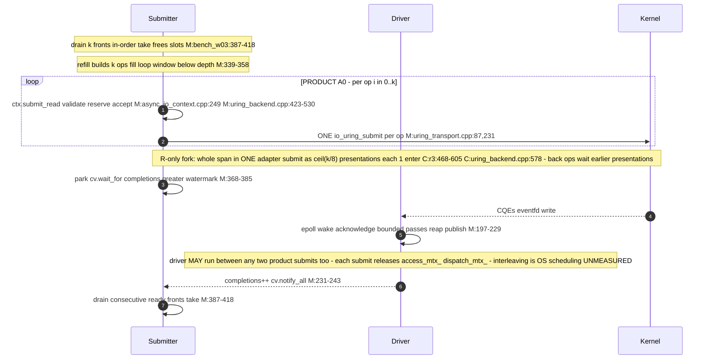
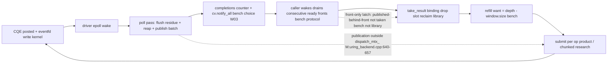

# #595 Flow Audit — 完整执行流程、反馈回路与机器工作审计

Round `flow-audit`, 2026-11-07. Anchor conventions: `M:path:line` =
PRODUCT master `271b81bf`; `C:path:line` = RESEARCH R_cleanup `b191bb89`
(R_original `f3b25329` 行号见 PR #630 CALL_PATTERNS.md §7，结构未变);
`W03/W02` = BENCH。全部边为 SOURCE_VERIFIED（本轮在标注树直接读取），
除明确标 HYPOTHESIS/UNMEASURED 的虚线。

## 0. 主要结论（先行）

1. **PRODUCT 只有一条提交路径**：`ctx.submit_read` 每 op 一次
   `io_uring_submit`。R/S/C 族的批量入口（`submit_ready_reads`）、
   adapter（`r3_ready_batch.hpp`）、TestAccess seam、决策表是
   research-branch-only 代码，master 从未包含（master 是所有研究分支的
   祖先；见 BASELINE.md 对象表）。因此 R5 的三臂对比是
   “产品+研究叠加层 vs 产品”，不是产品内部两条路径之争。
2. **R 族的三个失败模式按层分解**（详见 HYPOTHESES.md）：
   - CPU −22%/吞吐 +28%（robust）：enter 摊销——**transport 层机制**，
     任何批量形态都能拿到，与感知策略无关；
   - d16 p99 +18%：restart-refill 后块（位置 8-15）在研究呈现路径的
     串行化后面等待（F5 修正后：0-7 位尾风险 ≈1.2%、8-15 位 ≈9.0%，
     阶跃恰在呈现量子 8；占用 8 的 refill 全位 ≈26%；PERTURBED lead）。
     p99 差 ≈20µs 与“呈现 8 op 的研究路径 CPU”同量级
     （C≈2.5µs/op×8）——**研究路径成本可解释相当部分**，未确证为
     batching 内在代价；
   - 浅队列税（d2serial/W02-d1/d2）：几乎不合批仍退化——研究入口的
     纯调用路径税，产品路径不存在此层。
3. **“感知调度”没有产品落点**：决策表的输入（owner-pass facts、
   `outstanding()`）全部是研究 harness 状态；产品唯一的策略自由度是
   backend 内部的 transport 排程（何时 enter），契约允许 submit 只
   “arrange dispatch”（contract §“Submitting may perform finite
   bookkeeping … arrange dispatch”），PROG-01 的 residue 机制已保证
   未 dispatch 工作的最终驱动。**下一步不应是感知策略。**
4. **观察端**：front-only drain 是 BENCH 协议不是库机制；库按请求独立
   publish（publication 循环在 `dispatch_mtx_` 外，`M:uring_backend.cpp:640-657`）。
   A0 自身尾部是 observe-dominated（诊断 lead：A0 observe tail-mean
   24.9µs vs R 10.4µs）。driver **可以**在两次呈现之间发布（每次呈现
   释放 access_mtx_+dispatch_mtx_；旧“不能中途发布”已撤回，本轮源码
   再次确认）。
5. **CPU 口径**：主指标 = CLOCK_PROCESS_CPUTIME_ID（measured 相位），
   不含 io-wq kthread。io-wq ticks 份额（invocation 口径，10ms 粒度，
   RECALCULATED）：A0≈40%、R/C≈48%（app+io-wq 合计中）；
   R/C io-wq ticks ≤ A0。“CPU −22%” 不是全系统数。

## 1. 图 A — PRODUCT W03 A0 与 RESEARCH R_cleanup 对照流程

共同节点为两树共有源码；标 `[R]` 的节点/边只存在于研究分支。

```mermaid
flowchart LR
  subgraph CALLER["Submitter thread - bench main"]
    FILL["fill window to depth<br/>per op build+submit<br/>M:bench_w03:339-358"]
    PARK["park shared.cv until completions greater watermark<br/>M:bench_w03:368-385"]
    DRAIN["front-only drain take_result pop_front<br/>M:bench_w03:387-418"]
  end

  subgraph ADPTR["R-only adapter layer - NOT IN PRODUCT"]
    GRP["build ready group stamp all T0 at build<br/>C:bench_w03:399-413"]
    LOOP["presentation loop chunking re-entry<br/>C:r3_ready_batch.hpp:468-605"]
    SEAM["TestAccess seam precheck dynamic_cast<br/>access_mtx_ whole batch<br/>C:test_access.hpp:55-77"]
  end

  subgraph CTX["AsyncIoContext"]
    SR["submit_read initiation check access_mtx_<br/>M:async_io_context.cpp:249-269"]
    OUT["outstanding access_mtx_ + core mutex_ R-arm does not call<br/>M:async_io_context.cpp:837-840"]
  end

  subgraph BK["UringAsyncBackend"]
    SRR["[R] submit_ready_reads cap 8 sq_budget<br/>whole-batch dispatch_mtx_ ONE enter per presentation<br/>C:uring_backend.cpp:443-619"]
    ADM["submit_request validate reserve accept prepared_ops<br/>M:uring_backend.cpp:423-530"]
    DAA["dispatch_after_accept push dispatch_one_locked<br/>ONE enter PER OP in product path<br/>M:uring_transport.cpp:43-102,130-209"]
  end

  KER["kernel io_uring enter executes posts CQE writes eventfd"]
  subgraph DRV["Driver thread - progress owner"]
    EP["epoll_wait eventfd then acknowledge<br/>M:bench_w03:197-211"]
    PP["bounded poll_progress passes<br/>M:bench_w03:218-229"]
    FACTS["[R] pass facts to SharedLoop cv.notify_all<br/>M C:bench_w03:231-243"]
  end
  subgraph CQ["Completion side"]
    REAP["reap_cqes batch32 handle_one_cqe per dispatch_mtx_<br/>M:uring_completion.cpp:200-278,100"]
    PUB["publish_one OUTSIDE dispatch_mtx_ begin complete deliver<br/>M:uring_backend.cpp:578-608,640-657"]
  end
  OBSV["Request.ready take_result slot reclaim<br/>M:request.hpp:130-159 M:request_core.cpp:323-344,586"]

  FILL -->|"product path per op"| SR
  GRP -->|"[R] one submit call presents whole span"| LOOP
  LOOP -->|"[R]"| SEAM
  SEAM -->|"[R]"| SRR
  SRR -->|"[R] admit under same dispatch_mtx_"| ADM
  SR --> ADM
  ADM --> DAA
  LOOP -.->|"R arm reads none"| OUT
  DAA --> KER
  KER --> EP --> PP --> REAP --> PUB --> FACTS
  FACTS -->|"notify cv wake"| PARK
  PUB --> OBSV --> DRAIN
  DRAIN -->|"window slot released refill k ops"| FILL
```

对照表（关键边源码）：

| 边 | PRODUCT `271b81bf` | RESEARCH 增量 `b191bb89` |
|---|---|---|
| 调用者→提交 | 逐条 `ctx.submit_read` `M:bench_w03:349`；T0=submit 返回后 `:355-356` | 整组构建+组内 T0 `C:bench_w03:399-413`；A0 臂 T0=各 op 自己 submit 前（臂内同源） |
| 呈现 | 无此层 | loop `C:r3:468-605`；DecisionRecord+计数器/块；`outstanding()` 读仅 budgeted 臂 `C:r3:498` |
| seam | 无 | precheck×≤8 + `dynamic_cast` + 整批 `access_mtx_` `C:test_access.hpp:55-77` |
| 批量入口 | 无 | `submit_ready_reads` `C:uring_backend.cpp:443-619`：整批 `dispatch_mtx_`、`limit=min(size,8,sq_budget)` :529-534、每次呈现恰 1 enter :578 |
| admit | `submit_request` `M:uring_backend.cpp:423-530` | 同一 admit 逻辑在批内循环 |
| enter | 每 op 1 次（`dispatch_after_accept`→`submit_transport_locked` `M:uring_transport.cpp:87,218-235`） | 每呈现 1 次（最多 8 SQE） |
| 完成/发布/观察 | 相同源码（`request_core/uring_completion/request.hpp` 两树逐字节相同） | 相同 |

## 2. 图 B — W02 自驱动 vs W03 external driver（执行者/同步）

```mermaid
flowchart TB
  subgraph W2["W02 pipeline - ONE thread"]
    A2["submitter == consumer == progress owner<br/>RequestScope M:bench_w02:321-362"]
    B2["scope.wait_for front ticket<br/>parks in ctx.wait_one<br/>M:request_scope.cpp:103 M:async_io_context.cpp:573-696"]
    C2["wait_one loop pass then park on eventfd via wait_if_unchanged<br/>M:async_io_context.cpp:608-664"]
    D2["take frees slot LIFO free_slots<br/>M:bench_w02:330-339"]
    A2 --> B2 --> C2
    C2 -->|"same thread drives reap publish"| D2
    D2 -->|"refill 1 typical steady state"| A2
  end
  subgraph W3["W03 external loop - TWO threads"]
    A3["submitter thread fill park drain M:bench_w03:339-418"]
    B3["driver thread claim owner epoll bounded passes<br/>M:bench_w03:172-258"]
    S3["SharedLoop mutex cv completions counter<br/>M:bench_w03:142-155"]
    A3 -->|"park cv.wait_for watermark :368-385"| S3
    B3 -->|"publish completions cv.notify_all :231-243"| S3
    B3 -->|"poll_progress takes access_mtx_ then dispatch_mtx_"| A3
  end
  K["kernel eventfd one hop to W02 waiter two hops to W03 submitter"]
```

- W02 稳态每次只补 1（consume-1-refill-1），批策略永不触发
  （PR #630 ⚠X1 结论，本轮在 master W02 结构上再确认：
  窗口满后 `while (window.size() < depth)` 只腾出 1 个槽）。
- W02 无跨线程锁竞争；W03 的真实竞争点：submitter 整批/逐 op 的
  `dispatch_mtx_` vs driver 每 CQE 的 `dispatch_mtx_`（`M:uring_completion.cpp:100`），
  及 `access_mtx_`（submit vs `drive_entry_admitted_`/outstanding）。
- W02 的等待是 eventfd 直达（`wait_one`→`wait_if_unchanged` 探针
  `has_immediate_physical_work`）；W03 submitter 等的是 driver 聚合的
  per-pass 完成计数（粒度=一个 pass 的聚合）。

## 3. 图 C — 一个 Request 的生命周期（线性化点与 borrow）

```mermaid
stateDiagram-v2
  direction LR
  [*] --> Reserved: reserve M:request_core.cpp:165-181
  Reserved --> Accepted: accept outstanding++ M:184-209
  Reserved --> Freed: rollback M:212-222
  Accepted --> ExecutionClaimed: claim_execution M:367-378
  ExecutionClaimed --> TerminalChosen: offer_terminal CQE outcome M:346-365
  TerminalChosen --> BorrowRetired: release_execution M:393-409
  BorrowRetired --> PublicationPending: push FIFO M:uring_completion.cpp:92
  PublicationPending --> Published: begin+complete publication outstanding-- M:uring_backend.cpp:578-608 M:request_core.cpp:438-484
  Published --> Consumed: take_result binding drop try_reclaim M:request.hpp:146-159 M:request_core.cpp:323-344
  Published --> SlotReclaimed: discard path same conditions
  Consumed --> SlotReclaimed: published && !binding_live && refs==0 && no observer M:request_core.cpp:586-599
  SlotReclaimed --> [*]: generation++ LIFO free list
```

- 线性化点：accept（提交序）、terminal_chosen（首结果胜出）、
  published（观察可见）、consume/discard（binding 释放）。
  `outstanding_` 的语义 = accepted∧未 publish（drain detector），
  与 kernel inflight、与已发布未收集均不相同（C4 结论在两树一致）。
- borrow（caller buffer）由 `prepared_ops_[slot]` 持有
  （`M:uring_backend.cpp:479-486`），`release_execution` 全额退休后才
  允许 publish（`M:uring_completion.cpp:89-92`）；slot 回收是消费门控的
  （C6 结论，master `request_core.cpp:586` 同）。
- **观察端点**：`ready()`/`try_result()` 按请求独立
  （`M:request.hpp:130-144`）；库不要求顺序消费。

## 4. 图 D — 一个完整 refill 的顺序（W03，PRODUCT 视角，R 呈现分叉标注）

“允许发生”vs“实际发生”：driver 在 fill 循环的两个 submit 之间获取
`dispatch_mtx_` 是源码允许的（每 op 提交完释放）；实际频率未测。
R 呈现的块边界同样只是窗口而非 yield（C5 结论；研究树再确认）。

## 5. 图 E — 反馈回路：completion → observation → window → refill → submit

三类必要依赖 vs 选择：
- 应用必要：数据正确性（verify）、槽位互斥（seq%depth 安全三条件）、
  unique terminal/publication、borrow 退休先于发布。
- BENCH 选择：front-only drain、watermark cv 等待、T0 起点、k-op refill
  聚合、driver per-pass 事实聚合。
- 产品要求：acceptance→eventual dispatch（PROG-01 residue）、
  publication 完整性、消费门控回收、锁序 access→dispatch→core。

## 6. 六环节必答要点（引用上文证据）

**4.1 调用者/ready**：PRODUCT 中 descriptor 构造=buffer 可用=应用 ready
=提交前一刻（fill 循环内联，`M:bench_w03:343-357`），四个事件重合；
研究 R 把“构组”与“呈现”分离，组内 T0 全部=构建时刻。
`window.size`=在窗未结算 deque；`outstanding()`=accepted∧未发布；
已提交未完成 ⊂ outstanding；已完成未观察 = published∧未 take（不在
outstanding 内）。refill 粒度=k（本轮回灌全部 drained）是 BENCH 的
闭环选择；steady-state k≈7.9（R4 计数）。

**4.2 Adapter/研究入口**：单条路径与产品 `ctx.submit_read` 不相同：
R 每呈现额外付 DecisionRecord+计数器、有界扫描、seam precheck（第 3
次验证）+`dynamic_cast`+整批 `access_mtx_`+整批 `dispatch_mtx_` 临界区；
产品每 op 付 2 次验证（ctx `initiation_rejection` + backend
`validate_op`，跨层信任边界）+ 3 次 core 锁 + 2 次 dispatch 锁 + 1 enter。
`remaining=1` 仍走研究入口是 d2serial 税的充分结构条件（假设，未测 ns）。

**4.3 Admission/dispatch/transport**：锁序 access→dispatch→core
（`C:test_access.hpp:46-47` 注释；产品同样成立）。锁内外部 callback：
无（deliver_event 的 sink 在 publication 段、锁外，`M:uring_backend.cpp:610-614`）。
slot/generation+cookie/router+ledger 各自权威：身份/路由/传输记账，
每请求身份解析一次（cookie→router 一次 lookup，`M:uring_completion.cpp:148`）。
SQE 准备/提交/内核消费/partial/retry 是五个事件
（`dispatch_one_locked`/`submit_transport_locked`/`account_transport_result_locked`/
`reconcile_ledger_with_kernel_locked_`）。**cap=8 是研究批量入口的常量**
（`ready_batch_cap`），约束呈现批量；产品无 cap。submit flush 减少的
是 enter 次数；新增：整批临界区（研究）或无（产品 per-op 已有）。

**4.4 Kernel/完成服务**：承担 I/O 的执行者 = inline（submitter 上下文
syscall 内）或 io-wq kthread——内核内部路由不可观测（UNMEASURED）；
io-wq CPU 在 rusage 外（ticks 份额复算见 §0.5）。driver 由 eventfd
epoll 唤醒；pass 先 flush residue 再 reap 再 publish
（`M:uring_backend.cpp:620-657`）。三种积压可区分两态：
CQE-visible-未-reap（`has_immediate_physical_work`/cq_ready）、
reaped-未-publish（publication_pending_/immediate_work_remains）；
published-未-observe 是 caller 侧事实（ready() 可查），库无聚合视图。
通知按事件（非按请求）：eventfd 写在 CQE 投递时（内核）+ 库内
ProgressSource::signal 于枚举的非 CQE 路径。driver 在同 refill 两 chunk
之间可发布（锁外 publication；频率未测）。

**4.5 Publication/观察/回收**：ready=per-request published；
通知=deliver_event（bench 无 sink）；take_result=binding 释放+回收尝试；
borrow 结束=release_execution 全额退休（早于 publication）。
ready 后窗口未释放的原因：take 尚未发生（front-only 时被队头挡住）。
顺序观察是 BENCH 协议；乱序观察需付出 C6 反例要求的资源代价
（逐条 buffer 所有权或 reorder 记账）——未取得实验资格（见 DECISION）。

**4.6 反馈/总体效率**：提交成批使 CQE 更突发（1 enter/8 op ⇒ 完成
更集中），driver pass 聚合粒度变大，W03 wake 粒度=pass；下一批 ready
形状=drained k。CPU↓+吞吐↑+p99↑可由“front op 更早进内核、back op
等待串行化呈现”一致解释（H1/H2/H3 组合，无需单一根因）。
d4 全指标变好（单 chunk，无阶跃）、d2serial 退化（无批仍付税）、
占用 8 全组高风险（整个 refill 是“后块”），支持“呈现路径成本×位置”
解释族；闭环 bench 的适用范围限定见 NEXT_EXPERIMENT §9。

## 7. 三对象差异清单（审计适用范围）

| 差异 | 影响 |
|---|---|
| PRODUCT 无 adapter/seam/批量入口 | R 族的一切成本/尾行为不能直接外推为产品缺陷或产品收益；A0=产品基线 |
| RESEARCH bench T0=组构建（R）/op-submit 前（A0 臂） | R-vs-A0（研究内）同 workload 同端点可比；与 PRODUCT bench 延迟端点不可直接比 |
| 诊断器修复（492086ac/3fd6476a）晚于计时二进制 | 计时数据未变；诊断结论保持 PERTURBED lead |
| W02 稳态单 op 呈现 | W02 退化=调用路径税的准-孤立证据 |
| `initiation_rejection` 提取为共享头（研究） | 产品行为逐字节等价（仅重构） |
