# STATE_AUTHORITY — Sluice v2-r1 产品调用路径：规范义务 / 代码权威 / 调用点

- 记录时间：2026-11-05
- 仓库：`/home/jnhu/Source/Sluice`，HEAD `0a22a79195f1b913145fcd443496e7f70b08cdcf`
  （与 `CONTEXT.md` §2 `baseSha` 一致；`CONTEXT.md` §3 记录该 HEAD 相对 R2 锚点
  `271b81bf` 的 `include/` / `src/` / `apps/` / `xmake/` / `tests/` / `xmake.lua`
  逐子树 IDENTICAL）。
- 角色边界：本文件只做**只读静态映射**。未修改源码，未构建，未运行测试，未运行
  benchmark。文中每条代码结论均来自本轮对当前 HEAD 的读取（`Read` / `grep` /
  `git log` / `wc -l`）；没有任何性能数值进入本文件。
- R3 手臂状态：`CONTEXT.md` §7.2 明记 `A0` / `A1` / `A_R2` / `B_R2` 的干预定义
  「语义未在本次冻结中给出」，`OPEN-1` 阻断正式计时。因此本文**不定义**任何 R3
  手臂，只映射产品路径本身。
- 当前产品 HEAD **不存在** R2 研究副本中的 `bounded_progress_` / defer 门：
  `grep -rn "bounded_progress_" src include tests` 在本轮无输出、exit 1（0 命中）。
  R2 文档（`docs/research/595-causal-r2/CF0_THREE_ARM.md` §2）里的
  `defer_transport_flush_locked_` 是**研究副本**机制。本文映射的是产品 HEAD 的
  「提交点立即 flush」形态；任何 R3 原型若引入 defer，只能改机制（BACKEND-04），
  不能改本文第 4 节的不变量。

---

## 0. 三层分离：规范义务 ≠ 代码权威 ≠ 调用点

| 层 | 载体 | 本文件如何使用 | 权威边界 |
|---|---|---|---|
| 规范义务 | `docs/explicit-io-contract.md`（v2-r1，GOV-05） | 给出 requirement ID 与原文条款号；这是"必须做什么" | 根规范独有产品范围/公开行为/生命周期/验收义务的所有权（GOV-01，`docs/explicit-io-contract.md:47-60`）；任何后端、实现 PR、测试、模型、issue、ADR 不得发明遗漏的公开契约（`:56-60`） |
| 代码权威 | 当前 HEAD 的 `include/`、`src/` | 回答"这个 commit 实际怎么做"；字段/锁/写者/读者 | 只证明当前 commit 的行为；与根规范不符是 conformance gap，不是改写契约的许可（GOV-02，`:62-73`） |
| 调用点 | 实际调用链与行号 | 回答"路径在哪、谁先谁后" | 不能单独成为语义义务；调用顺序本身不是 oracle |
| 证据台账 | `docs/roadmap/v2-conformance.md` | 给出义务组、状态、开放项与 release gate | 跟踪状态，不能放宽要求（GOV-02 行 `:71`） |
| 研究冻结 | `/home/jnhu/sluice-595-e5/r3/evidence/CONTEXT.md` | §5 硬约束、§6 ReadyGroup、§7.2 OPEN-1 | 本轮任务约束；不能改写 v2-r1 |

**读法**：下文的节点表把三者分开列：`规范义务`列给 requirement ID + 条款行；
`代码权威`列给权威字段/对象与写者；`调用点`列给实际函数与行号。

### 0.1 本文覆盖的义务组

| 义务组 | requirement IDs | 本文对应节点 |
|---|---|---|
| admission / acceptance / request lifetime | REQ-01, REQ-02, REQ-03, REQ-05, REQ-06, HANDLE-01..03 | N1–N4, N11–N13 |
| publication | REQ-03, REQ-04, REQ-05, OBS-01..03 | N10–N13 |
| progress / park / wake | PROG-01..04, THREAD-01/02 | N14, N15, N8 |
| shutdown | SHUT-01..04, BOUND-02 | N15, N16 |
| cancel / control | CANCEL-01, CANCEL-02 | N5, N17 |
| bounded resources | BOUND-01, BOUND-02 | N5–N7, N11 |
| backend seam | BACKEND-01..04 | N4–N11 |
| 验收证据类别 | VERIFY-01..04 | 第 8 节对照表 |

---

## 1. 权威 / 所有权 DAG

```mermaid
flowchart TD
  subgraph L0["生产者（调用者线程；THREAD-01 允许并发 submit）"]
    P["AsyncIoContext::submit_*&#40;&#41;<br/>entry validation + access_mtx_"]
    CX["AsyncIoContext::cancel&#40;id&#41;"]
  end

  subgraph L1["RequestCore（core mutex_ 串行权威）"]
    RSV["reserve&#40;&#41;<br/>free_slots_ -> SlotPhase::reserved"]
    ACC["accept&#40;&#41;<br/>线化点：binding_live + descriptor/borrow + execution_refs"]
    ZOP["zero_op：terminal_chosen=true,<br/>execution_refs=0"]
    TERM["offer_terminal&#40;&#41;<br/>唯一 immutable terminal 赢家"]
    REL["release_execution&#40;&#41;<br/>borrow-touch refs -> 0"]
    BEG["begin_publication&#40;&#41;<br/>gate: terminal_chosen && execution_refs==0 && binding_live"]
    CMP["complete_publication&#40;&#41;<br/>published=true; outstanding_--"]
    RD["lookup / observe / consume<br/>Request::ready / try_result / take_result"]
    OBS["observer phase<br/>armed -> queued -> delivering -> retired"]
  end

  subgraph L2["UringAsyncBackend（dispatch_mtx_ + kernel）"]
    DAA["dispatch_after_accept&#40;&#41;"]
    DQ["dispatch_ 有界队列<br/>capacity=request_capacity"]
    DOL["dispatch_one_locked&#40;&#41;<br/>claim_execution + SQE prep + router + ledger"]
    STL["submit_transport_locked&#40;&#41;<br/>io_uring_submit"]
    TL["TransportLedger<br/>capacity=sq.ring_entries"]
    POLL["poll&#40;&#41;：先 dispatch/submit，再 reap"]
    REAP["reap_cqes&#40;&#41;<br/>入口 CQ ready 有界 + 32 批"]
    CQE["handle_one_cqe /<br/>finalize_operation_terminal_"]
    PPQ["publication_pending_ 有界队列"]
    PUB["publish_one&#40;&#41;"]
    DEL["deliver_event&#40;&#41;<br/>claim/hook/retire observer"]
    ZPUB["publish_zero_op_inline&#40;&#41;"]
    CTRL["issue_running_cancel_locked_ /<br/>service_pending_controls_locked_"]
  end

  subgraph L3["内核与通知"]
    K["kernel: 消费 SQ / 产出 CQ /<br/>registered eventfd"]
  end

  subgraph L4["ProgressSource + 固定 progress owner"]
    PS["ProgressSource<br/>progress epoch / control generations /<br/>health_failed_ / eventfd pending bit"]
    W["wait_one&#40;&#41; / drive_settlement&#40;&#41;<br/>bounded pass -> park handshake"]
  end

  P --> RSV --> ACC
  ACC -->|zero_op| ZOP --> ZPUB
  ACC -->|non-zero| DAA
  DAA --> DQ --> DOL --> TL
  DOL --> STL --> TL
  STL --> K
  K --> POLL --> REAP --> CQE --> TERM
  CQE --> REL
  TERM --> PPQ --> PUB --> BEG --> CMP --> RD
  PUB --> DEL
  CMP --> OBS --> DEL
  ZPUB --> OBS
  CX --> DQ
  CX -->|requested| CTRL --> TL
  CX -->|won_before_execution| PPQ
  DAA -. "未提交残渣" .-> PS
  ZPUB -. "event_owed + signal" .-> PS
  CTRL -. "cancel 残留义务 signal" .-> PS
  K -. "physical readiness" .-> PS
  PS --> W
  W -->|"bounded progress pass"| POLL
```

读图要点（每点都有代码依据）：

节点编号与第 2 节对应：`P=N0`、`RSV=N1`、`ACC=N2`、`ZOP/ZPUB=N3`、`DAA=N4`、
`DOL=N5`、`STL=N6`、`TL=N7`、`K=N8`、`REAP=N9`、`CQE=N10`、`PPQ/PUB=N11`、
`DEL=N12`、`RD=N13`、`PS=N14`、`W=N15`、shutdown 状态=`N16`、`CX/CTRL=N17`。

1. **线化点在 `RequestCore::accept()`**，不在 backend 队列。`reserve` 只拿到 reserved 槽；
   `accept` 才设置 `binding_live`、`descriptor`、`borrow`、`execution_refs` 并把
   `outstanding_` 加一（`src/async/detail/request_core.cpp:184-210`）。
2. **borrow 的物理结束早于 public terminal**：`finalize_operation_terminal_` 先
   `offer_terminal`，再 `release_execution`，只有在收到
   `borrow_touch_fully_retired` 之后才把 handle 推进 `publication_pending_`
   （`src/async/uring_completion.cpp:70-93`）。
3. **publication 是 core 的决定**：backend 只提供 physical outcome 与 retirement fact
   （BACKEND-01，`:1079-1084`）；`begin_publication` 的 gate 由 core 持有
   （`src/async/detail/request_core.cpp:438-460`）。
4. **progress 信号不是 completion**：`dispatch_after_accept` 的残渣 signal、zero-op
   signal、cancel signal、kernel eventfd 都只表示"可能有可行动工作"；public ready 是
   core 的 `published` 事实（PROG-01，`:861-863`）。
5. **zero-op 是唯一在提交线程内联发布的普通路径**：`publish_zero_op_inline`
   （`src/async/uring_backend.cpp:553-576`）在 accept 之后立刻 `acquire_control`、
   `begin_publication`、`complete_publication`，并把 `event_owed` 交给后续 pass 投递。
   它不投递 observer hook（OBS-02 禁止 submit 内联调用 hook，`:793-798`）。

---

## 2. 逐节点表

列说明：
- **权威事实**：该节点唯一拥有的语义事实（若只是派生摘要会明确标注）。
- **写入者**：真正写该事实的代码。
- **读法**：合法读取该事实的路径。
- **锁 / 顺序**：同步前提。
- **失败模式**：拒绝、重试、sticky health、fail-fast。
- **规范义务**：根规范 requirement ID 与行号。

### 2.1 生产者、准入与接受

| 节点 | 权威事实 | 写入者 | 读法 | 锁 / 顺序 | 失败模式 | 规范义务 |
|---|---|---|---|---|---|---|
| **N0 生产者** `AsyncIoContext::submit_*` | 调用者提供的 `ReadOp/WriteOp/...`（fd、access、buffer、len、offset）；验证结论（`invalid_state`/`invalid_argument`/`out_of_range` 等） | 调用者构造；`initiation_rejection` 在进入 backend 前做 context 级预检（`src/async/async_io_context.cpp:24-27, 250-252`） | backend 的 `validate_op`（`src/async/uring_backend.cpp:94-137`） | 整个 submit 在 `access_mtx_` 下串行（`src/async/async_io_context.cpp:254-255`；THREAD-01 `:1003-1016`） | 预检失败：返回 error，**不 reserve、不产生借出**（REQ-02 回滚语义 `:611-615`；S1 `:1378`）；moved-from context：`invalid_state`（`async_io_context.cpp:257-258`） | REQ-02 `:603-627`；INV-02 `:328-345`；VERIFY-02 S1 `:1378`；V01/V02 `:1413-1414` |
| **N1 reserve** `RequestCore::reserve()` | 该 slot 处于 `SlotPhase::reserved`；`free_slots_` 弹出一个 index；`generation` 原样携带 | `free_slots_.pop_back()` + `slot.phase = reserved`（`src/async/detail/request_core.cpp:165-182`） | `accept`/`rollback` 经 `resolve_reserved_`（`:110-119`） | core `mutex_`（`:166`） | `admission_closed`（core 返回；backend 映射为 `invalid_state`，`uring_backend.cpp:449-456`）；`capacity`/`exhausted` → `would_block`；reserve 不是 acceptance（REQ-02 `:623-625`） | REQ-02 `:603-627`；REQ-01 `:583-601`；BOUND-01 `:1303`；V03 `:1415` |
| **N2 accept** `RequestCore::accept()` | **接受的线化点**：`phase=accepted`、`binding_live=true`、`descriptor`、`borrow`、`execution_refs=1`（zero-op 时为 0 且 `terminal_chosen=true`/`success(0)`）、`outstanding_++` | `src/async/detail/request_core.cpp:184-210`（字段写入 `195-207`，`outstanding_` `202`） | `lookup`/`cancel`/`discard`/`observe`/`consume` 经 `resolve_public_`（`147-163`）；backend 经 `RequestKey` 读（`uring_transport.cpp:151`、`uring_completion.cpp:33`） | core `mutex_`；`admission_open_` 与 reserve/accept 在同一临界区判定（`:192-194`） | `bad_reservation` 或 `admission_closed`：backend 立即 `rollback`（`uring_backend.cpp:514-518`；`request_core.cpp:212-224`）；accept 后的 dispatch 失败**不是** initiation error，而是返回 Request 上的 terminal/health（REQ-02 `:614-615`；V05 `:1417`） | REQ-02 `:603-627`；REQ-03 `:629-654`；REQ-06 `:689-700`；V04 `:1416` |
| **N3 零操作内联发布** `publish_zero_op_inline()` | `published=true` 且 terminal=`success(0)`；`event_owed=true`、`owed_key=id`；`owed_count_++`；`signal()` | `core_->acquire_control` → `begin_publication` → `complete_publication`（`src/async/uring_backend.cpp:553-563`）；delivery 记录在 `dispatch_mtx_` 下（`:564-572`）；signal（`:573-575`） | 后续 poll 的 owed sweep（`:658-686`）投递并 `release_control` | `dispatch_mtx_` 仅保护 delivery 记录；publication 三次 core 调用各自取 core `mutex_` | 任一 handoff 结果不符 → `uring_core_handoff_fail_fast()`（terminate）；zero-op 在 `accept` 后即终态，`begin_publication` 要求 `execution_refs==0`（`request_core.cpp:447-449`），由 accept 的 zero-op 分支保证（`:203-207`） | REQ-03 `:629-654`；REQ-04 `:656-671`；PROG-01 `:843-850`；OBS-02 `:793-798` |

### 2.2 派发、提交与传输账本

| 节点 | 权威事实 | 写入者 | 读法 | 锁 / 顺序 | 失败模式 | 规范义务 |
|---|---|---|---|---|---|---|
| **N4 dispatch_after_accept** `UringAsyncBackend::dispatch_after_accept()` | 已 accept 的 reservation 被压入 `dispatch_`（有界队列，capacity=`request_capacity`）；本次调用**已经尝试** dispatch + submit；未提交残渣被广告 | `src/async/uring_transport.cpp:43-102`：`dispatch_->push_back(h)`（`:72`）、循环 `dispatch_one_locked`（`:79-85`）、`submit_transport_locked` + `service_pending_controls_locked_`（`:86-89`）、残渣判定（`:93-96`）、解锁后 `signal_ready_progress()`（`:97-101`） | `poll()` 的 dispatch 循环（`uring_backend.cpp:620-634`）；`dispatch_retry_remains_locked_`（`uring_transport.cpp:211-216`） | `dispatch_mtx_`；signal 在释放锁之后 | poison 已存在：`retire_undispatched_after_poison_locked_`（`:104-128`），仍 `signal`；队列溢出：`BoundedDispatchQueue::push_back` 直接 terminate（`uring_internal.hpp:99-108`）；`dispatch_one_locked` 返回 false（SQ 满）：保留队列项，`dispatch_retry_remains=true` → signal（PROG-01 残渣诚实 `:851-859`） | REQ-02 `:623-627`；PROG-01 `:839-859`；BACKEND-02 `:1118-1121`；V12 `:1424` |
| **N5 dispatch_one_locked** `UringAsyncBackend::dispatch_one_locked()` | 一个 reservation 变成"已认领执行 + 已写入 SQE + router 已绑定 + ledger 已记账"；`cookie` 唯一且在控制标签域之外；physical SQ tail 位置连续 | `src/async/uring_transport.cpp:130-209`：`claim_execution`（`:151-159`）、`io_uring_get_sqe`（`:141-149`）、`io_uring_prep_*`（`:166-187`）、`sqe_set_data64`（`:189`）、router 初始化（`:190-195`）、`TransportLedger::append`（`:196-199`）、`remove_exact`（`:201-206`） | CQ 侧 `find_live_router_cookie_`（`:551-557`）；账本对账（`:298-335`） | 调用者持 `dispatch_mtx_`；`claim_execution` 内部取 core `mutex_` | `fatal_error_`：false；`cookie_free_list_` 空：terminate（`router exhaustion`）；`sqe==nullptr`：先 submit，再取一次；仍失败返回 false（队列项保留）；`claim_execution != claimed`（cancel 已赢或已终态）：回退 `sqe_tail` 并 `remove_exact`，返回 true（`:151-159`） | BACKEND-01 `:1079-1084`；BACKEND-02 `:1103-1121`；CANCEL-01 `:1043-1061`；BACKEND-03 `:1125-1144` |
| **N6 submit_transport_locked** `UringAsyncBackend::submit_transport_locked()` | 本次 `io_uring_submit` 的 kernel 消费结果：`rc>0` 消费 ledger 前缀 `rc` 条；`rc==0` 不消费；`rc<0` 按 errno 分类 | `src/async/uring_transport.cpp:218-235`；`account_transport_result_locked`（`:237-279`） | `dispatch_retry_remains_locked_`（`:211-216`）；`internal_work_retired`（`uring_backend.cpp:361-373`） | `dispatch_mtx_` | `rc>consumed > ledger size` → terminate；`EINTR/EAGAIN/EBUSY` → `reconcile_ledger_with_kernel_locked_` 后返回（可重试，`dispatch_retry_remains=true`）；其它负值 → reconcile + `poison_and_recover_locked`（`:271-278`）。**负 submit 不证明任何 prepared op 对内核不可见**（BACKEND-03 `:1131-1136`） | BACKEND-03 `:1125-1144`；V13 `:1425`；V22 `:1434` |
| **N7 TransportLedger** | 物理 SQE 账本：每条 entry =（sequence、kind、cookie、handle、class_a_recovery_retired）；`append` 要求物理位置连续、sequence 单调；`size>0` 表示"已准备但未被证明被内核消费" | `src/async/uring_internal.hpp:146-240`：`append`（`:170-191`）、`pop_front`（`:193-211`）、`all_class_a_recovery_retired`（`:223-229`）；capacity 来自 `ring.sq.ring_entries`（`src/async/uring_backend.cpp:177-178`） | 对账 `reconcile_ledger_with_kernel_locked_`（`uring_transport.cpp:298-335`，用 `io_uring_sq_ready` 自由计数器差）；quiescence（`uring_backend.cpp:344-345, 366-368`）；destructor（`:343-345`） | `dispatch_mtx_` | 溢出 / 非单调物理位置 / sequence 耗尽 → terminate（`uring_internal.hpp:177-185`）；underflow / 非单调 retired 前缀 → terminate（`:194-210`）；内核报告未消费数 > ledger → terminate（`uring_transport.cpp:313-326`） | BOUND-01 `:1303-1304`；BACKEND-03 `:1131-1136`；BACKEND-04 `:1148-1161` |

### 2.3 完成、终态与发布

| 节点 | 权威事实 | 写入者 | 读法 | 锁 / 顺序 | 失败模式 | 规范义务 |
|---|---|---|---|---|---|---|
| **N8 内核 CQ / eventfd** | 物理完成事实（CQE 的 `user_data` + `res`）；CQ ready/overflow；注册的 eventfd 读就绪 | kernel；注册在 attachment 时一次完成（`src/async/uring_backend.cpp:259-283`，由 `AsyncBackend::attach_progress_port` `include/sluice/async/detail/async_backend.hpp:33-39` 安装） | `has_immediate_physical_work`（`uring_backend.cpp:285-293`）；`reap_cqes`（`uring_completion.cpp:200-278`）；`ProgressSource::wait_if_unchanged` 的 `poll(2)`（`include/sluice/async/detail/progress_source.hpp:198-230`） | 读取 CQ 不加 `dispatch_mtx_`；`handle_one_cqe` 内部取 | overflow 未 flush：`has_immediate_physical_work` 仍为 true，报告为 immediate residue（`:290-293`）；flush 失败 → poison（`uring_completion.cpp:266-274`） | PROG-02 `:865-912`；PROG-03 `:914-930`；BACKEND-03 `:1131-1144` |
| **N9 reap_cqes** | 本次 pass 的 reap 边界 = 入口时可见的 CQ ready；32 条一批；overflow 通过 `io_uring_get_events` flush | `src/async/uring_completion.cpp:200-278`（入口边界 `:229`；批 `:201-228`；overflow `:230-277`） | `poll()`（`uring_backend.cpp:636`） | 每个 CQE 的 `handle_one_cqe` 取 `dispatch_mtx_` | 边界外的 CQE 留给下一 pass，并通过 `has_immediate_physical_work` 报为 immediate（`uring_backend.cpp:323-325`）；POLLNVAL 式 fd 生命周期违规在 park 内 terminate（`progress_source.hpp:216-222`） | PROG-01 pass 有界 `:843-850`；V11 `:1423` |
| **N10 handle_one_cqe → finalize_operation_terminal_** | 每个 CQE 的解释：control CQE 只释放 control ref；original CQE 产生唯一 terminal candidate（字节计数/errno/cancel/元数据），并交给 core 做赢家仲裁 | `src/async/uring_completion.cpp:99-198`（control `:101-144`；original `:145-197`；metadata 校验 `:174-192`）；`finalize_operation_terminal_` `:23-97`（`offer_terminal` `:70-75`；`release_execution` `:89-91`；`publication_pending_` `:92`；router 退休 `:94-96`） | core 的 `terminal_chosen`/`outcome`；`Request::ready()` 只看 `published` | `dispatch_mtx_` + core `mutex_`（每次 core 调用单独取） | terminal 输给已有赢家 → terminate（invariant violation，`:70-75`）；`release_execution` 不是 `borrow_touch_fully_retired` → fail-fast（`:89-91`）；失踪的 CQE 不产生 terminal，route 保留 borrow（poison 注释 `uring_transport.cpp:461-465`；V22 `:1434`） | REQ-03 `:650-654`；REQ-04 `:656-671`；BACKEND-03 `:1125-1144`；V13 `:1425` |
| **N11 publication_pending_ → publish_one** | 一个"terminal 已选且 borrow 已退休"的 reservation 待发布；`begin_publication` 授权后 `published` 成为公共可见事实 | 队列 push：`uring_completion.cpp:92`、`uring_transport.cpp:125/370/422/596`、`uring_backend.cpp:67`；pop 与 `publish_one`：`uring_backend.cpp:638-657, 578-608`；core：`request_core.cpp:438-484` | `lookup` / `observe_public_result` / `consume_public_result`（`:251-344`）；`RequestBridge`（`:705-771`） | 队列在 `dispatch_mtx_`；`begin/complete_publication` 在 core `mutex_`；`deliver_event` **不持任何锁** | `begin_publication != granted` → fail-fast（`uring_backend.cpp:583-588`）；`complete_publication != completed` → fail-fast（`:598-600`）；`publication_inflight` 期间 binding 不能被 discard（`request_core.cpp:283-290`） | REQ-04 `:656-671`；REQ-05 `:673-687`；OBS-01 `:759-777` |
| **N12 deliver_event / observer** | 每个注册的至多一次投递；`armed→queued→delivering→retired` | `src/async/uring_backend.cpp:610-614`（`claim_observer_delivery` → `on_ready` → `retire_observer_delivery`）；core 状态机 `request_core.cpp:486-578` | `delivery_retired()`（`async_io_context.cpp:823-835`） | hook 在 core/backend 锁之外（OBS-02 `:793-798`；THREAD-02 `:1028-1030`） | `claim` 返回 none 被容忍（无注册或已退休）；hook 为 `noexcept` sink（`include/sluice/async/detail/ready_sink.hpp:26`）；投递不消费结果、不触碰 buffer | OBS-01..03 `:759-824`；THREAD-02 `:1023-1037`；VERIFY-03 L3 `:1400` |
| **N13 公共就绪/结果** | `published && binding_live` 下的不可变 terminal payload；publication 是 release boundary | `complete_publication` 写 `published`（`request_core.cpp:471-473`） | `Request::ready()` → `RequestBridge::ready` → `core->lookup`（`include/sluice/async/request.hpp:130-132`；`request_core.cpp:251-258`）；`try_result`/`take_result`（`request.hpp:134-159`；`request_core.cpp:296-344`） | core `mutex_`（acquire/release 由同一把锁实现） | pending 不改 handle；stale 在 observe/consume/discard 上 fail-fast（`request_core.cpp:722-731, 744-770`）；非终态 destroy/discard → `request_nonterminal_release_fail_fast`（`:22-28, 754-771`；HANDLE-02 `:726-742`） | REQ-04 `:656-671`；HANDLE-01 `:704-724`；HANDLE-02 `:726-742`；V08/V09 `:1420-1421` |

### 2.4 进度、park 与 shutdown

| 节点 | 权威事实 | 写入者 | 读法 | 锁 / 顺序 | 失败模式 | 规范义务 |
|---|---|---|---|---|---|---|
| **N14 ProgressSource** | progress epoch 对（`progress_epoch_`, `progress_exhaustion_`）；control 三代（current/observed/acknowledged）；`health_failed_`；eventfd `notification_pending_` | `include/sluice/async/detail/progress_source.hpp`：`signal`（`:252-264`）、`interrupt`（`:234-250`）、`drain`（`:397-419`）、`retire_notification`（`:284-290`）、wait 内 health（`:206-213`） | `snapshot`（`:91-94`）、`wait_if_unchanged`（`:104-232`）、`observe_pending_control`（`:42-50`）、`acknowledge_control`（`:54-58`）、`exhausted`（`:266-269`）、`wait_health_failed`（`:63-66`） | source 自有 `mtx_`；physical probe 在锁外调用（`:175-181`） | eventfd 创建失败 → 构造抛 `runtime_error`（`:74-79`）；非 EINTR 的 poll 失败 → sticky `health_failed_`（`:206-213`）；POLLNVAL → terminate（`:216-222`）；read/write 非 EINTR/EAGAIN → terminate（`:373-380, 397-449`） | PROG-02 `:865-912`；PROG-04 `:937-949`；V24 `:1436` |
| **N15 固定 progress owner / 驱动** | `drive_active_`、`owner_claimed_`、`owner_thread_`、`notification_interest_live_`；`stop_policy_`（单调升级） | `src/async/async_io_context.cpp`：`drive_entry_admitted_`（`:179-191`）、`claim_progress_owner`（`:210-224`）、`release_progress_owner_`（`:198-202`）、`request_stop`（`:849-856`）、`shutdown`（`:858-882`）；成员 `include/sluice/async/async_io_context.hpp:336-345` | `drive_active_` 由 `DriveGuard` 退出（`:328-334`）；`request_stop` 在任意线程 | `access_mtx_`；`stop_policy_` 是 `std::atomic`（`:345`），允许 stop 与 drive 竞争 | 非 owner / 另一 drive 活动 / inert context → `invalid_state`（`:441-447, 573-597`）；`shutdown` 在 live notification interest 或 drive 活动时 → `invalid_state`（`:859-863`） | PROG-01 `:828-863`；PROG-04 `:937-949`；THREAD-01 `:1013-1014` |
| **N16 shutdown 状态** | `execution_closed_`（只写一次）、`settlement_outcome_`；收敛判据 = `backend_->internal_work_retired()` + `core_->occupancy()` 全零 | `drive_settlement_`（`src/async/async_io_context.cpp:479-563`）：close admission（`:484`）、policy 升级（`:486-489, 505-509`）、pass/park 循环（`:501-552`）、`stop_execution` + `retire_execution_resources` + `retire_notification`（`:554-556`）、写 closed/outcome（`:557-561`）；`settlement_converged_`（`:469-477`） | `execution_closed()`（`:889-892`）；`poll_progress`/`wait_one` 的前置检查（`:583-587`）；析构（`:77-97`） | `access_mtx_` 保护 `execution_closed_` 的写；循环本身由 owner 独占 | 不收敛的析构 → `async_context_settlement_fail_fast()`（`:94-96`）；仍有 public binding → `async_context_outstanding_fail_fast()`（`:81-85`）；live progress binding → `async_context_progress_binding_fail_fast()`（`:204-208`） | SHUT-01..04 `:1204-1295`；VERIFY-03 L4 `:1401`；V20/V21 `:1432-1433` |
| **N17 cancel / control** | 公共 disposition 是 core 的 `terminal_chosen`/`execution_claimed` 的函数；运行中取消的 physical 状态在 router `control_state`/`control_pending` | `src/async/uring_transport.cpp:584-618`（`cancel_key`：queue 移除 + `core_->cancel`）、`:620-693`（cancel SQE 或 sticky intent）、`:695-711`（每个 pass 服务 pending）；core：`request_core.cpp:260-275` | 公共 `AsyncIoContext::cancel`（`async_io_context.cpp:372-396`）→ `RequestBridge::cancel`（`request_core.cpp:773-787`） | `access_mtx_` → `dispatch_mtx_` → core `mutex_`；cancel 与 dispatch 都在 `dispatch_mtx_` 下线性化 | `won_before_execution` 只在 `!execution_claimed` 时可行（`request_core.cpp:269-274`）；`requested` 必须保留 sticky intent 或被服务（CANCEL-01 `:1051-1055`）；重复 cancel 早退、幂等（`uring_transport.cpp:628-634`）；cancel CQE 不是 original terminal（`uring_completion.cpp:101-144`） | CANCEL-01 `:1041-1061`；CANCEL-02 `:1063-1073`；V14/V15 `:1426-1427` |

---

## 3. 各类事实的权威来源（汇总）

### 3.1 就绪事实（readiness）——三个不同的事实，不可合并

| 事实 | 权威 | 实现位置 | 明确不是权威的东西 | 规范条款 |
|---|---|---|---|---|
| 公共就绪（public terminal） | core slot 的 `published`（且 `binding_live`） | `request_core.cpp:251-258, 296-344, 462-484` | progress token、eventfd 可读、CQE 存在、`terminal_chosen` 本身 | REQ-04 `:656-667`；PROG-01 `:861-863`；OBS-01 `:773-777` |
| progress 可用（wake） | `ProgressSource` 的 epoch 对 / control 代 / eventfd readiness；可合并、可虚假 | `progress_source.hpp:30-476`；kernel eventfd（`uring_backend.cpp:259-283`） | 不是完成计数，也不是就绪布尔（PROG-02 `:866-877`） | PROG-02 `:865-912`；PROG-03 `:914-935` |
| 物理完成 / borrow 退休 | CQE 与 core 的 `execution_refs` 归零 | `uring_completion.cpp:23-97`；`request_core.cpp:393-409` | `terminal_chosen` 只能说明"选了终态"，不能说明 borrow 结束（REQ-03 `:650-654`） | REQ-03/04；BACKEND-03 `:1125-1136` |

### 3.2 admission / SQ 容量 / 在途预算

| 事实 | 权威 | 实现位置 | 备注 |
|---|---|---|---|
| admission 开闭 | `RequestCore::admission_open_`（core `mutex_`） | `request_core.cpp:165-182, 184-210, 226-233, 240-244` | close 与 accept 在同一临界区；REQ-02 `:623-627` |
| slot 容量 / 可用槽 | `free_slots_` + `capacity_` | `request_core.cpp:39-52, 165-182`；`capacity_` 来自 `backend_->slot_capacity()` = `UringConfig::request_capacity`（`include/sluice/async/detail/uring_backend.hpp:91`；`src/async/uring_backend.cpp:161-162`） | `retired_count_` 只用于区分 `capacity` 与 `exhausted`（`:171-174`） |
| dispatch 队列容量 | `BoundedDispatchQueue(capacity=request_capacity)` | `uring_backend.cpp:169-170`；`uring_internal.hpp:83-144` | 溢出 terminate；这是 BACKEND-02 所说 "bounded core-owned pending set" 的物理载体 |
| SQ 容量 | 内核 ring entries；ledger capacity 镜像 `ring.sq.ring_entries` | `uring_backend.cpp:171-178`；`uring_internal.hpp:158-191` | `request_capacity` 与 `queue_depth` 独立；`validate_config_` 只要求两者 >0（`uring_backend.cpp:150-159`），因此 accepted 数可以合法大于同时可提交的 SQE 数 → 由 dispatch 队列持有并重试 |
| 在途预算 | **没有独立计数器**；上界由 `request_capacity` 个 slot × 每 slot 至多一个 operation + 至多一个 control 记录构成 | router/delivery/prepared/statx 数组均按 `capacity_` 分配（`uring_backend.cpp:161-167`）；每 route 的 `control_state` 互斥保证至多一个 control（`uring_transport.cpp:628-634`） | 这是从代码结构推出的界；规范要求"no orphaned accepted work"（BOUND-01 `:1303-1304`；BACKEND-02 `:1118-1121`）。`pending_control_count_` 只是派生摘要（ledger G6 `docs/roadmap/v2-conformance.md:86`） |
| 内核物理消费 | kernel SQ head；`io_uring_sq_ready` 的自由计数器差 | `uring_transport.cpp:298-335` | 不能把用户态 ledger 当成内核权威；只能用它记录"未证明被消费"的集合 |

### 3.3 ledger residue 的三层分解

| residue | 权威 | 判定 | 报告位置 |
|---|---|---|---|
| R1 transport ledger residue（已准备 SQE 未证明被内核消费） | `TransportLedger`（`size>0 && !all_class_a_recovery_retired`） | `dispatch_retry_remains_locked_` 第二项（`uring_transport.cpp:211-216`） | `ProgressPass::dispatch_retry_remains`（`uring_backend.cpp:304-328`） |
| R2 dispatch residue（accepted、未变成 SQE） | `dispatch_` 队列（严格按 reservation 身份） | `dispatch_retry_remains_locked_` 第一项 | 同上 |
| R3 publication residue（terminal+borrow retired、未 publish） | `publication_pending_` 队列 | `pass.immediate_work_remains`（`uring_backend.cpp:311-314`） | 同上 |
| R4 delivery residue（published、event 未投递） | `delivery_[].event_owed` 的**全量扫描** `any_event_owed_locked_`（`:295-302`） | `immediate_work_remains` 经 `owed_visible_locked_`（`:261-267`，读取派生 `owed_count_`） | 同上；settlement/destructor 用全量扫描（`:344-354, 361-373`） |

**派生摘要清单**（BACKEND-04 `:1155-1158` 允许，但不得成为结算权威）：

| 摘要 | 权威 | 位置 | 使用边界 |
|---|---|---|---|
| `outstanding_` | `occupancy().outstanding` 扫描 | `request_core.cpp:93-96`；注释 `request_core.hpp:180-183` | 只用于 `accepted_work_remains` 与诊断；settlement 用 `occupancy()`（`async_io_context.cpp:469-477`） |
| `owed_count_` | `delivery_[].event_owed` 全量扫描 | `uring_backend.cpp:295-302, 658-686` | 只用于空扫描跳过与 immediate 报告；quiescence 用全量扫描 |
| `pending_control_count_` | router `control_pending` 全量扫描 | `uring_transport.cpp:695-711`；`retire_router_entry_` `:573-578` | 只用于零计数早退；settlement/destructor 不读它（ledger G6 `:86`） |
| `live_cookies_` / `live_control_sqes_` | router 与 control_state（每次变更同步维护） | `uring_transport.cpp:195, 294-295, 427, 581`；`uring_completion.cpp:110-118` | 参与 quiescence；更新只在 `dispatch_mtx_` 下 |
| `AsyncStats` 全部字段 | 仅诊断 | `include/sluice/measurement.hpp:83-97` | 不参与任何 admission/settlement/publication 决策 |

### 3.4 control / cancel

- **公共 disposition 的权威是 core**：`terminal_chosen` 与 `execution_claimed`
  在 `cancel()` 的同一个 core 临界区内判定（`request_core.cpp:260-275`）。
  `won_before_execution` 只有在 `execution_claimed == false` 时可返回；这是
  CANCEL-01 "Pre-dispatch cancellation may win only while it can prove no
  dispatch/effect"（`:1057-1059`）的代码表达。
- **运行中取消的物理权威是 router**：`control_state ∈ {none, prepared, submitted}`
  与 `control_pending`（`include/sluice/async/detail/uring_backend.hpp:178-191`），
  全部在 `dispatch_mtx_` 下转换。`control_pending` 是"有粘性意图、尚未拿到 SQE"的
  语义权威；`pending_control_count_` 只是它的派生摘要（ledger G6 `:86`）。
- **cancel SQE 也要过 TransportLedger**（`uring_transport.cpp:688-692`）；它被内核
  消费后由 `mark_consumed_control_locked_` 标记 `prepared→submitted`
  （`:281-296`）。control CQE 到来时只释放 control ref，不产生 original terminal
  （`uring_completion.cpp:101-144`）。
- **失败/容量**：SQE 不可得时保留 sticky intent（`uring_transport.cpp:653-670`），
  由后续 pass 的 `service_pending_controls_locked_` 服务；重复 cancel 在
  `control_state != none` 时早退（`:628-634`），满足"coalesced"要求
  （CANCEL-01 `:1051-1055`）。poison 后不再发起控制（`:621-622`），但已 prep 的
  控制由 Class-A 回收处理（`:425-435`）。

### 3.5 poison

三个 sticky 判定，分别有独立所有者：

| 判定 | 所有者 | 设置点 | 读取点 |
|---|---|---|---|
| `fatal_error_`（backend 物理健康） | `UringAsyncBackend`，`dispatch_mtx_` | `poison_and_recover_locked`（`uring_transport.cpp:337-340`） | `poll_progress`（`uring_backend.cpp:319-322`）；dispatch/submit 门（`uring_transport.cpp:131-132, 219`）；destructor/quiescence（`uring_backend.cpp:343-345, 366-368`） |
| `health_failed_`（core/admission） | `RequestCore`，core `mutex_` | `note_health_failure`（`request_core.cpp:240-244`；由 poison 调用） | `run_progress_pass_` 组合（`async_io_context.cpp:433-434`） |
| `health_failed_`（wait 域） | `ProgressSource`，source `mtx_` | 非 EINTR poll 失败（`progress_source.hpp:206-213`） | `wait_health_failed`（`:63-66`）；`drive_settlement_`（`async_io_context.cpp:522-524`） |

行为约束（BACKEND-03 `:1138-1144`；SHUT/V22）：

- poison 时 `close_admission`（`request_core.cpp:243`）+ `signal`（`uring_transport.cpp:523`）。
- `dispatch_` 中从未取过 SQE 的 reservation 可以安全退休为 terminal failure
  （`uring_transport.cpp:351-372`；注释 `:112-115` 说明"poison 后 dispatch 在任何 ring
  访问前就拒绝"）。
- ledger 中仍存在的条目先经 `reconcile_ledger_with_kernel_locked_` 与内核 SQ head
  对账，只有证明内核未见过的条目才做 Class-A 退休（`uring_transport.cpp:337-443`）。
- 看不到 CQE 的 route **保留 borrow**，不能凭"不可见"判定已结束
  （`uring_transport.cpp:461-465`；V22 `:1434`）。
- `M5_POISON_FABRICATES_SUCCESS` / `M9_POISON_RELEASES_RUNNING_BORROW` 等 mutant 宏是
  对上述禁令的显式反例守卫（`uring_transport.cpp:355-359, 405-409, 445-460`）。

### 3.6 shutdown

| 事实 | 权威 | 实现位置 | 备注 |
|---|---|---|---|
| shutdown 阶段 | `execution_closed_`（只写一次，资源退休后写） | 声明注释 `async_io_context.hpp:347-350`；写点 `async_io_context.cpp:557-561` | SHUT-01 `:1204-1220`；ExecutionClosed 仍保留 ready/unconsumed 的 storage（`:1216-1219`） |
| 结果 | `settlement_outcome_`（`completed` / `health_unresolved` / `health_failed`） | `async_io_context.hpp:85-89, 350`；写点 `:557-561`；health_unresolved 判据 `:522-532` | SHUT-03 `:1255-1279` |
| 停止策略 | `stop_policy_`（`std::atomic<ShutdownPolicy>`，单调升级，不重开） | `async_io_context.hpp:345`；`upgrade_stop_policy_` `:463-467`；读 `:486-489, 505-509` | SHUT-01/02；THREAD-01 `:1012` |
| 收敛 | `backend_->internal_work_retired()` + `core_->occupancy()` 四个零 + `observer_registrations == 0` | `async_io_context.cpp:469-477` | 不用 `outstanding_` 摘要；BACKEND-04 `:1155-1158` |
| 资源退休顺序 | backend `stop_execution` → `retire_execution_resources`（unregister eventfd → queue_exit）→ `progress_->retire_notification` | `async_io_context.cpp:554-556`；`uring_backend.cpp:375-402` | SHUT-02 步骤 5–7 `:1241-1250`；PROG-03 `:932-935` |
| 析构前置 | 无 public binding、无 live progress binding、admission 已关、settlement 完成 | `async_io_context.cpp:77-97` | SHUT-04 `:1281-1295`；V21 `:1433` |
| Scope 结算 | 每个 owning slot 必须 ready 才返回；timeout 只结束该次 wait | `src/async/request_scope.cpp:82-155`（wait 循环 `:96-131`） | CANCEL-02 `:1069-1073`；V18/V19 `:1430-1431` |

---

## 4. 原型必须保持的不变量

每条给出：不变量 → 代码位置 → 被违反时对应的 requirement / 验收场景。
"原型"指任何改变 dispatch/submit 时点、批量、门控或唤醒路径的研究副本。

| # | 不变量 | 代码位置 | 规范义务 |
|---|---|---|---|
| **I1** | 接受只有一个线化点：`reserve` 不是接受；`accept` 同时建立 public binding 与 guaranteed settlement path；accept 前的失败不留下 caller borrow | `request_core.cpp:165-224`；`uring_backend.cpp:447-529`；`async_io_context.cpp:254-259` | REQ-02 `:603-627`；S1 `:1378`；V04 `:1416` |
| **I2** | 一个请求至多一个不可变 terminal；重复 candidate 被拒绝；zero-effect cancel 不能覆盖已 claimed 的执行 | `request_core.cpp:346-378` | REQ-03 `:650-654`；S2 `:1379`；CANCEL-01 `:1057-1059` |
| **I3** | public terminal 只能在 terminal 选定**且** `execution_refs == 0` 之后授予；`release_execution` 在 `terminal_chosen` 前归零必须被拒绝 | `request_core.cpp:393-409, 438-460`；`uring_completion.cpp:89-92` | REQ-03 `:650-654`；REQ-04 `:658-671`；S4 `:1381`；V13 `:1425` |
| **I4** | publication 是 release boundary；`ready()` / `try_result()` / `take_result()` 只从 `published` 读；publication 期间（`publication_inflight`）binding 不能被丢弃 | `request_core.cpp:283-321, 438-484`；`request.hpp:130-159` | REQ-04 `:656-671`；S4/S5 `:1381-1382`；HANDLE-01 `:704-724` |
| **I5** | reclaim 谓词必须同时满足：accepted、published、`!binding_live`、`control_refs==0`、`execution_refs==0`、`!publication_inflight`、observer 为 unattached/retired | `request_core.cpp:580-590` | REQ-05 `:673-687`；S6 `:1383`；V08/V26 `:1420, 1438` |
| **I6** | 槽复用推进 generation；`resolve_internal_/resolve_public_` 同时校验 context+slot+generation；generation 耗尽退休槽而不是回绕 | `request_core.cpp:121-163, 599-631` | REQ-01 `:583-601`；S3 `:1380`；V09 `:1421`；V24 `:1436` |
| **I7** | 有界结构不得静默溢出：dispatch 队列满、ledger 溢出/非单调、router 耗尽均为 invariant fail-fast，而不是丢工作 | `uring_internal.hpp:99-108, 170-211`；`uring_transport.cpp:134-139` | BOUND-01 `:1303-1304`；BACKEND-02 `:1118-1121` |
| **I8** | 每个产生 actionable work/control 的转换必须 `signal()`，或与 sleep handshake 安全竞争；残渣必须如实报告为 `immediate_work_remains` / `dispatch_retry_remains` / `accepted_work_remains` 三分类 | signal 点：`uring_transport.cpp:97-101, 523, 601-615`；`uring_backend.cpp:573-575, 700-703`；残渣分类：`uring_backend.cpp:304-328`；`include/sluice/async/async_io_context.hpp:68-78` | PROG-01 `:835-859`；PROG-02 `:865-912`；S9 `:1386`；V10/V11/V12 `:1422-1424` |
| **I9** | 一个 progress pass 必须有界：dispatch 循环受队列限制、submit 一次、reap 受入口 CQ ready 限制且 32 批、publication 受 `pass_bound` 快照限制、owed sweep 受 capacity 限制；pass 内不得 park | `uring_backend.cpp:616-689`；`uring_completion.cpp:200-278` | PROG-01 `:843-850`；VERIFY-01 `:1364`；V11 `:1423` |
| **I10** | cancel 语义固定：`won_before_execution` 只在未 claim 时；`requested` 必须保留可服务的 sticky intent 或显式可重试 disposition；重复 cancel 幂等且不增长无界控制记录；cancel CQE 不是 original terminal | `request_core.cpp:260-275`；`uring_transport.cpp:584-711`；`uring_completion.cpp:101-144` | CANCEL-01 `:1041-1061`；V14 `:1426`；ledger G6 `:86` |
| **I11** | poison 后不得伪造已结算：先 reconcile 内核 SQ head，再只退休证明不可见的条目；缺失 CQE 的 route 保留 borrow；不得用成功/零字节 terminal 覆盖未知效果 | `uring_transport.cpp:298-443, 461-465`；mutant 守卫 `:355-359, 405-409, 445-460` | BACKEND-03 `:1131-1144`；V22 `:1434`；S2 `:1379` |
| **I12** | shutdown 先线化关闭 admission 并保留已接受集合；策略单调升级；收敛以 authoritative scan（`internal_work_retired` + `occupancy`）为准；execution_closed 只在资源退休后写；析构在 live binding 上 always-on fail-fast | `async_io_context.cpp:77-97, 463-477, 479-563, 858-882` | SHUT-01..04 `:1204-1295`；S8 `:1385`；V20/V21 `:1432-1433` |
| **I13** | zero-op 是接受的逻辑 no-op：accept 后立刻 terminal+published，但仍必须有 owed control ref 与 delivery 义务，且不得在 submit 线程调用 observer hook | `request_core.cpp:203-207`；`uring_backend.cpp:553-576, 610-614` | PROG-01 `:843-850`；OBS-02 `:793-798`；LIFE-01 `:968-971` |
| **I14** | 锁序不得反转：`access_mtx_` → `dispatch_mtx_` → {core `mutex_`, source `mtx_`}；host hook 不在 core/backend 锁内；backend 锁内不调用 scheduler/host 代码 | `async_io_context.cpp:254-259, 376-396`；`uring_transport.cpp:48-97, 586-600`；`uring_backend.cpp:610-614`；`request_core.cpp` 无反向调用 | THREAD-02 `:1023-1037`；OBS-02 `:793-798` |

补充（与原型最相关的两个"看似可省、实则承载义务"的机制）：

- `dispatch_` 队列不是冗余缓冲：它承载"accepted 但尚未取得 SQE"的集合，是
  REQ-02 `:625-627` 与 BACKEND-02 `:1118-1121` 的物理载体。
- `publication_pending_` 不是批处理优化：它承载"terminal 已选、borrow 已退休、尚未
  publish"的集合；`begin_publication` 的 gate 依赖它把 publication 与 release 分开
  （REQ-03 `:650-654`）。

---

## 5. 正常路径的义务链

### 5.1 在返回调用者之前（submit 路径）

规范要求：

- 提交可以执行有限簿记、取锁、安排 dispatch；**不得**等待容量、不得在提交线程执行
  阻塞文件系统调用、不得等待结果（INV-02 `:328-345`）。
- accepted 但未 dispatch 的请求必须对 progress/shutdown 可见，不能被第二个队列的
  容量卡死（REQ-02 `:625-627`）。
- 为 dispatch 新接受请求所需的工作本身就是 progress 义务；驱动不得等待一个尚未
  dispatch 的 operation 的 completion（PROG-01 `:839-841`）。

代码中的实际链（以非 zero-op 为例）：

1. **预检**：context 级 `initiation_rejection` + backend `validate_op`
   （`async_io_context.cpp:250-252`；`uring_backend.cpp:430`）。失败 → 返回 error，
   无 reserve、无借出。
2. **reserve**：`core_->reserve()`（`uring_backend.cpp:447`）。失败 → `invalid_state`
   （admission closed）或 `would_block`（容量/耗尽）。
3. **prepare**：把 fd/buffer/length/offset/statx 目标写入 backend 拥有的有界
   `prepared_ops_`（`uring_backend.cpp:468-486`）；清空该 slot 的 delivery 记录
   （`:488-500`）。这一步不发起数据 I/O（REQ-02 `:611-613`）。
4. **accept**：`core_->accept(...)`（`:512-518`）。这是线化点；返回 `RequestKey`。
5. **派发尝试**（非 zero-op）：`dispatch_after_accept(h)`（`:527`）内部
   - `dispatch_->push_back(h)`（`uring_transport.cpp:72`）；
   - 循环 `dispatch_one_locked`：`claim_execution` → 取 SQE → prep → router 绑定 →
     ledger append → 移出队列（`:79-85, 130-209`）；
   - `submit_transport_locked()`：`io_uring_submit` 并消费 ledger 前缀
     （`:86-89, 218-279`）；
   - `service_pending_controls_locked()`：服务上一轮遗留的 cancel intent
     （`:88, 695-711`）；
   - **残渣广告**：`unsubmitted_after_dispatch = !fatal && dispatch_retry_remains_locked_()`
     （`:93-96`），然后 `signal_ready_progress()`（`:97-101`）。如果 poison 或
     post-poison 退休也 signal。
6. **返回 `Request`**：`AsyncIoContext::submit_*` 用 `RequestKey` 构造
   `Request<T>`（`async_io_context.cpp:266-268`）。此时请求可能已 published
   （zero-op、极快完成）或 pending；无论哪种，返回的是所有权责任，不是完成承诺
   （INV-02 `:342-345`）。

zero-op 分支：`accept` 已把 terminal 设为 `success(0)` 且 `execution_refs=0`
（`request_core.cpp:203-207`）；`publish_zero_op_inline` 立即完成 publication，并把
event 登记为 owed，然后 signal（`uring_backend.cpp:553-576`）。它仍走完整
publication gate，不绕过 `binding_live`。

**因此"返回前已尝试提交"的准确表述**：对非 zero-op，提交线程在返回前已经执行过
至少一次 `dispatch_one_locked` 与一次 `submit_transport_locked`；如果内核没有消费
（SQ 满或可重试提交错误），残渣被记为 `dispatch_retry_remains` 并 signal，驱动不会
在不知情的情况下等待一个未提交的 completion。对 zero-op，返回前已经完成
publication 并登记投递义务。

### 5.2 在进入 park 之前（owner wait / settlement 路径）

规范要求：

- 只能在整个 handshake 完成后阻塞：notification armed；stale notification 在最终
  检查前 acknowledged；有界 pass 后无 actionable work（或已显式安排下一次 pass）；
  记录 token 与最终检查之间没有相关转换；之后到达的工作会唤醒
  （PROG-02 `:879-888`）。
- 不允许"观察空队列后再采样新 token 然后等它变化"作为完整协议（`:890-893`）。
- 不基于周期性轮询掩盖缺陷（PROG-04 `:945-949`；S9 `:1386`）。
- 有 dispatch/retry 残渣时，park 必须被显式调度替代（PROG-01 `:851-859`）。

代码中的实际链（`wait_one`）：

1. `max_park` / `signals_physical_progress` / `execution_closed_` 前置检查
   （`async_io_context.cpp:573-593`）。
2. `drive_entry_admitted_()` 取得 drive 域（`:595-598`；`DriveGuard`）。
3. 每轮：
   a. **在 pass 前记录 token**：`progress_->snapshot()`（`:609`）。
   b. **运行有界 pass**：`run_progress_pass_()` → `backend_->poll_progress()`
      （`:611`；`uring_backend.cpp:304-328`）。pass 内先 dispatch/提交，再 reap，
      再发布，再投递 owed。
   c. 有 completion → 返回 `progress`（`:612-614`）。
   d. sticky health → 返回 `health_failure`（`:619-621`）。
   e. 观察 pending control 并记录 observed 代 → 返回 `control_interrupted`
      （`:627-629`；`progress_source.hpp:42-50`）。
   f. **quiescent 返回**：仅当 `!immediate_work_remains && !accepted_work_remains
      && !dispatch_retry_remains`（`:631-634`）。
   g. 否则 park：`dispatch_retry_remains` 把 deadline 限制到 10ms 的有界重试
      （`:644-652`），然后 `wait_if_unchanged(token, deadline, probe, this)`
      （`:654-664`）。`probe` = `backend_->has_immediate_physical_work()`
      （`:637-639`；`uring_backend.cpp:285-293`）。
4. `wait_if_unchanged` 内部（`progress_source.hpp:104-232`）：
   a. health 检查（`:121-127`）；
   b. 同一临界区内：control 检查 → epoch 变化检查 → deadline → **drain stale
      readiness**（`:153-166`）；
   c. **物理 probe**（锁外，`:175-181`）——内核生产者不执行用户态 epoch 协议，
      只能靠它恢复被 drain 的通知；
   d. 再次在同一临界区检查 control/epoch（`:183-192`）；
   e. `poll(notification_fd_, timeout)`（`:198-230`）；POLLIN → progress/interrupted；
      EINTR → 循环；其它错误 → sticky health。
5. `drive_settlement_` 使用同一 handshake，但额外：在 pass 前 close admission
   （`async_io_context.cpp:484`）、按需 cancel（`:486-489, 505-509`）、
   `settlement_converged_()` 检查（`:513-520`）、health_unresolved 判定
   （`:522-532`）；只有 immediate/retry 都不存在时才 park（`:534-551`）。

**准确的"park 前必须已尝试提交"表述**：进入不限期 park 之前，owner 已经运行过至少
一个有界 pass；该 pass 对非空 `dispatch_` 执行了 `dispatch_one_locked` 与
`submit_transport_locked`。如果 pass 结束时仍有 `dispatch_retry_remains`，owner 不会
进入不限期 park，而是使用 10ms 有界重试（`:644-652`）或继续 pass。如果只有
`accepted_work_remains`（即已提交、等内核完成），才允许按正常内核通知 park；这正是
PROG-01 对"已交给自主执行资源的工作"与"驱动自身必须做的 dispatch/retry 工作"的
区分（`:856-859`）。

### 5.3 每个"可行动转换"的 signal 点（防丢唤醒的完备性清单）

| 转换 | signal 位置 | 备注 |
|---|---|---|
| dispatch 残渣 / poison / post-poison 退休 | `uring_transport.cpp:97-101` | 解锁后 |
| poison 本身 | `uring_transport.cpp:523` | 在锁内（source 是叶子） |
| zero-op owed event | `uring_backend.cpp:573-575` | 解锁后 |
| cancel 赢在 dispatch 前 | `uring_transport.cpp:601-603` | 解锁后 |
| cancel 进入运行中（prepared/pending） | `uring_transport.cpp:604-615` | 解锁后 |
| core admission close（backend 侧） | `uring_backend.cpp:700-703` | |
| context `close_admission` | `async_io_context.cpp:842-847` | |
| context `request_stop` | `async_io_context.cpp:849-856` | close + `interrupt()` |
| 内核完成 | registered eventfd（`uring_backend.cpp:259-283`） | 直接内核写，不经 epoch |
| epoch 耗尽 | `close_admission_on_progress_exhaustion_`（`async_io_context.cpp:449-453`） | PROG-02 `:867-869` |

注意：正常非 zero-op publication **不** signal；它由 owner 自己的 pass 产生并计入
`completed`，或由 kernel eventfd 唤醒。这不是丢唤醒，因为 publication 的生产者
（owner 的 reap）与消费者（owner 的 pass）是同一固定 owner（PROG-01 `:830-841`）。
并发生产者（cancel-won、poison、post-poison 退休）都在 signal 之前完成 push
（`uring_transport.cpp:596` 在 `:601` 之前；`:370, 422` 在 `:523` 之前；
`:125` 在 `:100` 之前），因此不存在"token 已采样但残渣已存在且无 signal"的
窗口。该论证是**顺序代码论证**，不是形式证明。

---

## 6. 公开 API 与 v2-r1 契约必须保持不变的理由

结论：`publicApiUnchanged = true`。理由分五层，逐层给出依据：

### 6.1 规范权威层

- 根规范拥有产品范围、公开行为、责任边界、生命周期与验收义务；**任何后端、实现 PR、
  测试、模型、issue、ADR 不得发明遗漏的公开契约**；改变调用者可见行为的遗漏必须在
  本规范中修订（GOV-01，`docs/explicit-io-contract.md:47-60`）。
- requirement ID 稳定；实质性变更必须递增 revision 并记录 changed IDs、理由、兼容性
  影响、迁移与所需证据（GOV-04 `:98-111`）；本轮的 `v2-r1` 是已采纳的唯一规范
  revision（revision record `:1748`）。
- 因此"R3 原型"若改变任何公开类型、签名、符号或可观察语义，就不再是机制研究，而是
  需要 root amendment 的契约变更。

### 6.2 公开边界层

- 目标安装面固定为 **11 个公开头**（Appendix B `:1690-1738`；owner decision D2
  `:1674`；台账 G9 `docs/roadmap/v2-conformance.md:115-122`）。
- `include/sluice/async/{async_io_context,request,request_scope,threadpool_backend,
  uring_backend}.hpp` 是 5 个公开 async 头（Appendix B `:1703-1707`）。
- 后端类、`AsyncBackend` seam、`request_core.hpp`、`progress_source.hpp`、`ready_sink`
  等是**内部头**（Appendix B `:1712-1718`；BACKEND-01 `:1086-1095`）。因此修改
  `dispatch_after_accept` / `submit_transport_locked` 的调用时点、批量或门控，属于
  **内部 seam 的机制变化**，不触碰公开头。
- `AsyncIoContext` 的公开成员（`submit_*`、`cancel`、`lookup`、`poll`、`poll_progress`、
  `claim_progress_owner`、`wait_one`、`shutdown`、`close_admission`、`request_stop`、
  `attach_observer` 等）在 `include/sluice/async/async_io_context.hpp:124-274`；
  本轮的映射没有发现这些签名的变更需要。

### 6.3 机制与契约的分层（BACKEND-04）

- 根规范明确把下列内容列为**机制**、不得当作公开契约或可移植承诺：
  "dispatch rings, publication-pending batches, delivery records, and pass-snapshot
  stores"；"io_uring ring depths, registration choices, submission batching, kernel
  feature probes"；"derived summaries (for example maintained outstanding counts) —
  conveniences over an authority; settlement, shutdown and destruction decisions
  must consult the authoritative scan, not the summary"
  （BACKEND-04 `:1148-1161`）。
- 因此，**defer flush / admission gate / 批量提交 / 门控开关**这些 R3 可能研究的
  对象属于机制层；它们可以在 reviewed commit 内改变（`:1148-1150`），前提是满足
  第 4 节的全部不变量。
- 反过来，改变"什么时候算 accepted"、"public terminal 何时可见"、"cancel disposition
  的含义"、"shutdown 的完成含义"就跨过了契约层，必须修 root（GOV-01 `:56-60`）。

### 6.4 任务约束层

- `CONTEXT.md` §5 硬约束：
  1) 主工作树不得出现本任务产生的修改；
  2) **公开 API 不变**：`include/` 下公开头与符号不得改动；
  3) **v2-r1 契约不变**：`docs/explicit-io-contract.md` 及其派生约束不得改写；
  4) 不 push、不改 Issue、不开 PR；
  5) R1/R2 原始证据只读；
  6) 只在隔离 worktree 写代码；
  7) 不跑无锁计时。
- 这是本轮任务的一等约束，不是建议。原型若需要公开 API 变化，应先 `escalate`，
  而不是自行改契约。

### 6.5 证据/方法论层

- 优化不得引入新的语义权威、未经证明的独立运行时状态或新的公开行为；非权威派生
  摘要只有在 owner、不变量与失败边界有文档记录时才允许（`docs/performance/
  methodology.md:40-44`）。
- 正确性门优先于测量收益；不得为了让数字好看而跳过或弱化测试（`:35-37`）。
- 台账的 G2/G3/G4/G6/G7/G10 与 Release Gate RG1–RG7 均在已记录的 commit/配置上
  成立（`docs/roadmap/v2-conformance.md:51-144`）；R3 的性能研究不能把这些状态
  降级，也不能用 workload-local 测量宣称库级改进（methodology `:45-46`）。

### 6.6 原型可以改什么、不可以改什么（判定清单）

| 变更 | 允许？ | 依据 |
|---|---|---|
| 在 `dispatch_after_accept` 内延后/合并 `submit_transport_locked` 的调用 | 允许（机制），但必须保留 I1/I2/I3/I7/I8/I9 与 5.1 的"已尝试提交 + 残渣广告"链 | BACKEND-04 `:1148-1161`；PROG-01 `:839-859` |
| 增加 admission 门（owner/payload/witness/cap 等） | 允许（机制），但门的失败不得改变 acceptance 语义，也不得让 accepted work 变成不可发现 | BACKEND-02 `:1118-1121`；REQ-02 `:625-627` |
| 改变 ring depth / ledger 容量 / 批量大小 | 允许（机制），必须维持 ledger 不变量与有界性 | BACKEND-04 `:1158-1160`；I7 |
| 改变 `Request<T>`、`RequestId`、`CancelDisposition`、`ShutdownOutcome` 等公开类型 | 不允许 | Appendix B `:1703-1707`；GOV-01 `:56-60`；CONTEXT §5.2 |
| 改变 `ready()` 的可见时点或 `cancel` 的 disposition 集合 | 不允许（契约语义） | REQ-04 `:656-671`；CANCEL-01 `:1043-1049`；HANDLE-01 `:704-724` |
| 让 settled/poison 判定读取派生摘要而非权威扫描 | 不允许 | BACKEND-04 `:1155-1158`；I11/I12 |
| 在 submit 线程内联调用 observer hook | 不允许 | OBS-02 `:793-798`；I13 |
| 在 header 中新增公开符号或 `detail/` 泄漏 | 不允许 | Appendix B `:1729-1738`；台账 G9 `:121` |

---

## 7. 未验证与开放项（如实标注）

1. **未运行任何测试、模型检查或 benchmark**。本文件全部代码结论来自静态读取；
   没有执行 `xmake`、二进制或测量脚本。因此本文不提供任何"通过/失败"的运行证据。
2. **形式模型只覆盖有界实例**：`RequestCore.tla` 覆盖 2 slots、generation 0..2；
   `ProgressSource.tla` 不含 C1 的 suppression action；`ShutdownCore.tla` 不建模
   host teardown 与消费时序（`docs/roadmap/v2-conformance.md:104-107`）。
   publication happens-before 由 core-mutex 串行化论证，不是形式证明（G4 行
   `:69`："Publication happens-before visibility argued by core-mutex
   serialization, not formal proof (C1-B)"）。
3. **`pending_control_count_` 的 P>0 原生成本未测量**：台账 G6 `:86` 明记
   "Native-kernel P>0 sticky-state cost unmeasured on kernel 7.2.9/liburing 2.13"。
   本文只把它标为派生摘要，不声称其成本。
4. **R3 手臂未定义**：`CONTEXT.md` §7.2 `OPEN-1` 阻断正式计时；`A0` / `A1` /
   `A_R2` / `B_R2` 的干预语义在本文件写作时不存在于仓库或冻结上下文中。本文件
   因此只描述产品路径，不把任何 R3 标签映射到具体代码分支。
5. **"残渣顺序论证"不是形式证明**：5.3 的"push 先于 signal"来自对当前代码顺序的
   阅读（`uring_transport.cpp:559-572, 596-615`；`uring_transport.cpp:104-128`），
   没有模型或竞态注入证据。
6. **`request_capacity` 与 `queue_depth` 的关系未在本轮实测**：代码只校验两者 >0
   （`uring_backend.cpp:150-159`）。"accepted 数可大于同时可提交 SQE 数"是代码结构
   推论；没有运行验证其在何种配置下发生。
7. **Scope 的 `wait_for` 超时路径**：本轮只静态确认 `timeout` 不释放 slot
   （`src/async/request_scope.cpp:96-131`，尤其 `:124-130`），未运行 V19 场景。

---

## 8. 规范条款 → 节点 → 代码 对照表

| 条款 | 主题 | 节点 | 代码锚点 | 本文件状态 |
|---|---|---|---|---|
| REQ-01 `:583-601` | identity / storage / 非别名 | N1, N2, N11 | `request_core.cpp:121-163, 599-631`；`src/async/detail/context_identity.cpp:16-48` | 已映射（静态） |
| REQ-02 `:603-627` | acceptance 事务 / 回滚 / close 竞争 / 不可搁置 | N1, N2, N4 | `request_core.cpp:165-224`；`uring_backend.cpp:447-529`；`uring_transport.cpp:43-102`；`async_io_context.cpp:254-259` | 已映射（静态） |
| REQ-03 `:629-654` | 生命周期维度 / 唯一 terminal / publication 顺序 | N2, N10, N11 | `request_core.cpp:346-409, 438-484`；`uring_completion.cpp:23-97` | 已映射（静态） |
| REQ-04 `:656-671` | publication release boundary / borrow 结束 | N11, N13 | `request_core.cpp:283-344, 438-484`；`request.hpp:130-159` | 已映射（静态） |
| REQ-05 `:673-687` | reclaim 谓词 | N13 | `request_core.cpp:277-294, 580-590, 599-631` | 已映射（静态） |
| REQ-06 `:689-700` | settlement liveness / 不得用 timeout/poison 证明可释放 | N8–N12, N16 | `uring_completion.cpp:89-92`；`uring_transport.cpp:461-465`；`async_io_context.cpp:469-477` | 已映射（静态） |
| HANDLE-01/02/03 `:704-755` | handle 状态、destroy 策略、context 生命周期 | N13 | `request.hpp:101-185`；`request_core.cpp:705-771`；`async_io_context.cpp:77-97` | 已映射（静态） |
| OBS-01..03 `:759-824` | attach / deliver / retire / 不变量 | N12 | `uring_backend.cpp:610-614`；`request_core.cpp:486-578`；`async_io_context.cpp:751-835` | 已映射（静态） |
| PROG-01 `:828-863` | pass 有界 / 残渣诚实 / dispatch 义务 | N4, N9, N14, N15 | `uring_backend.cpp:304-328, 616-689`；`uring_completion.cpp:200-278`；`async_io_context.cpp:611-664` | 已映射（静态） |
| PROG-02 `:865-912` | no-lost-wake / park 五条件 | N14 | `progress_source.hpp:104-232`；`uring_backend.cpp:285-293, 259-283` | 已映射（静态）；顺序论证非形式证明 |
| PROG-03 `:914-935` | pollable fd / 单一 drain 权威 / detach | N8, N15 | `progress_source.hpp:271-279`；`async_io_context.cpp:720-748` | 已映射（静态） |
| PROG-04 `:937-949` | wait 结果 / sticky control / request_stop | N14, N15 | `progress_source.hpp:42-58`；`async_io_context.cpp:698-709, 849-856` | 已映射（静态） |
| THREAD-01/02 `:1003-1037` | 并发矩阵 / 锁与投递 | N0, N14, N15 | `async_io_context.cpp:179-196, 254-259`；`uring_backend.cpp:610-614` | 已映射（静态） |
| CANCEL-01/02 `:1041-1073` | cancel disposition / 期限 | N17 | `request_core.cpp:260-275`；`uring_transport.cpp:584-711`；`uring_completion.cpp:101-144` | 已映射（静态） |
| BACKEND-01 `:1077-1101` | seam 分工 / core 拥有 publication | N11, N17 | `request_core.cpp:346-484`；`uring_completion.cpp:70-93` | 已映射（静态） |
| BACKEND-02 `:1103-1121` | 能力 / 有界 pending | N4, N5 | `uring_backend.cpp:150-208`；`uring_internal.hpp:83-144` | 已映射（静态） |
| BACKEND-03 `:1123-1144` | reference accounting / fault / poison | N6, N7, N10 | `uring_transport.cpp:237-443, 461-465`；`uring_completion.cpp:200-278` | 已映射（静态） |
| BACKEND-04 `:1146-1161` | 机制非契约 / 派生摘要非权威 | 全局 | 见 §3.3、§6.3 | 已映射（静态） |
| SHUT-01..04 `:1204-1295` | 状态 / 顺序 / 结果 / 析构 | N16 | `async_io_context.cpp:77-97, 469-563, 858-882` | 已映射（静态） |
| BOUND-01/02 `:1299-1336` | 预算 / 容量可见性 / 回收 | N1, N4–N7, N11, N16 | `uring_backend.cpp:150-208`；`uring_internal.hpp:146-240`；`request_core.cpp:580-631` | 已映射（静态） |
| VERIFY-02 S1–S10 `:1374-1392` | 安全义务 | I1–I12 | 见 §4 | 已映射（静态） |
| VERIFY-03 L1–L5 `:1394-1407` | 条件活性 | I8, I12 | 见 §4、§5 | 已映射（静态） |
| VERIFY-04 V04/V05/V09–V13/V20/V22/V26 `:1409-1439` | 命名验收场景 | N1–N17 | 见 §2 | 已映射（静态），未运行 |
| Appendix B `:1690-1738`；§23.4 D2/D3 `:1672-1688` | 11 头安装面 / 破坏性变更 | §6 | `xmake/libraries.lua`（台账 G9 `:119`） | 已引用，未复核构建 |

---

## 9. 最小结论

1. **接受权威在 `RequestCore::accept()`**；dispatch 队列、SQE、CQE、ledger 都不是
   acceptance 权威。
2. **就绪权威在 core 的 `published`**；progress token / eventfd / CQE 只是"可能有
   可行动工作"，不是 completion 或 ready 的证明。
3. **borrow 的结束由 `execution_refs` 归零 + terminal chosen 共同证明**，publication
   必须排在其后；poison 不得伪造这一顺序。
4. **残渣有三类**（dispatch、transport-ledger、publication/owed），每一类都有独立的
   权威结构、独立的报告位与独立的 signal/retry 义务；不能用 `outstanding_` 这样的
   派生摘要替代。
5. **任何原型只要改变 dispatch/submit 的时点，就必须重新证明**：
   - 返回前已尝试提交 + 残渣广告（5.1）；
   - park 前已跑有界 pass 且不在 retry 残渣上不限期 park（5.2）；
   - 所有可行动转换都有 signal 或安全竞争（5.3）；
   - 三类残渣的报告仍然诚实（PROG-01 `:851-859`）。
6. **公开 API 与 v2-r1 不变**不是风格偏好，而是 GOV-01/GOV-04、Appendix B/D2，
   BACKEND-04 的机制/契约分层、`CONTEXT.md` §5 硬约束与方法论规则共同要求的。
