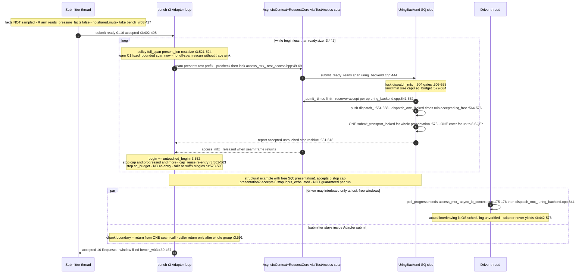
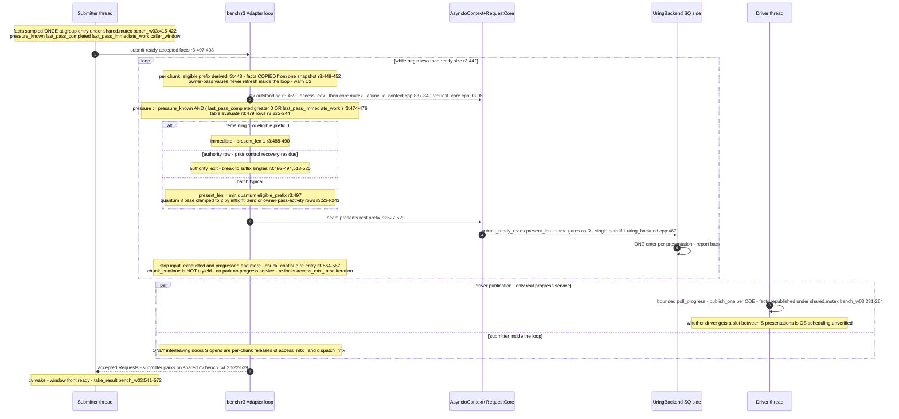
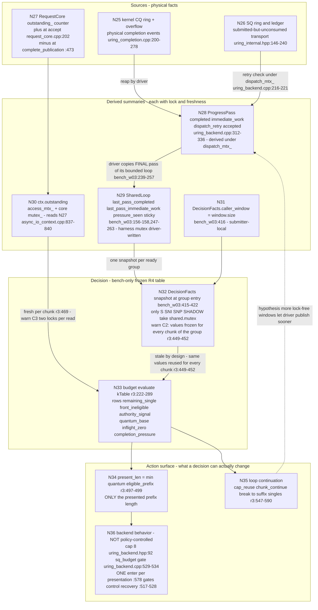
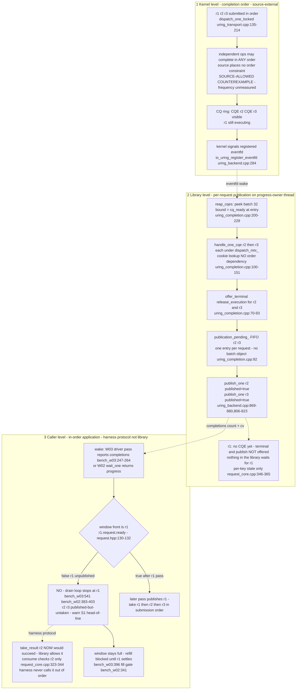
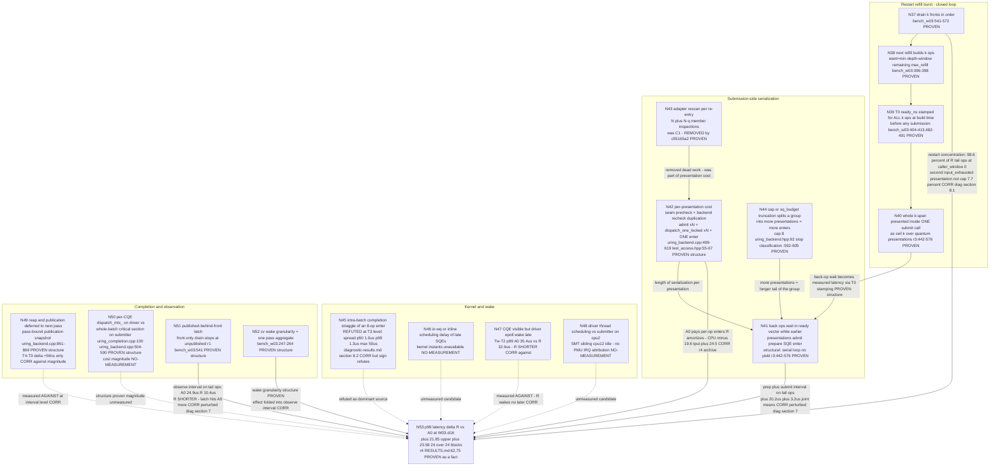

# #595 R5 Phase A — Actual Call-Pattern Graphs (G1–G5)

Deliverable: merged and refined execution graphs for the R4_ORIGINAL
implementation, plus the candidate p99 causal graph. Written by the R5 Phase A
synthesis writer on 2026-11-07 from the two R5 tracer/verifier materials
(`r5/analysis/call-patterns-submit.md`, `r5/analysis/call-patterns-complete.md`)
and the verifier reports (`r5/analysis/findings-c1-c4.md`,
`r5/analysis/findings-c5-c7.md`), with independent spot re-verification of the
cited source lines in the frozen tree during synthesis (see §7).

Baseline for every citation: the frozen R4_ORIGINAL tree
`f3b25329bc8a64a201961c426a58adacfb8fdf08` (read at
`/home/jnhu/sluice-595-e5/r5/worktree`; the branch has since advanced to the
R5 cleanup commits `c55165a2`/`b191bb89`, which are behavior-equivalent and do
not move any line cited here in the frozen tree). Diagnostic evidence cites the
R5 diag branch commit `21374a40` and the artifacts under `r5/raw-diag/`.

## SUMMARY (four questions, answered by the graphs)

1. **Where does the submission policy actually have scheduling control?**
   Exclusively in the bench adapter's presentation loop
   (`bench/r3_ready_batch.hpp:442-576`): the presented-prefix length
   `present_len = min(quantum, eligible_prefix)` (`r3:497-499`) and the
   re-entry rhythm (`cap_reuse` `r3:561-563`, `chunk_continue` `r3:564-567`,
   break to suffix singles `r3:573-590`). Everything below `AsyncIoContext` —
   the cap=8/sq_budget admission gate, exactly one `io_uring_enter` per
   presentation, reap/publication on the driver — is backend-owned source
   (`src/async/uring_backend.cpp:443-619`, `ready_batch_cap`
   `include/sluice/async/detail/uring_backend.hpp:92`). A chunk boundary is
   **not** a yield (C5 CONFIRMED): no park, no progress service, no caller
   return; the policy's only external lever is the *timing of
   `access_mtx_`/`dispatch_mtx_` release* between presentations.
2. **Verified vs hypothesis in the graphs.** Every solid edge is a source fact
   at the cited lines (or a deterministic check output); every dashed edge is
   an explicitly unverified hypothesis (§0). G5 grades the p99 candidate edges
   a third way: PROVEN / CORRELATION-ONLY / NO-MEASUREMENT.
3. **What the graphs show about the tail.** The completion side has three
   distinct order levels (kernel completion order → per-request publication in
   CQ-reap order → caller front-only application, a harness protocol), and the
   observation latch plus the restart-refill burst structure are the two
   structural features G5 ties to p99 (lead-level; see TAIL_ANALYSIS.md).
4. **Problems marked on the figures** (this round's findings): ⚠C1 rescan,
   ⚠C2 mislabeled signal, ⚠C3 lock tax, ⚠C4 `outstanding()` semantics,
   ⚠S1 spurious wake + head-of-line, ⚠S4 publication lag, ⚠X1 W02/W03
   divergence — each defined in §1 legend with its verdict.

---

## 0. Edge and evidence conventions (harmonized)

The two tracer materials used different arrow conventions (submit-side:
solid=verified / dotted=hypothesis; completion-side: solid=same-thread /
dashed=cross-thread / dotted=harness-protocol). This document harmonizes to a
single convention, per the round instruction:

- **Solid `-->`** — PROVEN: a same-thread call, data flow, or ordering
  verified at cited `path:line` in the frozen tree, or produced by a
  deterministic check run this round. Cross-thread *mechanisms* that are
  source-verified (kernel eventfd write on CQE posting; `cv.notify_all`)
  are also drawn solid, with a `notify` label; only their *per-run timing
  effect* is scheduling-dependent (noted in figure notes).
- **Dashed `-.->`** — HYPOTHESIS: a causal/temporal claim this repository
  cannot verify from source (OS scheduling interleavings, kernel-internal
  routing, unmeasured magnitudes). Never a completion edge unless the label
  says so.
- Edge label types: `call` (same-thread invocation), `queue` (hand-off through
  a data structure under a lock), `notify` (fd/epoch/cv wake signal — a
  notification, never itself a completion), `wait` (park).
- Nodes suffixed `[kernel: unknown internals]` mark regions not observable
  from this codebase.
- **⚠ markers** place this round's confirmed findings directly on the figures
  (legend in §1).
- G5 uses a separate three-level grading (§6).

Every figure has at most 5 horizontal executors (submitter, driver,
context+core, backend, kernel).

### 0.1 Identifier mapping (frozen tree ↔ C2 rename)

All line citations are to the frozen R4_ORIGINAL tree `f3b25329`, which uses
the LEFT-column identifiers. The C2 cleanup commit `b191bb89`
(behavior-identical, equivalence-proven) renamed them to the RIGHT-column
identifiers on branch `research-595-r5`. This document uses the frozen names
at frozen-tree citation sites and may use the new names when describing the
post-rename state or the semantics the rename encodes:

| Frozen `f3b25329` | After C2 `b191bb89` |
|---|---|
| `DecisionFacts::pressure_known` | `owner_pass_sampled` |
| `BudgetVariant::read_pressure` / `Adapter::reads_pressure_facts` | `read_owner_pass_activity` / `reads_owner_pass_facts` |
| `budget::Input::pressure_hint_active` / `pressure` | `owner_pass_activity_hint_active` / `owner_pass_had_activity` |
| decision-table row `completion_pressure` | `owner_pass_activity` |
| `DecisionRecord::{pressure_read, pressure, pressure_known}` | `{owner_pass_activity_read, owner_pass_had_activity, owner_pass_sampled}` |
| harness `SharedLoop::pressure_seen` | `owner_pass_sampled` |
| diag-line labels `pressure*` | `owner_pass_*` |

Arm tokens SNI/SNP and the `r4_*` record/counter schema (including
`r4_pressure_decisions`) were deliberately NOT renamed (frozen R4 evidence
join keys).

---

## 1. G1 — End-to-end executors and queues (W03 shape, d16 case)

### 1.0 Arm glossary (tokens as defined at `bench/r3_ready_batch.hpp:29-39,160-181`)

| Token | Arm name | Meaning (verified at the cited lines) |
|---|---|---|
| A0 | IMMEDIATE | product per-op path: `ctx.submit_read` per ReadOp; the adapter is **not constructed** for `a0` (`bench_w03:337-339`) |
| R | READY_REUSE | full-span presentation; re-present the suffix on `stop=cap` (`reuse_on_cap=true, budgeted=false`) |
| S | STATE_AWARE | budgeted decision table with both hints (inflight read + owner-pass facts) |
| SNI | S_NO_INFLIGHT | budgeted, reads owner-pass facts only — no `outstanding()` read |
| SNP | S_NO_PRESSURE | budgeted, reads `outstanding()` only — no owner-pass facts |
| Q2 / Q8 | pinned quantum | budgeted table with pinned quantum 2 / 8, no hints |
| SHADOW | shadow | acts exactly as R (full-span, cap re-entry) but evaluates the S table and logs the counterfactual decision |
| B | FIXED_PREFIX | one full-span presentation, **no** cap re-entry — the remainder goes through the per-op suffix-singles loop (`reuse_on_cap=false, budgeted=false`); this is the R4 "B supplement" baseline arm (R3_FIXED_PREFIX). Not to be confused with Candidate B or the budget variable `B_ops` in NEXT_EXPERIMENT.md |

Five executors. `io-wq` lives inside the kernel region: R4 attributed its cost
only by 10 ms time-bucket accounting (`r4/RESULTS.md:212-224`), never by
tracing; it is drawn as unknown.

```mermaid
flowchart LR
  subgraph SUBM["Submitter thread - bench main"]
    W["N1 caller window deque of Inflight<br/>submitter-private<br/>bench_w03_external_loop.cpp:377,461-467"]
    RV["N2 ready vector of ReadOps<br/>want=min depth-window, remaining, max_refill<br/>bench_w03:396-398 - T0 ready_ns stamped per op at build<br/>bench_w03:404-413"]
    AD["N3 bench r3 Adapter presentation loop<br/>r3_ready_batch.hpp:442-576<br/>warn C1: full-span rescan per re-entry at r3:448 - fixed by c55165a2<br/>warn C2: signal named pressure is owner-pass activity - renamed by b191bb89<br/>warn C3: per-decision outstanding read takes 2 locks - r3:469"]
    OBS["N4 Request ready and take_result<br/>request.hpp:130-159<br/>warn S1: front-only drain - published-behind-front unobservable"]
  end

  subgraph DRV["Driver thread - progress owner"]
    EP["N5 epoll_wait on notification eventfd<br/>bench_w03:207-217"]
    ACK["N6 acknowledge_progress_notification<br/>eventfd drain - async_io_context.cpp:720-748"]
    PP["N7 ctx.poll_progress bounded pass loop<br/>bench_w03:231-245 -&gt; poll_progress<br/>async_io_context.cpp:437-443 -&gt; poll<br/>uring_backend.cpp:839-912"]
    SF["N8 SharedLoop facts publish under shared.mutex<br/>bench_w03:247-264<br/>warn C2: last_pass_completed counts work already published"]
  end

  subgraph CTX["AsyncIoContext + RequestCore<br/>locks access_mtx_ and core mutex_"]
    SR["N9 submit_read - A0 product entry<br/>async_io_context.cpp:245-265"]
    SEAM["N10 TestAccess context_submit_ready_reads<br/>bench arms entry - holds access_mtx_ at :69<br/>test_access.hpp:49-135"]
    CORE["N11 RequestCore slots<br/>reserve accept outstanding++ at request_core.cpp:202<br/>begin complete_publication outstanding-- at :473<br/>warn C4: outstanding = accepted AND not published"]
    OUTST["N12 ctx.outstanding<br/>async_io_context.cpp:837-840 -&gt; request_core.cpp:93-96<br/>takes access_mtx_ then core mutex_"]
  end

  subgraph BK["UringAsyncBackend - lock dispatch_mtx_"]
    SRR["N13 submit_ready_reads<br/>single path :467-497 / grouped :499-619<br/>dispatch_mtx_ at :504 - limit=min size cap8 sq_budget :529-534"]
    DQ["N14 dispatch_ BoundedDispatchQueue<br/>uring_internal.hpp:83-144"]
    DSP["N15 dispatch_one_locked<br/>get_sqe claim_execution prep_read cookie ledger<br/>uring_transport.cpp:135-214"]
    ENT["N16 submit_transport_locked - one io_uring_submit<br/>uring_transport.cpp:223-240"]
    CQ["N17 CQ ring + overflow flag"]
    REAP["N18 reap_cqes - driver only<br/>peek batch 32 - per-CQE handle_one_cqe<br/>takes dispatch_mtx_ per CQE at uring_completion.cpp:100<br/>warn C3: driver per-CQE vs submitter whole-batch critical section"]
    PBQ["N19 publication_pending_ FIFO - one entry per request<br/>uring_completion.cpp:92"]
    PUB["N20 publish_one outside lock<br/>begin complete_publication then deliver_event<br/>uring_backend.cpp:801-837<br/>warn S4: publication can lag its CQE by one pass"]
  end

  subgraph KER["Kernel - unknown internals"]
    KSUB["N21 io_uring_enter syscall boundary<br/>called at uring_transport.cpp:233-236<br/>liburing internals not traced"]
    KEX["N22 opcode execution - inline or io-wq<br/>unknown"]
    KCQE["N23 CQE posting + registered eventfd write<br/>registration verified uring_backend.cpp:281-286"]
    EFD["N24 eventfd - ProgressSource-owned<br/>progress_source.hpp:75"]
  end

  W -->|"refill builds"| RV
  RV -->|"call span once per refill group - bench_w03:423-424"| AD
  RV -->|"call A0 per-op direct ctx.submit_read bench_w03:482-504<br/>adapter NOT constructed for a0 bench_w03:337-339"| SR
  AD -->|"call R and S span prefix r3:527-529"| SEAM
  SR -->|"call under access_mtx_"| SRR
  SEAM -->|"call still under access_mtx_"| SRR
  SRR -->|"admit under dispatch_mtx_ + core mutex_"| CORE
  SRR -->|"queue push"| DQ
  SRR -->|"call per accepted op"| DSP
  DQ -->|"pop"| DSP
  DSP -->|"append ledger + SQE data"| ENT
  ENT -->|"call once per presentation"| KSUB
  KSUB -->|"queue SQEs"| KEX
  KEX -->|"completion data"| KCQE
  KCQE -->|"data"| CQ
  KCQE -->|"notify eventfd write"| EFD
  EFD -->|"notify epoll readable"| EP
  EP -->|"call"| ACK
  ACK -->|"call"| PP
  PP -->|"dispatch residue + one enter uring_backend.cpp:843-857"| ENT
  PP -->|"call"| REAP
  REAP -->|"pop CQEs"| CQ
  REAP -->|"call per CQE under dispatch_mtx_"| CORE
  REAP -->|"queue handles"| PBQ
  PP -->|"pop under dispatch_mtx_ :864-875"| PBQ
  PBQ -->|"call"| PUB
  PUB -->|"call"| CORE
  PUB -->|"notify sink on_ready - no-op in bench builds<br/>uring_backend.cpp:833-837"| OBS
  PP -->|"publish pass facts + cv.notify_all bench_w03:247-264"| SF
  SF -->|"queue facts under shared.mutex - one snapshot per refill group bench_w03:415-422"| AD
  AD -->|"call ctx.outstanding per decision - S SNP SHADOW r3:469"| OUTST
  SF -->|"notify cv.notify_all ends submitter park bench_w03:264,522-539"| OBS
  AD -.->|"hypothesis chunk boundaries give driver lock-free windows"| PP
```



Figure notes (verified unless marked):

1. **Notification is never completion.** Two notify edges reach the same
   eventfd: (a) the kernel writes the registered eventfd when posting CQEs
   (`io_uring_register_eventfd`, `uring_backend.cpp:281-286`); (b) userspace
   `ProgressSource::signal()` also `::write`s it (`wake_notification_nolock_`,
   `progress_source.hpp:434-457`, write at `:441`) for residue advertisement
   (`uring_backend.cpp:614-617`), zero-op publication, admission close,
   poison, cancel wins and dispatch failures (enumerated in
   `call-patterns-complete.md` §1.7). The eventfd only wakes the driver's
   epoll (`bench_w03:209`); it never marks a request complete.
2. **Ownership:** `dispatch_`, `publication_pending_`, ledger, router and
   SQ/CQ access are serialized by `dispatch_mtx_` (`uring_backend.hpp:363-365`);
   the caller window deque is submitter-private; the facts channel
   (`SharedLoop`) is harness-owned under its own mutex.
3. **Publication is driver-thread-only in W03**: no submit-path code reaps or
   publishes (`submit_ready_reads` `uring_backend.cpp:443-619` and
   `dispatch_after_accept` `uring_transport.cpp:48-107` contain no reap call;
   `reap_cqes` is called only from `poll()` `uring_backend.cpp:859`). The
   driver pass *also* drains dispatch residue and issues one enter
   (`uring_backend.cpp:843-857`) — the only submit-side work on the driver.
4. **The driver's pass loop breaks on `!immediate_work_remains`**
   (`bench_w03:231-245`), so the published `last_pass_immediate_work` is false
   by construction on normal exit — one root of ⚠C2.
5. **[kernel: unknown internals]** whether an opcode runs inline or on io-wq,
   and the eventfd write point, are not derivable from this repo; R4's io-wq
   figure is time-bucket attribution only (`r4/RESULTS.md:212-224`).
6. **Hypothesis edges**: whether the driver actually obtains
   `access_mtx_`/`dispatch_mtx_` between two adapter presentations on a given
   run is OS scheduling — source shows only that the doors open
   (`async_io_context.cpp:175-176`, `uring_backend.cpp:844,864`); no yield or
   park exists on the submit path (C5 CONFIRMED,
   `findings-c5-c7.md` §C5.1-5.2). The cv-wake edge
   (`SF → OBS`) is drawn solid because the *mechanism* is source-verified
   (`cv.notify_all` after each publication batch, `bench_w03:264`, ends a
   `cv.wait_for` *wait attempt* at `:522-539` — a potential park: the
   predicate may already hold, in which case no block occurs; corrected
   2026-11-07, F4); only *when* the driver gets to publish
   relative to the submitter's presentations is scheduling-dependent (the
   remaining dashed edge `AD -.-> PP`).

### Legend — this round's findings marked on the figures

| Marker | Finding | Verdict | Where fixed / documented |
|---|---|---|---|
| ⚠C1 | Adapter re-derived the full-span eligible prefix on every loop re-entry before any budget decision (N+（N−q)+… member inspections per group) | CONFIRMED | Fixed by `c55165a2` (bounded scan, equivalence proven) — `CODE_FINDINGS_AND_FIXES.md` §1 |
| ⚠C2 | The signal named `pressure` is owner-pass activity (work already published), sticky, frozen per refill group — not pending completion pressure | CONFIRMED | Renamed by `b191bb89` (naming only) — §2 below |
| ⚠C3 | `outstanding()` is not a free read (access_mtx_ + core mutex_ per decision); S ≈8 double-lock reads per d16 group, SHADOW ≈2, R 0; per-presentation access_mtx_×1 + dispatch_mtx_×1; per accepted op core mutex_×3 | CONFIRMED | Caliber correction only (no code change) — §3 below |
| ⚠C4 | `outstanding()` counts accepted∧not-yet-published slots — a drain detector, not "kernel inflight" | CONFIRMED | Naming/documentation only — §4 below |
| ⚠S1 | Submitter can wake, find an unpublished window front, take nothing, re-park (spurious wake coupled with head-of-line blocking); frequency unmeasured | structural, confirmed | `call-patterns-complete.md` §6 |
| ⚠S4 | Publication can lag its own CQE by one pass (pass-bound snapshot `uring_backend.cpp:861-869`) | structural, confirmed | `call-patterns-complete.md` §6 |
| ⚠X1 | Same policy, opposite W02/W03 behavior: W02 steady state presents singles (batch policy never engages), W03 presents drain-sized groups (policy engages for real) | CONFIRMED | §5 below |

---

## 2. G2 — Sequence for one 16-ReadOp ready group (W03-d16 shape)

Preamble common to all arms: the group is built only when the caller window
has room — `want = min(depth − window.size(), request_count − submitted,
max_refill)` (`bench_w03:396-398`); each op takes buffer slot
`sequence % depth` (`:404-413`); the latency origin `ready_ns` is stamped at
ReadOp build time (`:373,413`) for **all** ops of the group before any is
submitted. The 8+8 / 2+2+… shapes below are structural examples of the
mechanism, not a claim that every run looks like this — sq_budget
(`uring_backend.cpp:529-531`), core capacity refusals
(`request_core.cpp:170-175`) and partial windows change actual counts.

### 2.1 A0 (IMMEDIATE product path)

```mermaid
sequenceDiagram
  autonumber
  participant S as Submitter thread
  participant AC as AsyncIoContext+RequestCore
  participant BK as UringBackend SQ side
  participant K as Kernel unknown
  participant D as Driver thread

  Note over S: build 16 ReadOps, stamp ready_ns each - bench_w03:482-491
  loop each of 16 ops - bench_w03:482-504
    S->>AC: ctx.submit_read op - lock access_mtx_ async_io_context.cpp:245-255
    AC->>BK: submit_read to submit_request to admit_ uring_backend.cpp:735-757,633-733
    Note over BK: admit_ - dispatch_mtx_ fatal check :653 reset_delivery :710<br/>core reserve+accept outstanding++ request_core.cpp:165-209
    BK->>BK: dispatch_after_accept - lock dispatch_mtx_ :54 push dispatch_ :77
    BK->>BK: dispatch_one_locked - get_sqe claim_execution prep_read ledger uring_transport.cpp:135-214
    BK->>K: submit_transport_locked - ONE enter PER OP uring_transport.cpp:223-240
    Note over K: enter return is not completion - execution start unobservable
    K-->>BK: rc greater than 0 - ledger pops rc entries uring_transport.cpp:247-261
    BK-->>S: Request handle - access_mtx_ released async_io_context.cpp:262-264
  end
  par driver runs concurrently - thread scheduling unverified
    D->>D: epoll_wait wake then poll_progress loop bench_w03:207-245
    D->>BK: reap_cqes bounded by CQ-ready-at-entry uring_completion.cpp:200-278
    D->>AC: offer_terminal + release_execution per CQE uring_completion.cpp:70,89-92
    D->>AC: publish_one - complete_publication outstanding-- + deliver_event uring_backend.cpp:801-837
    D-->>S: shared.cv.notify after publishing facts bench_w03:247-264
  and submitter continues
    S->>S: wait on shared.cv for completions greater than watermark bench_w03:522-539 (potential park; predicate may already hold - corrected 2026-11-07)
  end
  S->>AC: window front Request ready then take_result bench_w03:541-572
```

Verified per-op lock traffic for A0: `access_mtx_`×1, `dispatch_mtx_`×3
(`admit_` fatal check `uring_backend.cpp:653`, `reset_delivery` `:710`,
`dispatch_after_accept` `uring_transport.cpp:54`), core `mutex_`×3 (reserve,
accept, claim_execution), and **one `io_uring_submit` per op** (each
`dispatch_after_accept` ends in `submit_transport_locked`,
`uring_transport.cpp:91-92`).

Consistency with G1: A0 in W03 does **not** construct the adapter
(`bench_w03:337-339`); the submitter calls `ctx.submit_read` per op directly
(`:482-504`), which is why G1 draws the A0 edge from the ready-build node
rather than through the adapter node. (The adapter's internal A0 fallback at
`r3:411-414`/product singles `r3:595-605` exists for batch arms whose seam
call returns no backend — it is not the A0 arm's path.)

Stats-gated lock caveat (matches C3's per-presentation row): the extra
core-`mutex_` acquisition of `note_outstanding` (`uring_backend.cpp:459-465`,
called at `:495` single path and `:610` grouped path) exists only inside the
seam/batch entry `submit_ready_reads`. The A0 product path
(`submit_read → submit_request`, `uring_backend.cpp:735-757`) contains no
`note_outstanding` call, so it does not apply to A0 per-op submits — and the
R4 timed blocks and the R5 diagnostic both ran with `SLUICE_BENCH_STATS=0`
in any case (block env, `r4/raw/matrix/MAIN-W03-D16/block-00.json`;
`r5/raw-diag/matrix/manifest.json`).

### 2.2 R (READY_REUSE)



Verified R-specific facts: no facts-channel read (`reads_pressure_facts()` =
`read_pressure || shadow`, both false for R, `r3:375-378`); no
`ctx_.outstanding()` call (gated on `read_inflight || shadow`, `r3:467-471`);
re-entry only on `cap`; `sq_budget`/`rejected` stops break to the
suffix-singles loop (`r3:547-551,573-575`), which presents spans of 1 (backend
single path `uring_backend.cpp:467-497`). T0 for all 16 ops was stamped at
build time, so the back 8 ops' measured latency includes the first
presentation's admit+dispatch+enter — the structural root of the G5 restart
lead.

### 2.3 S (STATE_AWARE)



Structural example only: with owner-pass activity true for the whole group, S
presents 2+2+2+2+2+2+2+2 (8 presentations, 8 enters) for a 16-op group; with
it false and outstanding>0 it degenerates to R's 8+8 shape driven by
`chunk_continue`. Which happens when is workload- and scheduler-dependent
[unverified beyond R4 counters: 99.92% completion_pressure / 99.97% quantum-2
decisions, `r4/RESULTS.md:199-206`].

Group-size context (so the presentation/enter counts are not misread): for
the MAIN case `W03-uring-4k-d16`, `max_refill=0` ⇒ effective refill bound =
`depth` = 16 (`bench_w03:384-385` fills `want = min(depth − window.size(),
remaining, max_refill)` at `:396-398`), so a **fully drained** window
restarts with a 16-op group (S: 8 presentations/8 enters; R: 2/2). In
**steady state** `want = depth − window.size() < 16`, and R4's frozen
counters give mean ready 7.92 per decision (`r4/RESULTS.md:204-206`) — a mean
group of ≈8 ops, i.e. ≈4 quantum-2 presentations/enters per group for S. The
8-presentation figure is the full-restart case; the ≈4 figure is the
steady-state mean; companion documents name their corpus when quoting either.

**Small-batch boundary audit (verified, answers the round's control-point
question directly):**

- A chunk boundary does **not** return to the caller: the loop stays inside
  `Adapter::submit` (`r3:442-576`); the caller regains control only when the
  whole group is disposed (`r3:591`) or an error/authority exit breaks out.
- Locks released at a chunk boundary: `access_mtx_` and `dispatch_mtx_` (each
  per-presentation acquisition is scoped to the seam/backend call frames,
  `test_access.hpp:69`, `uring_backend.cpp:504`) — plus, for S/SNP/SHADOW,
  the `access_mtx_`+core-`mutex_` pair of the per-chunk `outstanding()` read.
- No actual progress/observation service exists on the submit path — only
  *opportunistic* lock-free windows; the submitter never reaps/publishes
  itself (G1 note 3); facts never refresh mid-group (`r3:449-452`).
- `enter` return is bookkeeping only (`uring_transport.cpp:238-261`);
  completions are exclusively CQ-side.

---

## 3. G3 — Information sources → propagation → decision → action



### Signal audit table (verified)

| Signal | True definition | Kind | Produced / copied | Freshness at decision | Locks on the path |
|---|---|---|---|---|---|
| `outstanding()` | `RequestCore::outstanding_` = slots accepted-but-not-published (`request_core.cpp:202,473`) — includes undispatched, kernel-in-flight, and already-reaped-but-unpublished ops; **excludes** published-but-uncollected | current residue | `+` at accept (any thread), `−` only at `complete_publication` on the driver thread | fresh (read per chunk, `r3:469`) | `access_mtx_` + core `mutex_` |
| `last_pass_completed` | completions published by the **final** pass of the driver's bounded loop (`bench_w03:239-245` records only the last iteration) | past-event summary | driver → `SharedLoop` under harness mutex (`:248-263`) | stale: frozen at group entry (`bench_w03:415-422`) | harness `shared.mutex` |
| `last_pass_immediate_work` | final pass's `immediate_work_remains`; on normal loop exit **false by construction** (loop breaks when the flag clears, `bench_w03:242-244`) | past-event summary | same channel | same | same |
| `owner_pass_sampled` (was `pressure_known`) | sticky once ANY driver pass has run (`bench_w03:158,257,421`) | liveness witness, not freshness | same channel | monotone true | same |
| owner-pass activity (was `pressure`) | `owner_pass_sampled && (last_pass_completed>0 ‖ last_pass_immediate_work)` (`r3:474-476`) ≈ "the driver's final pass published ≥1 completion" | proxy | adapter-local | frozen per group | composed |
| `caller_window` | submitter's own deque size | current residue (caller side) | submitter-local (`bench_w03:416`) | fresh at group entry | none |
| `residue_advertised` | backend still holds undispatched/unsubmitted accepted work after the presentation (`uring_backend.cpp:586-588`; `dispatch_retry_remains_locked_` `uring_transport.cpp:216-221`) | current backend residue | backend report → adapter latch (`r3:556,460`) | fresh per presentation | `dispatch_mtx_` |

### What the quantum actually changes (and does not)

Verified: selecting `quantum` changes **only** (a) the presented prefix length
(`r3:497-499`) and (b) how many presentations/enters the group is chopped into
via re-entry (`r3:559-575`). It does **not** change the backend cap (8), the
sq_budget arithmetic (`uring_backend.cpp:529-534`), the one-enter-per-
presentation rule (`:578`), or any wait semantics. It also does not change
driver wakes: the primary wake source is the kernel's CQE eventfd write
(G1 note 1), and the wakes the *library itself* initiates via
`ProgressSource::signal()` occur on the enumerated non-CQE paths — residue
advertisement (`uring_backend.cpp:614-617`), zero-op publication
(`:794-798`), admission close (`:914-927`), poison
(`uring_transport.cpp:528`), cancel wins (`:606-620`), and dispatch failures
(`:103-106`) — none of which the quantum touches. There is no
continuous-work budget object and no executor-scheduling
knob anywhere in the submit path; the decision's only lever on the rest of the
system is the timing of lock release between presentations.

---

## 4. G4 — Completion order vs observation order, and the buffer contract

Three strictly distinct levels (do not merge them):

1. **Kernel completion order**: independent ops may complete in any order; the
   library never depends on order (cookie-routed lookup with no order
   assumption, `uring_transport.cpp:556-562`; per-CQE terminal with no
   predecessor check, `uring_completion.cpp:99-198`). Frequency of reordering
   on tmpfs/E5: unmeasured — kernel behavior.
2. **Library per-request publication**: publication order = CQ-reap order
   within a pass (`publication_pending_` FIFO, `uring_completion.cpp:92`;
   publication sweep `uring_backend.cpp:861-880`). Each request is published
   individually the moment its own CQE is reaped; an unpublished r1 never
   blocks publication of r2/r3.
3. **Caller in-order application**: both R4 harnesses consume strictly from
   `window.front()` (W03 `bench_w03:541-572`; W02 `bench_w02:383-403`, r3 arms
   `:602-644`). This is a **harness protocol**, not a library mechanism:
   `take_result(r2)` while r1 is pending would succeed immediately
   (`consume_public_result` checks only r2's own `published`,
   `request_core.cpp:323-344`).

### G4 diagram — source-allowed counterexample (r1 outstanding, r2/r3 published)



Reading of the counterexample edges: `window.front().request.ready()` does
stop the drain loop (`bench_w03:541`) and a full window stops refill — but
this is caller protocol; it cannot block `take_result` at the library level
(each `Request` resolves independently, `request_core.cpp:121-163,323-344`).
The only library-side ordering constraint is within-pass FIFO publication,
which orders by CQ reap order — not submission order, not a batch.

### Buffer reuse, slot/generation, in-order delivery (verified)

- **Library buffers are caller-owned raw pointers.** `ReadOp.dst` is captured
  into `prepared_ops_[slot]` at admission (`uring_backend.cpp:698-705`) and
  passed to `io_uring_prep_read` at dispatch (`uring_transport.cpp:171-175`);
  `admit_` performs no aliasing check (caller obligation).
- **Library slot/generation recycling is consumption-gated**: a core slot is
  reclaimed only when published, binding dropped, control/execution refs zero,
  publication not in flight, observer retired (`request_core.cpp:580-590`);
  `release_slot_` bumps `generation` and pushes to the free list; `reserve()`
  pops LIFO (`:165-182`). With front-only consumption, library slots recycle
  in consumption order. The router entry retires earlier, at CQE time
  (`uring_completion.cpp:94-96`).
- **`sequence % depth` reuse safety, per harness phase:**
  - W03 (A0 `bench_w03:484`, arms `:406`): **safe** — window holds consecutive
    sequences with size ≤ depth (fill gate `:396`, FIFO pop `:571`), so two
    in-window sequences never collide mod depth; relies on in-order
    application keeping the window contiguous.
  - W02 sliding-window and W02-r3 arms (`bench_w02:332-337,441`;
    `:526-529,673`): explicit `free_slots` LIFO freed only after the owning
    request is taken (harness comment states the contract `:330-333`).
  - W02 saturating phase (`:249`): `sequence % depth` safe via the admission
    bound (`request_capacity == depth` → `would_block` closes the fill).
- **Documented hazard (C6)**: a naive "scan the deque, consume whoever is
  ready" change breaks the W03 proof — out-of-order pops leave gaps and admit
  `sequence + depth` reusing the buffer of an in-flight op. Minimal
  counterexample (depth=4): window {s0,s1,s2,s3}; s1..s3 ready and popped;
  window {s0} (size 1<4) → refill builds s4, slot 0 = s0's slot → the kernel
  starts a second read into `buffers[0]` while s0's read may still be writing
  it → corrupted data. The round's prohibition on deque-scan +
  old-slot-allocation is necessary, not stylistic.

---

## 5. W02 vs W03 — why the same policy behaves oppositely (verified)

| Dimension | W02 `bench_w02_pipeline.cpp` | W03 `bench_w03_external_loop.cpp` |
|---|---|---|
| Threads | 1: submitter == consumer == progress owner (RequestScope holds owner) | 2: main submitter/consumer + driver thread owning progress (`:182-195`) |
| Presentation granularity | steady state consumes 1 then refills 1 → adapter presents a single op every round (`remaining_single→immediate`, `r3:223-225,283-284`; `bench_w02:602-644,539-542`) — **batch policy never engages after initial fill** (⚠X1) | presents previous cycle's drained count k (≤depth) as a group; quantum/budget decisions engage for real |
| Decision facts | not passed — 2-arg `adapter.submit` (`bench_w02:560`) → `DecisionFacts{}`: `pressure_known=false` (frozen name; `owner_pass_sampled` after C2), `caller_window=0` (`r3:402-405`); no `DecisionFacts` site exists in the file | driver publishes pass facts per pass (`:247-264`); S/SNI/SNP/SHADOW snapshot per presentation group (`:415-422`) |
| Wake path | consumer parks in `wait_one` directly on the eventfd — one hop (`async_io_context.cpp:569-700`) | submitter parks on `SharedLoop` cv waiting for the driver's aggregated per-pass completions count — kernel→driver→cv→submitter, two hops; wake granularity = one pass's aggregate |
| Buffer reuse | free_slots LIFO, freed only after take (`:332-337,441`; r3 `:526-529,673`); saturating phase `sequence%depth` (`:249`) | `sequence % depth` (`:406,:484`), safe under FIFO+capacity≤depth |
| Consumption | strictly oldest-one-per-iteration (`:383-403` / r3 `:602-644`); `any_ready` is a threadpool-only diagnostic switch, unused by R4 uring arms | drains all consecutive ready fronts (`:541-572`) |
| Cross-thread locks | none (single thread) — same policy has zero lock contention cost | per-CQE `dispatch_mtx_` (driver) vs whole-batch critical section (submitter, `uring_backend.cpp:504-590`) — real cross-thread mutex point (⚠C3) |
| `outstanding()` hint | never activated (facts not passed) | active for S/SNP/SHADOW; equals 0 at whole-window refill moments right after drain — structurally unrelated to real pressure (⚠C4, R4 SNP anomaly) |
| Case matrix (uring) | d1/d4/d16/d64 (d2 opt-in; **no d3 case** — matches R4 W02-d3 NOT_RUN_WITH_REASON) | d4/d16/d64 + research d2pos/d2serial/d3/d16cap/64k; `max_refill` caps the group (`:397-398`) — d2serial (`max_refill=1`) presents one op at a time so every SHADOW decision sees `outstanding()==0` (structural zero, source-provable) |

Consequence (structural; numeric outcomes belong to the R4 archive): on W02
every arm reduces to A0's behavior plus per-presentation decision overhead —
consistent with R4's uniform W02 regressions; on W03 R amortizes
`io_uring_submit` across the freed group while S clamps to quantum 2 — the
same policy code acts on different objects in the two workloads.

---

## 6. G5 — Candidate p99 causal graph (W03-d16, R vs A0)

Purpose: locate R's p99 +21.85% (upper +23.58%, 24/24 blocks positive,
`r4/RESULTS.md:62,75`). This is a **candidate DAG, deliberately not a single
chain**: several mechanisms can co-occur; each edge carries a three-level
grade:

- **[P] PROVEN (已证)** — deterministic source fact, deterministic check
  output, or two independent lines agreeing.
- **[C] CORRELATION-ONLY (仅相关)** — measured association (R4 archived
  counters, or the R5 diagnostic in perturbed mode) without attribution
  power.
- **[M] NO-MEASUREMENT (缺测量)** — plausible mechanism with no measurement
  at all.

The R5 phase-decomposition diagnostic (executed 2026-11-06,
`r5/analysis/diagnostic-results.md`) **failed its on/off perturbation
acceptance window** (+3.39pp/+3.96pp > ±3pp), so per its frozen protocol all
its interval numbers are leads; every edge whose only support is that
diagnostic is graded [C], never [P].



### G5 edge table (grade, evidence, and what would change it)

| # | Edge (from → to) | Grade | Evidence | What would raise/lower the grade |
|---|---|---|---|---|
| E1 | drain k → refill k (N37→N38) | [P] | `bench_w03:396-398,541-572` (read this session) | — |
| E2 | refill stamps T0 for all k (N39) | [P] | `bench_w03:404-413,482-491`; diag T0 coverage 480,000/480,000 | — |
| E3 | one submit call presents whole span (N40) | [P] | `r3:442-576`, `bench_w03:423-424` | — |
| E4 | back-op queueing behind earlier presentations (N40→N41) | [P] structure | serial loop, no yield (`r3:442-576`; C5 CONFIRMED) | — |
| E5 | queueing → p99 via T0→T1 (N41→N53) | [C] | perturbed diag: prep Δp99 +25,230 ns; tail-mean +20.2 µs (`diagnostic-results.md` §6-7) | a passing on/off check + ≥1 more session would make it an attribution |
| E6 | per-presentation cost → serialization length (N42→N41) | [P] structure | `uring_backend.cpp:499-619`, `test_access.hpp:55-67` (triple eligibility check: adapter mirror `r3:184-196` + seam precheck + backend recheck `uring_backend.cpp:437-439,537`) | magnitude of each component: not measured |
| E7 | C1 rescan removed (N43) | [P] | source-level counts N+(N−q)+… cross-checked against R4 counters (`findings-c1-c4.md` §C1); fix `c55165a2` with 18/18 oracle byte-identity | — |
| E8 | cap/sq_budget truncation → more presentations (N44→N41) | [P] | `uring_backend.hpp:92`, `uring_backend.cpp:592-605`; R4 counters 2,508 presentations/1,236 cap re-entries per rep | — |
| E9 | enter amortization → CPU/throughput (N42→N53) | [C] | R4: R CPU −19.62%, tput +24.53% (`r4/RESULTS.md:58-60`) | causal direction established by arm design; graded [C] because p99 linkage is the open part |
| E10 | intra-batch straggle → p99 (N45→N53) | refuted at T3 | T3 spread within R 8-op presentations p50 1.03 µs / p99 1.34 µs (`diagnostic-results.md` §8.2) | keep refuted unless off-mode replication shows otherwise |
| E11 | io-wq/inline scheduling → p99 (N46→N53) | [M] | kernel instants unavailable by construction; io-wq CPU share 31.8–36.1% is bucket accounting only (`r4/RESULTS.md:212-224`) | kernel tracing (out of round constraints) |
| E12 | driver wake latency → p99 (N47→N53) | [C, against] | wake part Tw−T2 p99 A0 35,405 vs R 32,903 ns (R shorter) | — |
| E13 | thread placement/SMT → p99 (N48→N53) | [M] | both threads + io-wq pinned to cpu2; no PMU (paranoid=2), no IRQ attribution (`r4/RESULTS.md:439`) | PMU access or IRQ counters |
| E14 | publication deferral → p99 (N49→N53) | [C, against] | reap→publish T4−T3 Δp99 +59 ns | — |
| E15 | per-CQE vs whole-batch mutex → p99 (N50→N53) | [P] structure / [M] magnitude | `uring_completion.cpp:100`, `uring_backend.cpp:504-590` | lock-held-time instrumentation |
| E16 | published-behind-front latch → observe (N51→N53) | [P] structure, [C] magnitude | `bench_w03:541`; diag observe tail-mean A0 24.9 µs vs R 10.4 µs — the latch penalizes A0 more in this shape | — |
| E17 | cv aggregated wake → observe (N52→N53) | [P] structure | `bench_w03:247-264,522-539` | folded into observe interval |
| E18 | restart concentration of tail ops (R1→N53) | [C] | 98.6% of R tail ops at caller_window=0 (1,183 of the 1,200 pooled top-1% tail ops = 1% of the 120,000 on-mode ops per arm); 92 of those 1,200 in `stop=cap` presentations vs a 47.5% cap share among body ops (`diagnostic-results.md` §8.1) | off-mode replication |
| E19 | SNP wrong-moment clamp → p99 (not drawn; W03 SNP) | [P] structure, [C] outcome | `outstanding()==0` fires at drain moments; R4 SNP: 35% small batches, p99 +34.48 ≈ S level (`r4-archive/TAIL-LATENCY.md:50-65`) | — |

Reading: the only measured paths that point **toward** R's tail are
submission-side (E5, E6, E8, E18); the kernel-straggle, wake-latency and
reap/publication paths are measured **against** (E10, E12, E14) at the
interval level, all in perturbed mode; two structural candidates remain
unmeasured (E11, E13, E15 magnitude). A0's own tail is observe-dominated
(E16) — R currently *reduces* that component.

---

## 7. Node index (all against tree `f3b25329` unless noted)

Executors and harness (bench, research-only layer):

- `f3b25329:bench/bench_w03_external_loop.cpp:driver_thread:182-279` — driver
  thread: claim owner (`:183`), epoll (`:207-217`), bounded passes
  (`:231-245`), facts publish (`:247-264`), shutdown.
- `f3b25329:bench/bench_w03_external_loop.cpp:run_external_phase:281-623` —
  window/refill/ready build (`:396-414`), facts sample (`:415-422`), A0 loop
  (`:482-504`), cv park (`:522-539`), front-only drain (`:541-572`).
- `f3b25329:bench/bench_w03_external_loop.cpp:make_context:100-128` —
  `UringConfig.request_capacity=depth, queue_depth=depth` (`:115-118`).
- `f3b25329:bench/r3_ready_batch.hpp:arm_policy:29-40,160-182` — arm taxonomy.
- `f3b25329:bench/r3_ready_batch.hpp:DecisionFacts:135-145` — facts snapshot
  struct.
- `f3b25329:bench/r3_ready_batch.hpp:budget::kTable/evaluate:218-291` —
  frozen R4 decision table (rows `remaining_single`/`front_ineligible`/
  `authority_signal`/`quantum_base`/`inflight_zero`/`completion_pressure`).
- `f3b25329:bench/r3_ready_batch.hpp:batch_shaped_prefix:189-196` — eligible
  prefix scan (now bounded in policy input by `c55165a2`).
- `f3b25329:bench/r3_ready_batch.hpp:Adapter::submit:402-605` — presentation
  loop (`:442-576`); outstanding read (`:469`); pressure def (`:474-476`);
  present_len (`:497-499`); latches (`:553-558`); cap_reuse/chunk_continue
  (`:561-567`); break (`:573-575`); suffix singles (`:578-590`); product
  singles (`:595-605`).
- `f3b25329:bench/bench_w02_pipeline.cpp:run_pipeline_phase_r3:468-712` — W02
  single-thread submit + `wait_one` shape (`:560-561,602-654`), free_slots
  LIFO (`:332-337,441`), saturating `sequence%depth` (`:249`). (Function
  spans `:468-712`; the next definition, `fill_stats`, begins at `:714`.)
- `f3b25329:xmake/bench.lua:bench targets:1-40` — bench links shipped
  archives; no internal-testing define (production library code measured).

Context / seam / core:

- `f3b25329:src/async/async_io_context.cpp:submit_read:245-265` — A0 product
  entry.
- `f3b25329:src/async/async_io_context.cpp:poll_progress/run_progress_pass_:425-443`
  — driver pass entry (`drive_entry_admitted_` `:175-192` takes
  `access_mtx_`).
- `f3b25329:src/async/async_io_context.cpp:wait_one:569-700` — W02 park+drive.
- `f3b25329:src/async/async_io_context.cpp:outstanding:837-840` —
  `access_mtx_` + backend delegation.
- `f3b25329:src/async/async_io_context.cpp:acknowledge_progress_notification:720-748`.
- `f3b25329:include/sluice/async/detail/test_access.hpp:context_submit_ready_reads:49-135`
  — seam: precheck (`:55-67`), `access_mtx_` (`:69`), lock-order comment
  (`:47`).
- `f3b25329:src/async/detail/request_core.cpp:reserve/accept:165-209` —
  admission, `outstanding_++` at `:202`.
- `f3b25329:src/async/detail/request_core.cpp:outstanding_summary:93-96`.
- `f3b25329:src/async/detail/request_core.cpp:offer_terminal:346-365`,
  `release_execution:393-409`, `consume_public_result:323-344`,
  `begin/complete_publication:438-484` (`outstanding_--` at `:473`), slot
  reclaim `:580-631`.

Backend SQ side (submission):

- `f3b25329:src/async/uring_backend.cpp:UringAsyncBackend ctor:169-216`.
- `f3b25329:src/async/uring_backend.cpp:batch_eligible_read:437-439`.
- `f3b25329:src/async/uring_backend.cpp:submit_ready_reads:443-619` — single
  path `:467-497`; grouped: `dispatch_mtx_` `:504`, gates `:505-528`,
  sq_budget limit `:529-534`, admit loop `:536-552`, dispatch push
  `:554-558`, dispatch+enter `:559-580`, stop classification `:592-605`,
  residue advertise `:614-617`.
- `f3b25329:src/async/uring_backend.cpp:admit_:633-733`.
- `f3b25329:src/async/uring_backend.cpp:poll:839-912` — dispatch residue
  (`:843-857`), reap (`:859`), publication pops (`:861-880`), owed sweep
  (`:881-909`).
- `f3b25329:src/async/uring_backend.cpp:publish_one/deliver_event:801-837`.
- `f3b25329:src/async/uring_backend.cpp:poll_progress:312-336` — ProgressPass.
- `f3b25329:src/async/uring_backend.cpp:progress_port_attached:267-291` —
  `io_uring_register_eventfd`.
- `f3b25329:src/async/uring_transport.cpp:dispatch_after_accept:48-107`,
  `dispatch_one_locked:135-214`, `submit_transport_locked:223-240`,
  `account_transport_result_locked:242-284`.
- `f3b25329:src/async/uring_internal.hpp:BoundedDispatchQueue:83-144`,
  `TransportLedger:146-240`.

Backend CQ side (driver):

- `f3b25329:src/async/uring_completion.cpp:reap_cqes:200-278`,
  `handle_one_cqe:99-198` (`dispatch_mtx_` at `:100`),
  `finalize_operation_terminal_:23-97`.
- `f3b25329:include/sluice/async/detail/progress_source.hpp:signal:252-264`,
  `wake_notification_nolock_:434-457`.

Observation (caller side):

- `f3b25329:include/sluice/async/request.hpp:ready/try_result/take_result:130-159`.
- `f3b25329:include/sluice/async/detail/reference_ready_sink.hpp:on_ready:9-16`
  — no-op in bench builds.

Diagnostic nodes (G5, diag branch `21374a40`, artifacts `r5/raw-diag/`):

- `21374a40:include/sluice/async/detail/r5_tail_trace.hpp` +
  `src/async/r5_tail_trace.cpp` — preallocated arena instrument (env-gated).
- T0 `bench/bench_w03_external_loop.cpp:423/:509`; T1
  `src/async/uring_backend.cpp:575/:501/:776`; T2 `uring_backend.cpp:608` /
  `uring_transport.cpp:95`; T_wake `bench_w03:214`; T3
  `uring_completion.cpp:153`; T4 `uring_backend.cpp:859`; T5 `bench_w03:589`
  (diag-branch line numbers; frozen-tree anchors verified before
  implementation, `diagnostic-results.md` §1).

## 8. Mermaid validation method (recorded honestly)

No mermaid rendering CLI exists on this host: `mmdc` is absent, `npx
@mermaid-js/mermaid-cli` is not installed (an install would require a network
download of a Chromium-bundled package; not attempted). Validation was
therefore a structural text self-check, executed after writing
(`EVIDENCE-INDEX.md` records the command and output): per fenced mermaid
block — balanced double quotes, balanced round/curly brackets outside quoted
labels, `subgraph`/`end` pairing, every edge line matching the
`-->`/`-.->`/`->>`/`-->>` arrow forms with optional quoted `|"…"|` labels,
and no unquoted parentheses/colons inside node text. This checks syntax
structure only; it is not a renderer-verified layout.
