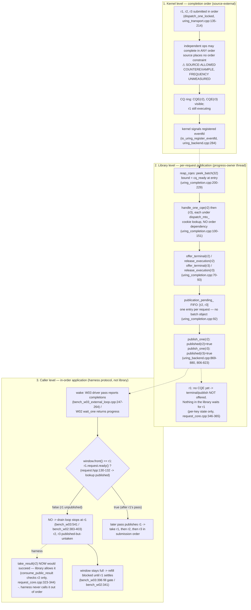

# R5 Phase A — Completion & Observation Call-Pattern Trace (G4, G1 completion side, W02/W03)

Role: completion/observation-side call-chain tracer (#595 R5, phase A).
Baseline: `f3b25329bc8a64a201961c426a58adacfb8fdf08` (= R4 measured implementation;
read at `/home/jnhu/sluice-595-e5/r5/worktree`, worktree read-only, porcelain 0 at
session start). All citations below are `path:line` in that tree unless prefixed
otherwise. Method: source reading only; no builds, no timed runs, no lock taken
(this role performed zero timing/performance comparisons, so no MEASUREMENT.lock
receipt is owed; the lock file was probed free by the environment verifier,
env-context.md §1).

Provenance checks run this session:
- `git -C /home/jnhu/sluice-595-e5/r5/worktree rev-parse HEAD` → `f3b25329…`.
- `git hash-object bench/bench_w02_pipeline.cpp` → `95cc4b79f158a63b213b376163d5c11d7215401b`
  == the R4 post-delta blob in `r4/logs/21-apply-delta-w02.log` (W02 harness byte-identical
  to what R4 measured).
- `git diff --stat d9d140ee f3b25329` → touches only `bench/` files; library sources
  (`src/`, `include/`) are identical between the R4 frozen baseline `d9d140ee` and
  `f3b25329`, so the completion-side library path traced here is exactly the R4-measured one.

## 0. Edge conventions used in all diagrams below

G1–G3 diagram files were not present under `r5/analysis/` when this document was
written (parallel roles had not yet emitted them), so the convention is declared
here rather than copied; if G1–G3 differ, harmonize at merge time.

- **Solid arrow (`A --> B`)**: same-thread synchronous call or state transition,
  verified at `SHA:file:line`.
- **Dashed arrow (`A -.-> B`)**: cross-thread or asynchronous edge (kernel→user,
  thread→thread, wake/notify), verified at `SHA:file:line`.
- **Dotted arrow with label (`A -. harness .-> B`)**: caller/harness protocol
  behavior, NOT a library mechanism; the library permits but does not perform it.
- Every node carries its citation. Doubts are marked `⚠` directly on the nodes
  where they arise and listed in §7.
- "Source-allowed counterexample, frequency unmeasured" labels mark orderings the
  source permits but that this phase did not (and could not, source-only) quantify.

## 1. Completion-side call chain (what actually happens, in order)

Single owner pass (`poll()` / `poll_progress()`; W03: driver thread; W02: the one
consumer thread). All steps below are same-thread within a pass unless marked.

1. **Entry / authority**: `AsyncIoContext::poll_progress` gates on the attached
   progress owner (`src/async/async_io_context.cpp:437-443`, `drive_entry_admitted_`
   `:175-187`), then `run_progress_pass_` (`:425-435`) calls `backend->poll_progress()`
   (`src/async/uring_backend.cpp:312-336`).
2. **Dispatch residue** (submit side, listed only for context): drain `dispatch_`
   queue + one `io_uring_submit` (`src/async/uring_backend.cpp:843-857`;
   `submit_transport_locked` `src/async/uring_transport.cpp:223-240`).
3. **Reap (bounded)**: `reap_cqes` (`src/async/uring_completion.cpp:200-229`) loops
   `io_uring_peek_batch_cqe` in batches of 32, marks each CQE seen, and calls
   `handle_one_cqe(user_data, res)` **per CQE**; the pass boundary is the CQ-ready
   count at entry (`:229`); if the CQ overflow flag is set, one
   `io_uring_get_events` flush then a second bounded reap (`:238-277`).
4. **Per CQE, under `dispatch_mtx_`** (`src/async/uring_completion.cpp:100`):
   cookie→router lookup with **no order assumption**
   (`find_live_router_cookie_` `src/async/uring_transport.cpp:556-562`; reverse
   scan, monotonic cookies `:531-543`); build `IoOutcome` from `res`
   (`uring_completion.cpp:161-195`); `finalize_operation_terminal_`
   (`:23-97`):
   - `core_->offer_terminal(key, candidate)` — first terminal wins
     (`src/async/detail/request_core.cpp:346-365`);
   - `core_->release_execution(key)` — retires the kernel borrow
     (`request_core.cpp:393-409`);
   - `publication_pending_->push_back(handle)` — FIFO, **one entry per request**
     (`uring_completion.cpp:92`);
   - `retire_router_entry_` frees the router slot immediately when no cancel
     control is live (`uring_completion.cpp:94-96`, `uring_transport.cpp:564-587`).
5. **Publication sweep** (`src/async/uring_backend.cpp:861-880`): bound snapshot
   under the lock, then per entry: pop under lock, `publish_one(h)` **outside**
   the lock (`:801-831`): `begin_publication` (eligibility: terminal chosen,
   execution refs 0, binding live — `request_core.cpp:438-460`), copy
   `delivery_[slot].kind`, `complete_publication` → **`published=true`,
   `--outstanding_`, armed observer → queued** (`request_core.cpp:462-484`),
   then `deliver_event` (`uring_backend.cpp:833-837`):
   `claim_observer_delivery` → `on_ready` sink → `retire_observer_delivery`.
6. **Owed sweep** (zero-length ops only — never fires for the 4 KiB/64 KiB bench
   cases): slot-index order 0..capacity-1, not completion order
   (`src/async/uring_backend.cpp:881-909`; `event_owed` set only in
   `publish_zero_op_inline` `:776-799`).
7. **Notification** (ownership: context `ProgressSource`, an eventfd):
   the kernel signals the eventfd registered at context attach
   (`io_uring_register_eventfd`, `src/async/uring_backend.cpp:267-291`) when CQEs
   are posted; the library itself writes the eventfd (`progress_port_.signal()`)
   only for: ready-batch residue advertisement (`uring_backend.cpp:614-617`),
   zero-op publication (`:796-799`), admission close (`:914-927`), poison
   (`uring_transport.cpp:528`), pre-dispatch cancel win / running cancel
   (`uring_transport.cpp:606-620`), and dispatch-failure paths (`:103-106`).
   Ordinary CQE publication adds **no** library-side signal — the wake is the
   kernel eventfd write plus the CQ-visibility probe
   (`has_immediate_physical_work` `uring_backend.cpp:293-301`, consulted by
   `ProgressSource::wait_if_unchanged` `include/sluice/async/detail/progress_source.hpp:104-232`
   and by `poll_progress`'s `immediate_work_remains` `uring_backend.cpp:318-335`).

There is **no library "batch completion"**: each CQE produces its own
terminal/release/publication-entry, and each publication its own
begin/complete pair. The only batch-shaped observables are (a) the 32-wide reap
loop, (b) wake granularity (one eventfd wake / one driver pass covers many
CQEs), and (c) the W03 harness's aggregated completion counter (§4).

## 2. G1 — completion-side facts (for merge with the submission-side G1)

| Fact | Owner / location | Citation |
|---|---|---|
| Publication executes on the progress-owner thread, inside `poll()`'s sweep, one request at a time, in CQ-reap order of the pass | backend + core, owner thread | `uring_backend.cpp:861-880`, `request_core.cpp:462-484` |
| First caller-observable moment is `published=true` (set by `complete_publication`); a visible CQE is not yet observable until a pass publishes it | core slot | `request_core.cpp:471-473`, reap→publish split `uring_completion.cpp:200-229` / `uring_backend.cpp:861-880` |
| `ready()`/`try_result()` read `published` per request under the core mutex only (no `access_mtx_`, no backend lock) | caller thread, core | `include/sluice/async/request.hpp:130-144`, `request_core.cpp:251-321` |
| `take_result()` = `consume_public_result`: reads the outcome, drops `binding_live`, reclaims the slot (generation++) | caller thread, core | `request.hpp:146-159`, `request_core.cpp:323-344, 580-631` |
| Notification authority is the context `ProgressSource` eventfd; kernel-registered for CQEs at attach; library signals only the enumerated non-CQE cases | context-owned; kernel writes it | `progress_source.hpp:74-79, 252-264, 434-457`, `uring_backend.cpp:267-291` |
| External driver (W03) borrows the fd via `progress_notification_fd()`, must acknowledge via `acknowledge_progress_notification()` (eventfd drain) | harness driver thread | `async_io_context.cpp:720-748`, `progress_source.hpp:274-278` |
| Observer `on_ready` callbacks run on the owner thread inside `poll()`; the default sink is a **no-op in production** (`routing_sink_` is set only by test seams) — harness callers observe by polling `ready()`/`take_result()`, not callbacks | owner thread | `uring_backend.cpp:833-837`, `reference_ready_sink.hpp:11-16`, `async_backend.hpp:27`, `detail/test_access.hpp:148-154` |
| Caller window ownership is entirely harness-side: the library has no window; it only pins slots via live `Request` bindings until take/discard | harness | `request_core.cpp:580-590` (reclaim needs `!binding_live`) |

### G1c — completion-side sequence (mergeable into full G1)

```mermaid
sequenceDiagram
  participant K as kernel io_uring
  participant D as progress owner thread<br/>(W03: driver / W02: consumer)
  participant B as UringAsyncBackend
  participant C as RequestCore
  participant U as caller thread<br/>(W02 = D; W03 = submitter)

  K -.->> B: CQE posted in CQ ring<br/>(completion order, source places no order constraint)
  K -.->> D: eventfd signaled<br/>(registered at attach, uring_backend.cpp:284)
  Note over D: W03: epoll_wait + acknowledge_progress_notification<br/>(bench_w03_external_loop.cpp:209-217)
  D->>B: poll_progress() (async_io_context.cpp:437)
  B->>B: reap_cqes: peek_batch(32), per-CQE<br/>handle_one_cqe under dispatch_mtx_ (uring_completion.cpp:100)
  B->>C: offer_terminal / release_execution per request<br/>(uring_completion.cpp:70,89)
  B->>B: publication_pending_.push (FIFO, 1/request) (uring_completion.cpp:92)
  B->>C: publish_one: begin_publication / complete_publication<br/>published=true, outstanding-- (uring_backend.cpp:806-823)
  B->>B: deliver_event: observer claim / on_ready / retire<br/>(uring_backend.cpp:833-837)
  D-->>U: W03: shared.completions += published, cv.notify<br/>(bench_w03_external_loop.cpp:247-264) | W02: wait_one returns progress
  U->>C: window.front().request.ready() (core lookup, request.hpp:130)
  U->>C: take_result -> consume_public_result<br/>binding_live=false, slot reclaimed, generation++ (request_core.cpp:323-344)
  U->>U: refill (W02: free_slots LIFO / W03: sequence%depth) + next submission
```

## 3. G4 — completion out-of-order vs in-order observation (head-of-line)

Three strictly distinct levels (do not merge them):

1. **Kernel completion order**: independent ops may complete in any order; the
   library never depends on order (cookie-routed lookup,
   `uring_transport.cpp:556-562`; per-CQE terminal with no predecessor check,
   `uring_completion.cpp:99-198`). *Frequency of reordering on tmpfs/E5:
   unmeasured — kernel behavior, not verifiable from this repo's source.*
2. **Library per-request publication**: publication order = CQ-reap order within
   a pass (`publication_pending_` FIFO, `uring_completion.cpp:92`;
   `uring_backend.cpp:869-880`). Each request is published individually the
   moment its own CQE is reaped; an unpublished r1 never blocks publication of
   r2/r3.
3. **Caller in-order application**: both R4 harnesses consume strictly from
   `window.front()` (W03 drain loop `bench/bench_w03_external_loop.cpp:541-572`;
   W02 `scope.wait_for(oldest)` + `take` `bench/bench_w02_pipeline.cpp:383-403`,
   r3 arms `:602-644`). This is a **harness protocol**, not a library mechanism:
   `take_result(r2)` while r1 is pending would succeed immediately
   (`consume_public_result` checks only r2's own `published`,
   `request_core.cpp:323-344`).

### G4 diagram — source-allowed counterexample (r1 outstanding, r2/r3 published)

Scenario (all steps source-verified; occurrence frequency unmeasured): r1, r2, r3
submitted in order; the kernel completes r2 and r3 first; one owner pass reaps
both and publishes both; the caller's front-only protocol cannot observe them
until r1 completes.



Reading of the counterexample edges:

- `window.front().request.ready()` **does** stop the drain loop (`while …
  window.front().request.ready()`, `bench_w03_external_loop.cpp:541`; W02 waits on
  the front ticket, `bench_w02_pipeline.cpp:387`), and the window-full condition
  stops refill — but this is caller protocol. **It does not and cannot block
  `take_result` at the library level**: each `Request` resolves independently
  (`request_core.cpp:121-163, 323-344`).
- The only library-side ordering constraint in the whole chain is *within-pass
  FIFO publication* (`publication_pending_`), which orders publication by CQ reap
  order — not by submission order and not as a batch.

### Buffer reuse, slot/generation, and in-order delivery

- **Library buffers are caller-owned raw pointers.** `ReadOp.dst` is captured into
  `prepared_ops_[slot]` at admission (`uring_backend.cpp:698-705`) and passed to
  `io_uring_prep_read` at dispatch (`uring_transport.cpp:171-175`). `BorrowFacts`
  records fd/buffer/length (`include/sluice/async/detail/request_core.hpp:19-23`)
  but nothing enforces buffer exclusivity — two in-flight ops on the same buffer
  would be accepted (caller obligation; `admit_` `uring_backend.cpp:633-733`
  performs no aliasing check).
- **Library slot/generation recycling is consumption-gated.** A core slot is
  reclaimed only when `published && !binding_live && control_refs==0 &&
  execution_refs==0 && !publication_inflight && observer retired/unattached`
  (`request_core.cpp:580-590`); `binding_live` drops at `take_result`/`discard`
  (`:339-342`, `:291-293`). `release_slot_` then bumps `generation` and pushes the
  slot to the free list (`:599-631`); `reserve()` pops LIFO (`:165-182`). So with
  front-only consumption, **library slots recycle in consumption order**, one
  generation per reuse. The router entry (cookie→slot) retires earlier, at CQE
  time (`uring_completion.cpp:94-96`).
- **"Reuse buffer by `submitted % depth`" — assumption check per harness phase:**
  - W03 (A0 singles `bench_w03_external_loop.cpp:484` and arms `:406`): **TRUE** —
    `slot = sequence % depth`. Its safety is arithmetic, not tracked: the window
    holds consecutive sequences with size ≤ depth (fill gate `:396`, FIFO pop
    `:571`), so two in-window sequences never collide mod depth. It relies on
    in-order application keeping the window contiguous.
  - W02 sliding-window and W02-r3 arms (`bench_w02_pipeline.cpp:332-337, 441`
    and `:526-529, 673`): **FALSE** — an explicit `free_slots` LIFO freed only
    after the owning request is taken; the harness comment states the contract
    (`:330-333`).
  - W02 saturating phase (`:249`): `sequence % depth` **TRUE**, made safe by the
    admission bound (`request_capacity == depth` → `would_block` closes the fill,
    `:259-264`).
  - The two mechanisms are independent: the harness buffer index is
    submission-order arithmetic; the library slot is consumption-gated. Both are
    safe under front-only consumption, and neither implies the other.

## 4. W02 vs W03 — caller behavior, window, refill (source-verified)

| Dimension | W02 `bench_w02_pipeline.cpp` | W03 `bench_w03_external_loop.cpp` |
|---|---|---|
| Threads | 1: submitter == consumer == progress owner (scope claims owner `:28-34` via `request_scope.cpp:15-26`; r3 arms attach via `wait_one` `:616`) | 2: main submitter/consumer + driver thread that claims the progress owner (`:182-195`) |
| Drive | consumer thread: `scope.wait_for(front)` → `ctx.wait_one` (`request_scope.hpp:145-185`) runs passes and parks on the eventfd | driver: `epoll_wait` on the borrowed notification fd (`:207-217`), `acknowledge_progress_notification` (`:213`), then a `poll_progress` drain loop while `immediate_work_remains` (`:231-245`) |
| Consumer wake | `wait_one` park: kernel eventfd / library signal, one hop (`async_io_context.cpp:569-696`) | cv on `shared.completions` published by the driver per pass (`:247-264`, wait `:522-539`) — an **extra thread handoff**; granularity is the pass's aggregate publication count |
| Submission (A0) | `RequestScope::submit_read` singles (`:353`) | `ctx.submit_read` singles (`:493`) |
| Submission (arms) | adapter `submit_ready_reads` group entry, **but steady state presents a single op**: each outer iteration consumes exactly 1 (`:602-644`) then refills `want = depth − window = 1` (`:539-542`) → `remaining_single → immediate` (`bench/r3_ready_batch.hpp:223-225, 283-284`) — **batch policy never engages after the initial fill** | adapter presents the previous cycle's freed count k (up to depth): fill runs to a full window (`:396-398`), drain takes all consecutive ready fronts (`:541-572`) → next fill presents k ops → **quantum/budget decisions engage for real** (`r3_ready_batch.hpp:222-289`) |
| Decision facts | **not passed** — 2-arg `adapter.submit` (`:560`) → `DecisionFacts{}`: `pressure_known=false`, `caller_window=0` (`r3_ready_batch.hpp:402-405`) | driver publishes `last_pass_completed / last_pass_immediate_work / pressure_seen` under the shared mutex (`:254-258`); S/SNP/SHADOW read them per presentation (`:415-422`, `r3_ready_batch.hpp:467-478`) |
| Consumption order | front-only (oldest); `any_ready_consume` exists but is a threadpool-only opt-in diagnostic (`:374-403`, gate `:964-999`), unused by the R4 uring arms | front-only drain of all consecutive ready fronts (`:541-572`) |
| Buffer reuse | free-list LIFO freed at take (`:332-337, 441`; r3 `:526-529, 673`); saturating phase uses `sequence % depth` (`:249`) | `sequence % depth` (`:406`, `:484`) |
| Refill feedback | take → `free_slots.push_back` → next iteration's fill (same thread) | drain k fronts → next cycle fill want=k → adapter presents k (clamped by arm quantum/cap with re-entry, `r3_ready_batch.hpp:547-576`); plus R-arm residue advertisement → `signal_ready_progress` → eventfd → driver pass (`uring_backend.cpp:614-617`) |
| `wait_calls` stat | > 0 (asserted by oracle `:813-815`) | == 0 asserted (driver never `wait_one`s, `:746-748`) |
| Case depths (uring) | d1, d4, d16, d64 (+ opt-in d2; **no d3 case exists** — `:916-936`, matching R4's W02-d3 NOT_RUN_WITH_REASON) | d4, d16, d64 + research d2pos/d2serial/d3/d16cap/64k-d16 (`:842-860`); `max_refill` caps the presented group (`:397-398`, break `:509-511`) — d2serial (`max_refill=1`) submits strictly one op at a time, so every SHADOW presentation sees `outstanding()==0` (structural zero of the T1 trajectory arm) |

**Why the same policy can behave oppositely across the two workloads
(structural facts; numeric outcomes belong to the R4 archive):**

- On W02, arms reduce to single-op presentations in steady state → every arm is
  A0's behavior **plus** per-presentation decision overhead (S/SHADOW additionally
  pay `ctx_.outstanding()` per presentation, `r3_ready_batch.hpp:467-471`), with
  zero batching benefit — consistent with R4's uniform W02 regressions.
- On W03, presentation size is coupled to the previous drain size and to driver
  pass facts: R (full-span, cap-reuse) amortizes `io_uring_submit` across the
  freed group (`uring_backend.cpp:554-590`), while S clamps to quantum 2 under
  `completion_pressure` (99.92% of decisions in R4) — the two workloads present
  the policy with different steady-state group sizes and different fact channels.
- Observation paths differ by one thread hop: W03 per-op latency (timer starts at
  ReadOp build `:413/:491`, stops at `take_result` of the front `:543-571`)
  includes kernel→driver→(cv)→submitter handoffs and the aggregated wake, while
  W02's timer (`:351/:423`) stops on the same thread that parks. Tail effects of
  the same library policy therefore land on different mechanisms in the two
  workloads.
- `outstanding()` (the S/SNP/SHADOW inflight hint) counts **accepted-and-not-
  published** slots (`request_core.cpp:76-79, 93-97`). In W03 it reaches 0 both
  when the system is idle **and** when a whole published window was just drained
  before a full refill — the SNP "hint fires at the wrong moments" anomaly
  (R4 digest #14) is structurally visible here: `outstanding()==0` at
  presentation time says nothing about caller-side backlog or about published-
  but-untaken results behind an unready front. ⚠ frequency claims belong to R4.

## 5. Observer threads, external-driver concurrency, lock points

- Observer (`on_ready`) thread = the progress owner thread (W03 driver; W02
  consumer); production sink is a no-op (`reference_ready_sink.hpp:11-16`), so
  harness-visible observation is `ready()`/`take_result()` polling on the caller
  thread.
- External driver concurrency (W03): driver and submitter run concurrently on
  one context. Documented lock order `access_mtx_ → dispatch_mtx_ → core
  mutex_` (`detail/test_access.hpp:47`). Contention points, all cross-thread
  only in W03:
  1. `ctx.access_mtx_` — submitter: every submit (`async_io_context.cpp:251`,
     `detail/test_access.hpp:69`) ; driver: `poll_progress` entry/exit per pass
     (`async_io_context.cpp:175-192, 437-443`).
  2. backend `dispatch_mtx_` — driver: **one acquire per CQE**
     (`uring_completion.cpp:100`) plus publication pops (`uring_backend.cpp:873-875`);
     submitter: one hold across the whole batch admission+dispatch+`io_uring_submit`
     critical section (`uring_backend.cpp:504-590`) or per single submit
     (`dispatch_after_accept` `uring_transport.cpp:48-107`). ⚠ cost unattributed
     (R4 had no PMU; CPU buckets left a 22–25.7% residual).
  3. `RequestCore::mutex_` — driver: offer/release/begin/complete per op;
     submitter: reserve/accept per op, `outstanding_summary` per submit stats
     (`uring_backend.cpp:459-465`) and per S/SHADOW fact read
     (`r3_ready_batch.hpp:469`), `ready()` checks on the caller thread.
  4. W03 harness `SharedLoop.mutex_` + cv — driver per pass (`:247-264`),
     submitter per facts read (`:417-422`) and per completion wait (`:522-539`).
- `Request::ready()`/`take_result()` touch only the core mutex
  (`request.hpp:130-159` → `request_core.cpp:251-344`), not `access_mtx_` — the
  W03 drain loop does not contend with submits on the context mutex.

## 6. Suspicion markers (also flagged ⚠ in the diagrams)

- S1: any publication advances `shared.completions`; the W03 submitter can wake,
  observe an unready front (published result behind it), take nothing, and re-park
  (`bench_w03_external_loop.cpp:524-539` + `:541`) — a spurious-wake pattern
  coupled with head-of-line blocking. Frequency unmeasured.
- S2: `outstanding()==0` conflates "idle" with "fully published/drained" (§4) —
  the structural seed of the R4 SNP anomaly.
- S3: per-CQE `dispatch_mtx_` acquisition (driver) vs. the submitter's single
  long critical section (§5.2) — serialization point whose cost R4 could not
  attribute.
- S4: publication can lag its own CQE by one pass (pass-bound snapshot
  `uring_backend.cpp:865-869`; the next pass is owed via
  `immediate_work_remains` `:318-335`), so first-observability timing includes a
  pass-scheduling quantum.
- S5: W02-r3 steady state presents singles regardless of arm (§4) — arm deltas
  on W02 measure decision overhead, not batching.

## 7. Unverified / unknown

- Actual kernel out-of-order completion frequency for tmpfs 4 KiB reads on this
  E5 host: **unmeasured** (source permits it; no runtime observation in this
  source-only phase).
- Kernel-side eventfd signaling semantics (per-CQE write vs. coalescing):
  kernel behavior, not verified from this repo's source; the library itself
  treats eventfd and CQ visibility as distinct (`uring_backend.cpp:293-300`).
- Performance cost of any lock point in §5: not measured here; R4 CPU-bucket
  attribution limits are recorded in `r4/RESULTS.md` (per env-context digest
  item 18).
- G1–G3 diagram conventions: not present when this was written (§0); merge-time
  harmonization may be needed.

## 8. Commands run in this session (all read-only)

- `git -C /home/jnhu/sluice-595-e5/r5/worktree rev-parse HEAD` → f3b25329…
- `git hash-object` on `bench_w02_pipeline.cpp`, `bench_w03_external_loop.cpp`,
  `bench/r3_ready_batch.hpp` (blob provenance vs `r4/logs/21-apply-delta-w02.log`,
  `22-apply-delta-w03.log`).
- `git ls-tree d9d140ee bench/`, `git diff d9d140ee f3b25329 -- bench/bench_w03_external_loop.cpp`,
  `git diff --stat d9d140ee f3b25329` (library sources unchanged between the R4
  frozen baseline and f3b25329).
- `cat r4/logs/{20,21,22,24}-*.log`, `r4/logs/commit{1,2}.txt` (harness provenance).
- Source reads cited throughout. No files outside `r5/analysis/` were written; the
  main repo and `r4/` were never modified.
