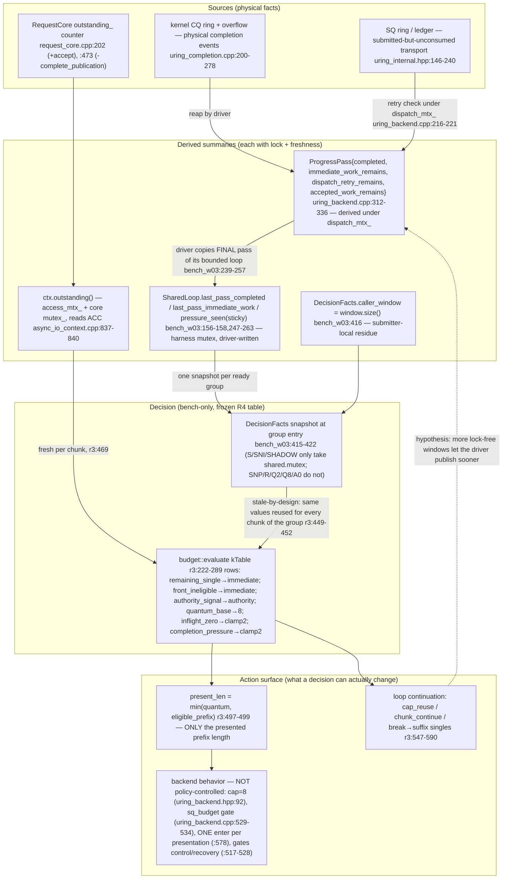

# #595 R5 Phase A — Submission-Side Call-Pattern Trace (G1/G2/G3)

Role: submission-path tracer. Written 2026-11-06 (UTC). All claims below come
from reading the frozen R4_ORIGINAL source tree at
`/home/jnhu/sluice-595-e5/r5/worktree`, HEAD
`f3b25329bc8a64a201961c426a58adacfb8fdf08` (verified this session:
`git -C ... rev-parse HEAD` → `f3b25329…`, `status --porcelain` empty; main
repo `/home/jnhu/Source/Sluice` also verified clean). **No build, no run, no
timing was performed in this session** — this is a static source trace; every
claim marked "verified" is backed by cited `path:line` in that tree. Runtime
interleaving effects that source reading cannot establish are marked
unverified/unknown. Node index shorthand: `f3b25329:<path>:<function>:<lines>`;
`f3b25329` is the tree SHA above, paths are relative to the worktree root.

Conventions for all three figures:

- **Solid edge** (`-->`): a call, data flow, or ordering verified in source
  this session; the node index gives the exact lines.
- **Dotted edge** (`-.->`): a causal/temporal hypothesis that this repository
  cannot verify (e.g., OS scheduling interleavings, kernel-internal routing).
  These are *not* completion edges unless the label says so.
- Edge **labels** distinguish type: `call` (same-thread function invocation),
  `queue` (hand-off through a data structure under a lock), `notify` (fd/epoch
  wake signal — a *notification*, never itself a completion).
- Nodes suffixed `[unknown]` mark regions whose internals are not observable
  from this codebase (kernel submission path, io-wq, PMU-level attribution).

---

## 0. Where the A0/R/S fork actually lives (verified)

The three arms share *all* production code. The fork is entirely in the
research harness layer, `bench/r3_ready_batch.hpp`, above `AsyncIoContext`:

| Arm | Harness path into the product | Verified at |
|---|---|---|
| A0 (IMMEDIATE) | `Adapter` is not even constructed for `Arm::a0` (`bench/bench_w03_external_loop.cpp:337-339`); the submitter loop calls `ctx.submit_read(op)` per ReadOp (`bench_w03:482-504`), or `Adapter::submit` falls to `submit_context_singles` → `ctx_.submit_read(op)` (`bench/r3_ready_batch.hpp:411-414`, `:595-605`). This is the unchanged product public path (`AsyncIoContext::submit_read`, `src/async/async_io_context.cpp:245-265`). |
| R (READY_REUSE) | `arm_policy(R) = {reuse_on_cap=true, budgeted=false}` (`bench/r3_ready_batch.hpp:160-182`): present the whole remaining ready span; re-present only after a `cap` stop (`:561-563`). |
| S (STATE_AWARE) | `arm_policy(S) = {reuse_on_cap=true, budgeted=true, {read_inflight=true, read_pressure=true}}` (`:167`): per-chunk table decision (`:455-516`), chunk loop re-entry (`:564-575`). |
| (SNI/SNP/Q2/Q8/SHADOW) | Same loop, different `BudgetVariant` bits (`:168-175`). |

The batch entry the non-A0 arms use is
`detail::TestAccess::context_submit_ready_reads` (`include/sluice/async/detail/test_access.hpp:49-135`),
an isolated-test seam ("never installed, never included by production
translation units", `test_access.hpp:22-24`), which wraps the backend's real
grouped-admission entry `UringAsyncBackend::submit_ready_reads`
(`src/async/uring_backend.cpp:443-619`). The bench binaries link the shipped
`sluice_async` archive and do **not** define `SLUICE_ASYNC_INTERNAL_TESTING`
(`xmake/bench.lua:1-3,18-32`; the define appears only in `xmake/tests.lua`), so
the measured submission code under the seam is the production library code with
test hooks compiled out. `TestAccess` itself is not macro-gated, which is why
the bench can use it.

**Real divergence point A0 vs R/S**: `bench/r3_ready_batch.hpp:411-414` (per-op
`submit_read`) vs `:527-529` (span presentation through the TestAccess seam).
Everything below `AsyncIoContext` is common; the backend additionally branches
internally at `uring_backend.cpp:467` (span of 1 or ineligible front → single
path ≈ A0 shape; else the grouped path at `:499-619`).

### Lock inventory (all verified)

| Lock | Owner | Taken by submit path at |
|---|---|---|
| `AsyncIoContext::access_mtx_` | context (`include/sluice/async/async_io_context.hpp:336`) | `submit_read` `src/async/async_io_context.cpp:251`; batch seam `test_access.hpp:69`; `outstanding()` `src/async/async_io_context.cpp:838`; driver `drive_entry_admitted_` `src/async/async_io_context.cpp:175-176` |
| `UringAsyncBackend::dispatch_mtx_` | backend (`include/sluice/async/detail/uring_backend.hpp:363`) | grouped batch `uring_backend.cpp:504`; `admit_` `:653`/`:710`; `dispatch_after_accept` `src/async/uring_transport.cpp:54`; CQ handling `src/async/uring_completion.cpp:100`; publication pops `uring_backend.cpp:864,873,883,891` |
| `RequestCore::mutex_` | core (`include/sluice/async/detail/request_core.hpp:295`) | `reserve`/`accept` `src/async/detail/request_core.cpp:166,187`; `claim_execution`, `offer_terminal`, `begin/complete_publication` (`:438-484` region); `outstanding_summary` `:94` |
| Harness `SharedLoop::mutex` | bench (`bench_w03:146-164`) | driver publish `bench_w03:248-263`; submitter facts sample `:417-422` (only for `reads_pressure_facts()` arms) |
| `ProgressSource::mtx_` | wait domain (`include/sluice/async/detail/progress_source.hpp:459`) | `signal()` `:252-253` |

Stated order: `access_mtx_ → dispatch_mtx_ → core mutex_`
(`test_access.hpp:47`); every path walked below respects it.

---

## 1. G1 — End-to-end executors and queues (W03 shape, d16 case)

Five executors: Submitter thread (caller), Driver thread (progress owner),
AsyncIoContext+RequestCore (locked), UringBackend (SQ/CQ machinery), Kernel
region [unknown]. `io-wq` is inside the kernel region: R4 could only attribute
its cost by time-bucket accounting (`r4/RESULTS.md` digest item 18), never by
tracing; drawn as unknown here.

```mermaid
flowchart LR
  subgraph SUBM["Submitter thread (bench main)"]
    W["caller window deque&lt;Inflight&gt; — submitter-private, bench_w03:377,461-467"]
    RV["ready vector (ReadOps, up to want=min(depth-window, remaining, max_refill)) bench_w03:396-414"]
    AD["bench r3 Adapter::submit decision loop r3:402-592"]
    OBS["Request::ready()/take_result() observation request.hpp:130-159"]
  end

  subgraph DRV["Driver thread (progress owner)"]
    EP["epoll_wait on notification eventfd bench_w03:209"]
    PP["ctx.poll_progress bounded loop bench_w03:231-245 -&gt; AsyncIoContext::poll_progress async_io_context.cpp:437-443"]
    SF["SharedLoop facts publish under shared.mutex bench_w03:248-263"]
  end

  subgraph CTX["AsyncIoContext + RequestCore (locks: access_mtx_, core mutex_)"]
    SR["AsyncIoContext::submit_read async_io_context.cpp:245-265 (A0 product entry)"]
    SEAM["TestAccess::context_submit_ready_reads test_access.hpp:49-135 (bench arms entry, holds access_mtx_)"]
    CORE["RequestCore slots: reserve/accept (outstanding_++), offer_terminal, begin/complete_publication (outstanding_--) request_core.cpp:165-209,438-484"]
    OUTST["outstanding() = outstanding_summary() async_io_context.cpp:837-840 -> uring_backend.cpp:929-931 -> request_core.cpp:93-96"]
  end

  subgraph BK["UringAsyncBackend (lock: dispatch_mtx_)"]
    SRR["submit_ready_reads uring_backend.cpp:443-619 single path :467-497 / grouped :499-619"]
    DQ["dispatch_ BoundedDispatchQueue uring_internal.hpp:83-144"]
    LED["TransportLedger (physical SQ positions) uring_internal.hpp:146-240"]
    RT["router_ entries cookie -&gt; slot uring_backend.hpp:207-220"]
    DSP["dispatch_one_locked: get_sqe, prep_read, set_data64, ledger append uring_transport.cpp:135-214"]
    ENT["submit_transport_locked: io_uring_submit (enter) uring_transport.cpp:223-240"]
    SQ["SQ ring (shared mem with kernel)"]
    CQ["CQ ring + overflow flag"]
    REAP["reap_cqes (driver only) uring_completion.cpp:200-278"]
    PBQ["publication_pending_ queue"]
    PUB["publish_one: begin/complete_publication + deliver_event uring_backend.cpp:801-837"]
  end

  subgraph KER["Kernel [unknown internals]"]
    KSUB["io_uring_enter syscall boundary - liburing io_uring_submit called at uring_transport.cpp:233/236; syscall path inside liburing-2.13 not traced [unverified]"]
    KEX["opcode execution: inline / io-wq [unknown]"]
    KCQE["CQE posting + registered-eventfd write [kernel behavior, registration verified uring_backend.cpp:281-286]"]
    EFD["eventfd (ProgressSource-owned, progress_source.hpp:75)"]
  end

  W -->|refill builds| RV
  RV -->|call span| AD
  AD -->|call A0 per-op| SR
  AD -->|call R/S span| SEAM
  AD -.->|hypothesis: chunk boundaries give driver interleaving windows| PP
  SR -->|call under access_mtx_| SRR
  SEAM -->|call still under access_mtx_| SRR
  SRR -->|admit under dispatch_mtx_ + core mutex_| CORE
  SRR -->|queue push| DQ
  SRR -->|call per accepted op| DSP
  DQ -->|pop| DSP
  DSP -->|append| LED
  DSP -->|data| SQ
  DSP -->|call once per presentation| ENT
  ENT -->|call| KSUB
  KSUB -->|queue SQEs| KEX
  KEX -->|completion data| KCQE
  KCQE -->|data| CQ
  KCQE -->|notify: eventfd write| EFD
  ENT -->|consume ledger prefix on rc&gt;0| LED
  EP -->|notify: eventfd readable| PP
  EFD -.->|kernel write race vs userspace signal (both target same fd; order unobservable)| EP
  PP -->|call| REAP
  REAP -->|pop CQEs| CQ
  REAP -->|call per CQE under dispatch_mtx_| CORE
  REAP -->|queue handles| PBQ
  PP -->|pop under dispatch_mtx_| PBQ
  PBQ -->|call| PUB
  PUB -->|call| CORE
  PUB -->|notify: sink on_ready (no-op in bench builds) uring_backend.cpp:833-837, reference_ready_sink.hpp:9-16| OBS
  SF -->|queue facts under shared.mutex| AD
  OUTST -->|call (S/SNP per chunk)| AD
  PP -->|publish pass facts| SF
  CORE -.->|hypothesis: publish makes window front ready| OBS
  OBS -.->|hypothesis: cv wake after driver publish bench_w03:522-539| W
```

Figure notes (all verified unless marked):

1. **Notification ≠ completion.** Two distinct notify edges exist: (a) kernel
   CQE posting writes the registered eventfd (`io_uring_register_eventfd`,
   `uring_backend.cpp:281-286`); (b) userspace `ProgressSource::signal()`
   (`progress_source.hpp:252-264`) also `::write`s the same eventfd
   (`wake_notification_nolock_`, `:434-457`, write at `:441`). Residue
   advertising is one userspace source (`signal_ready_progress`,
   `uring_backend.cpp:614-617`; `include/sluice/async/detail/uring_backend.hpp:338-340`).
   The eventfd only wakes the driver's epoll (`bench_w03:209`); it never marks
   a request complete.
2. **Ownership**: `dispatch_`, `publication_pending_`, ledger, router, SQ/CQ
   access are all serialized by `dispatch_mtx_` (`uring_backend.hpp:363-365`);
   the caller window deque is submitter-private; the facts channel
   (`SharedLoop`) is harness-owned under its own mutex.
3. **Publication is driver-thread-only in W03**: nothing on the submit path
   reaps CQEs or publishes — `submit_ready_reads` and `dispatch_after_accept`
   contain no `reap_cqes` call (verified by reading `uring_backend.cpp:443-619`
   and `uring_transport.cpp:48-107`); `reap_cqes` is called only from `poll()`
   (`uring_backend.cpp:859`), reached only via `poll_progress` on the driver.
   (In W02 the same thread submits and waits, so the roles serialize on one
   thread — see §3.)
4. **[unknown] kernel internals**: whether an opcode runs inline on the
   submitting CPU or on io-wq, and where the eventfd write is emitted from,
   are not derivable from this repo. R4's io-wq cost figure is time-bucket
   attribution only (digest item 18, `r4/RESULTS.md:212-224`).

---

## 2. G2 — Sequence diagrams for one 16-ReadOp ready group (W03-d16 shape)

Preamble common to all three: the group is built only when the caller window
has room — `want = min(depth - window.size(), request_count - submitted,
max_refill)` (`bench_w03:396-398`); each op takes a pre-assigned buffer slot
`sequence % depth` (`:404-413`); the latency origin `ready_ns` is stamped at
ReadOp build time (`:373,413`). A *full* 16-op group occurs when the window is
empty; partial groups occur during steady state. The 8+8 / 2+2+… shapes below
are **structural examples of the mechanism, not a claim that every run looks
like this** — sq_budget (`uring_backend.cpp:529-531`), core capacity refusals
(`request_core.cpp:170-175`) and partial windows all change the actual counts.

### 2.1 A0 (IMMEDIATE product path)

```mermaid
sequenceDiagram
  autonumber
  participant S as Submitter thread
  participant AC as AsyncIoContext+RequestCore
  participant BK as UringBackend (SQ side)
  participant K as Kernel [unknown]
  participant D as Driver thread

  Note over S: build 16 ReadOps, stamp ready_ns (bench_w03:482-491)
  loop each of 16 ops (bench_w03:482-504)
    S->>AC: ctx.submit_read(op) — initiation_rejection then lock access_mtx_ (async_io_context.cpp:245-255)
    AC->>BK: backend_->submit_read → submit_request → admit_ (uring_backend.cpp:755-757,735-753,633-733)
    Note over BK: admit_: dispatch_mtx_ for fatal check (:653) and reset_delivery (:710); core reserve+accept under core mutex_ (request_core.cpp:165-209, outstanding_++ :202)
    BK->>BK: dispatch_after_accept (uring_transport.cpp:48-107): lock dispatch_mtx_ (:54), push dispatch_ (:77)
    BK->>BK: dispatch_one_locked: get_sqe, claim_execution, prep_read, set_data64, ledger append (uring_transport.cpp:135-214)
    BK->>K: submit_transport_locked → io_uring_submit — ONE enter PER OP (uring_transport.cpp:223-240)
    Note over K: enter return ≠ I/O completion; execution start unobservable [unknown]
    K-->>BK: rc>0 → ledger pops rc entries (uring_transport.cpp:247-261)
    BK-->>S: Request handle (async_io_context.cpp:262-264) — access_mtx_ released
  end
  par driver runs concurrently (thread scheduling unverified)
    D->>D: epoll_wait wake → poll_progress loop (bench_w03:209,231-245)
    D->>BK: reap_cqes bounded by CQ-ready-at-entry (uring_completion.cpp:200-278)
    D->>AC: offer_terminal + release_execution per CQE (uring_completion.cpp:70,89-92)
    D->>AC: publish_one → begin/complete_publication (outstanding_--) + deliver_event (uring_backend.cpp:801-837, request_core.cpp:462-484)
    D-->>S: shared.cv.notify after publishing facts (bench_w03:247-264)
  and submitter continues
    S->>S: park on shared.cv until completions > watermark (bench_w03:522-539)
  end
  S->>AC: window front Request::ready() → take_result() consume (bench_w03:541-572, request.hpp:130-159)
```

Verified per-op lock traffic for A0: `access_mtx_` ×1, `dispatch_mtx_` ×3
(`admit_` fatal check `uring_backend.cpp:653`, `reset_delivery` `:710`,
`dispatch_after_accept` `uring_transport.cpp:54`), core `mutex_` ×3 (reserve,
accept, claim_execution), and **one `io_uring_submit` per op** (each
`dispatch_after_accept` ends in `submit_transport_locked`, `uring_transport.cpp:91-92`).

### 2.2 R (READY_REUSE)

```mermaid
sequenceDiagram
  autonumber
  participant S as Submitter thread
  participant AD as bench r3 Adapter loop
  participant AC as AsyncIoContext+RequestCore (via TestAccess seam)
  participant BK as UringBackend (SQ side)
  participant D as Driver thread

  Note over S: facts NOT sampled (R: reads_pressure_facts()=false, bench_w03:417; no shared.mutex take)
  S->>AD: submit(ready[0..16), accepted) (r3:402-408)
  loop while begin < ready.size() (r3:442)
    Note over AD: policy = full_span, present_len = rest.size() (r3:521-524)
    AD->>AC: TestAccess::context_submit_ready_reads(rest) — precheck then lock access_mtx_ (test_access.hpp:49-69)
    AC->>BK: submit_ready_reads(span) under access_mtx_ (uring_backend.cpp:444)
    Note over BK: lock dispatch_mtx_ (:504); gates have_ring/fatal/pending_control/dispatch_retry (:505-528); limit = min(size, cap=8, sq_budget) (:529-534)
    BK->>AC: admit_ ×limit (reserve+accept per op; dispatch_mtx_ already held, uring_backend.cpp:541-552)
    BK->>BK: push dispatch_ (:554-558); dispatch_one_locked ×min(accepted, sq_free) (:564-576)
    BK->>BK: ONE submit_transport_locked for the whole presentation (:578) — ONE enter for up to 8 SQEs
    BK-->>AD: report{accepted, untouched_begin, stop, flush_attempts, residue} (:581-618)
    AC-->>AD: access_mtx_ released when seam frame returns
    Note over AD: begin += untouched_begin (r3:552); stop=cap &amp; progressed &amp; more → cap_reuse re-entry (r3:561-563,569); stop=sq_budget → NO re-entry → falls to suffix singles (r3:573-575,578-590)
  end
  Note over AD,BK: structural example with free SQ: presentation1 accepts 8 (stop=cap), presentation2 accepts 8 (stop=input_exhausted) = "8+8"; NOT guaranteed per run
  par driver may interleave only at lock-free windows
    D->>D: poll_progress needs access_mtx_ (async_io_context.cpp:175-176) then dispatch_mtx_ (uring_backend.cpp:844)
    Note over D: actual interleaving is OS scheduling [unverified]; the adapter loop itself never yields, parks, or serves progress (r3:442-576)
  and submitter stays inside Adapter::submit
    Note over AD: chunk boundary = return from ONE seam call; caller return happens only after the whole group (r3:591)
  end
  AD-->>S: accepted[16] Requests; window filled (bench_w03:460-467)
```

Verified R-specific facts: no facts channel read (`reads_pressure_facts()` is
`read_pressure || shadow`, both false for R, `r3:375-378`), no `ctx_.outstanding()`
call (that read is gated on `read_inflight || shadow`, `r3:467-471`); re-entry
only on `cap`; `sq_budget` or `rejected` stops break to the suffix-singles loop
(`r3:547-551,573-575`), which presents spans of 1 (backend single path
`uring_backend.cpp:467-497`).

### 2.3 S (STATE_AWARE)

```mermaid
sequenceDiagram
  autonumber
  participant S as Submitter thread
  participant AD as bench r3 Adapter loop
  participant AC as AsyncIoContext+RequestCore
  participant BK as UringBackend (SQ side)
  participant D as Driver thread

  Note over S: facts sampled ONCE at group entry under shared.mutex (bench_w03:415-422): last_pass_completed, last_pass_immediate_work, pressure_known(sticky), caller_window
  S->>AD: submit(ready, accepted, facts) (r3:407-408)
  loop while begin < ready.size() (r3:442)
    Note over AD: per chunk: eligible_prefix re-derived (r3:448); facts fields COPIED from the one snapshot (r3:449-452) — pressure_known/last_pass_* never refresh inside the loop
    AD->>AC: ctx_.outstanding() (r3:469) — takes access_mtx_ (async_io_context.cpp:837-840) + core mutex_ (request_core.cpp:93-96)
    Note over AD: pressure := facts.pressure_known &amp;&amp; (last_pass_completed&gt;0 || last_pass_immediate_work) (r3:474-476); table evaluate (r3:479; kTable r3:222-244)
    alt remaining==1 or eligible_prefix==0
      Note over AD: immediate → present_len=1 (r3:488-490)
    else authority row (prior control/recovery/residue)
      Note over AD: authority_exit → break to suffix singles (r3:492-494,518-520)
    else batch (typical)
      Note over AD: present_len = min(quantum, eligible_prefix) (r3:497); quantum=8 base, clamped to 2 by inflight_zero (active_data==0) and/or completion_pressure (pressure) rows (r3:234-243,263-271)
    end
    AD->>AC: seam presents rest.first(present_len) (r3:527-529)
    AC->>BK: submit_ready_reads(present_len) — same gates as R; if present_len==1 the backend takes its single path (uring_backend.cpp:467)
    BK->>BK: ONE enter per presentation; report back
    Note over AD: stop==input_exhausted &amp; progressed &amp; more → chunk_continue re-entry (r3:564-567,570-572)
    Note over AD: chunk_continue is NOT a yield: no caller return, no park, no progress service — next loop iteration re-locks access_mtx_ (r3:442-529)
  end
  par driver publication (only real progress service)
    D->>D: bounded poll_progress; publish_one per CQE; facts republished under shared.mutex (bench_w03:231-264)
    Note over D: whether the driver actually gets a slot between S's presentations is OS scheduling [unverified]
  and submitter inside the loop
    Note over AD: the ONLY interleaving doors S opens are the per-chunk releases of access_mtx_ and dispatch_mtx_
  end
  AD-->>S: accepted Requests; submitter parks on shared.cv (bench_w03:522-539)
  Note over S: observation: cv wake → window.front().request.ready() → take_result (bench_w03:541-572)
```

Structural example only: with `pressure` true for the whole group, S presents
2+2+2+2+2+2+2+2 (8 presentations, 8 enters) for a 16-op group; with `pressure`
false and outstanding>0 it degenerates to R's 8+8 shape driven by
`chunk_continue` instead of `cap_reuse`. Which happens when is workload- and
scheduler-dependent [unverified beyond the counter evidence in `r4/RESULTS.md`
digest item 9: 99.92% completion_pressure, 99.97% quantum2].

**Small-batch boundary audit (verified, answers the ask directly):**
- Does a chunk boundary return to the caller? **No.** The loop stays inside
  `Adapter::submit` (`r3:442-576`); the caller sees control again only when the
  whole group is disposed (`r3:591`) or an error/authority exit breaks out.
- Which locks are released at a chunk boundary? `access_mtx_` and
  `dispatch_mtx_` — each per-op/per-presentation acquisition is scoped to the
  seam call frame (`test_access.hpp:69` lock_guard; `uring_backend.cpp:504`
  lock_guard) — plus, for S, the `access_mtx_`+core-`mutex_` pair taken by the
  per-chunk `outstanding()` read (`r3:469` → `async_io_context.cpp:837-840` →
  `request_core.cpp:93-96`).
- Is there an actual progress/observation service opportunity? Only
  *opportunistically*: the driver needs `access_mtx_`
  (`async_io_context.cpp:175-176`) and then `dispatch_mtx_`
  (`uring_backend.cpp:844,864`). Smaller presentations mean more lock-free
  windows, but no yield/park/wait exists on the submit path to force a handoff,
  and the submitter never reaps/publishes itself (§1 note 3). The facts channel
  update also requires the driver to have run between two seam calls; nothing
  in the adapter refreshes `facts` mid-group (`r3:449-452` copies from the one
  group-entry snapshot).
- `enter` return is bookkeeping only: `submit_transport_locked` returns rc and
  pops ledger entries (`uring_transport.cpp:238-261`); completions are
  exclusively CQ-side (`uring_completion.cpp`).

---

## 3. W02 contrast (one line, verified)

In `bench_w02_pipeline.cpp` the same thread submits through
`adapter.submit(ready, accepted)` (two-arg overload → `DecisionFacts{}`,
`r3:402-405`, call at `bench_w02:560-561`) and then parks in
`ctx.wait_one` (`bench_w02:616`), which attaches that thread as progress owner
and drives passes between parks (`async_io_context.cpp:573-664`). Consequences
verified in source: (a) submission and driving are strictly serialized on one
thread — there is no concurrent driver to interleave at S's chunk boundaries;
(b) `pressure_known` stays false for the entire run (facts default-constructed;
the W02 harness never fills them — no `DecisionFacts` site exists in the file,
verified by grep), so the `completion_pressure` row can never match in W02 and
S there behaves like an inflight-only variant.

---

## 4. G3 — Information sources → propagation → decision → action



### Signal audit table (verified)

| Signal | True definition | Kind | Produced / copied | Freshness at decision | Locks on the path |
|---|---|---|---|---|---|
| `outstanding()` | `RequestCore::outstanding_` = slots accepted-but-not-published (`request_core.cpp:202,473`) — includes undispatched, kernel-in-flight, **and already-reaped-but-unpublished** ops | current residue | `+` at accept (driver-independent), `−` only at `complete_publication` on the driver thread | fresh (read per chunk, `r3:469`) | `access_mtx_` + core `mutex_` |
| `last_pass_completed` | completions published by the **final** pass of the driver's bounded loop (`bench_w03:239-245` records only the last iteration) | past event summary | driver → `SharedLoop` under harness mutex (`:248-263`) | stale: frozen at group entry (`bench_w03:415-422`) | harness `shared.mutex` |
| `last_pass_immediate_work` | final pass's `immediate_work_remains`; on normal loop exit this is **false by construction** (loop breaks when the flag clears, `bench_w03:242-244`) | past event summary | same channel | same | same |
| `pressure_known` | sticky once ANY driver pass has run (`bench_w03:158,257,421`) | proxy: "a pass ever happened" | same channel | monotone true | same |
| `pressure` (S) | `pressure_known && (last_pass_completed>0 ‖ last_pass_immediate_work)` (`r3:474-476`) → in practice ≈ "the driver's final pass published ≥1 completion" | proxy signal | adapter-local | frozen per group | (composed from the above) |
| `caller_window` | submitter's own deque size | current residue (caller side) | submitter-local (`bench_w03:416`) | fresh at group entry | none |
| `residue_advertised` | backend still holds undispatched/unsubmitted accepted work after the presentation (`uring_backend.cpp:586-588`, `dispatch_retry_remains_locked_` `uring_transport.cpp:216-221`) | current backend residue | backend report → adapter `prior_residue` latch (`r3:556,460`) | fresh per presentation | `dispatch_mtx_` |

### What the quantum actually changes (and does not)

Verified: selecting `quantum` changes **only** (a) the presented prefix length
(`r3:497-499`) and (b) how many presentations/enters the group is chopped into
via `chunk_continue` (`r3:564-575`). It does **not** change the backend's
internal cap (8, `uring_backend.hpp:92`), the sq_budget admission arithmetic
(`uring_backend.cpp:529-534`), the enter count per presentation (one,
`:578`), driver wakeups (those come from `signal_ready_progress`, and only on
residue/poison/cancel paths — `uring_backend.cpp:614-617`,
`uring_transport.cpp:103-106,528`), or any wait semantics. There is no
"continuous-work budget" object and no executor-scheduling knob anywhere in
the submit path; the decision's only lever on the rest of the system is the
*timing of lock release* between presentations.

### Suspicions drawn on the figure (each verified as a structural property)

1. **Snapshot reuse**: `facts` is sampled once per group and re-copied into
   every chunk decision (`r3:449-452`); with 2-op chunks a 16-op group makes 8
   decisions off one snapshot — pressure can be stale by up to a whole group.
2. **`outstanding()==0` is a drain detector, not an idle-kernel detector**:
   because publication (the decrement site) happens only on the driver thread
   in W03, `outstanding()==0` at a submitter decision point means *every
   previously accepted op is already published* — i.e., the moment the pipeline
   has drained. This is the structural reading of the R4 SNP anomaly (digest
   item 14: small batches firing exactly at zero-inflight moments): the
   `inflight_zero` row (`r3:236-239`) clamps to 2 precisely when a large batch
   would have been safe, and `completion_pressure` (`r3:241-243`) is a
   past-event proxy that says nothing about current queue state.
3. **Per-chunk lock tax for state-aware arms**: every S/SNP decision pays an
   `access_mtx_` + core-`mutex_` round trip just to read `outstanding()`
   (`r3:469` → `async_io_context.cpp:837-840` → `request_core.cpp:93-96`) —
   on the same `access_mtx_` the immediately following presentation must take
   again, and on the same core mutex_ the driver's publication path needs.
4. **Triple eligibility scan of the same span**: the adapter mirrors the shape
   test (`batch_shaped_prefix`, `r3:184-196`, with the mirror-derivation
   comment at `:184-187`), the seam re-runs `initiation_rejection` per op
   (`test_access.hpp:55-67`), and the backend re-checks `batch_eligible_read`
   per member (`uring_backend.cpp:437-439,537`) — three passes over data the
   previous layer just validated.
5. **Driver-facts channel granularity**: `last_pass_*` records only the final
   pass of the driver's bounded loop (`bench_w03:231-245`); intermediate
   passes' completions are invisible to the policy, and
   `last_pass_immediate_work` is structurally almost always false (suspicion 1
   of G3 table).

---

## 5. Node index (by layer, `f3b25329` tree)

Caller/harness (bench, research-only layer):
- `f3b25329:bench/bench_w03_external_loop.cpp:driver_thread:182-279` — driver
  thread: claim owner, epoll, bounded passes, facts publish, shutdown.
- `f3b25329:bench/bench_w03_external_loop.cpp:run_external_phase:281-623` —
  window/refill/ready build (396-414), facts sample (415-422), A0 loop
  (482-504), cv park (522-539), settle/observe (541-572).
- `f3b25329:bench/bench_w03_external_loop.cpp:make_context:100-128` —
  `UringConfig.request_capacity=depth, queue_depth=depth` (115-118).
- `f3b25329:bench/r3_ready_batch.hpp:Arm/arm_policy:29-40,160-182` — arm
  taxonomy.
- `f3b25329:bench/r3_ready_batch.hpp:DecisionFacts:135-145` — facts snapshot
  struct (comment: adapter never polls).
- `f3b25329:bench/r3_ready_batch.hpp:budget::kTable/evaluate:198-291` — frozen
  R4 decision table.
- `f3b25329:bench/r3_ready_batch.hpp:Adapter::submit:402-592` — presentation
  loop; A0 fallback 411-414; outstanding read 469; pressure def 474-476;
  present_len 497-499; latches 553-558; cap_reuse/chunk_continue 559-575;
  suffix singles 578-590; product singles helper 595-605.
- `f3b25329:bench/bench_w02_pipeline.cpp:run_pipeline_phase_r3:468-…,560-561,602-654` —
  W02 single-thread submit+wait_one shape.
- `f3b25329:xmake/bench.lua:bench targets:10-40` — bench links shipped
  archives, no internal-testing define.

Context / seam / core:
- `f3b25329:src/async/async_io_context.cpp:submit_read:245-265` — A0 product
  entry (precheck 246, access_mtx_ 251, backend call 255).
- `f3b25329:src/async/async_io_context.cpp:poll_progress/run_progress_pass_:425-443` —
  driver pass entry (drive_entry_admitted_ 175-176 takes access_mtx_).
- `f3b25329:src/async/async_io_context.cpp:wait_one:569-700` — W02 park+drive
  loop.
- `f3b25329:src/async/async_io_context.cpp:outstanding:837-840` — access_mtx_
  + backend delegation.
- `f3b25329:include/sluice/async/detail/test_access.hpp:context_submit_ready_reads:49-135` —
  seam: precheck 55-67, access_mtx_ 69, backend call 104-105; lock-order
  comment 47.
- `f3b25329:src/async/detail/request_core.cpp:reserve/accept:165-209` — slot
  admission, `outstanding_++` at 202.
- `f3b25329:src/async/detail/request_core.cpp:begin/complete_publication:438-484` —
  publication, `outstanding_--` at 473.
- `f3b25329:src/async/detail/request_core.cpp:outstanding_summary:93-96` —
  derived summary under core mutex_.

Backend SQ side (submission):
- `f3b25329:src/async/uring_backend.cpp:UringAsyncBackend ctor:169-216` —
  ring init flags 0 (179), ledger capacity = sq ring entries (185-186).
- `f3b25329:src/async/uring_backend.cpp:batch_eligible_read:437-439` —
  len==4096 && dst!=nullptr.
- `f3b25329:src/async/uring_backend.cpp:submit_ready_reads:443-619` — single
  path 467-497; grouped: dispatch_mtx_ 504, gates 505-528, sq_budget limit
  529-534, admit loop 536-552, dispatch push 554-558, dispatch+enter 559-580,
  stop classification 592-605, residue advertise 614-617.
- `f3b25329:src/async/uring_backend.cpp:admit_:633-733` — validate, ring
  check, reserve 666, prepared_ops 698-705, reset_delivery 707-712, accept 726.
- `f3b25329:src/async/uring_backend.cpp:submit_request/submit_read:735-757`.
- `f3b25329:src/async/uring_transport.cpp:dispatch_after_accept:48-107` —
  per-op dispatch + enter + signal conditions.
- `f3b25329:src/async/uring_transport.cpp:dispatch_one_locked:135-214` —
  get_sqe (mid-submit retry 146-154), claim_execution 157-164, prep 171-192,
  cookie/router 194-204, ledger append 204.
- `f3b25329:src/async/uring_transport.cpp:submit_transport_locked:223-240` —
  the single `io_uring_submit` site (plus `io_uring_get_events` on the CQ
  side); `account_transport_result_locked:242-284` ledger consumption/reconcile.
- `f3b25329:src/async/uring_transport.cpp:service_pending_controls_locked_:700-716` —
  full router scan when pending controls exist.
- `f3b25329:src/async/uring_internal.hpp:BoundedDispatchQueue:83-144` /
  `TransportLedger:146-240`.

Backend CQ/publication side (driver):
- `f3b25329:src/async/uring_completion.cpp:reap_cqes:200-278` — bounded reap,
  per-CQE dispatch_mtx_ in `handle_one_cqe:99-198`, overflow flush enter 258-276.
- `f3b25329:src/async/uring_completion.cpp:finalize_operation_terminal_:23-97` —
  offer_terminal, release_execution, publication_pending_ push.
- `f3b25329:src/async/uring_backend.cpp:poll:839-912` — dispatch drain,
  submit, reap, publication pops (861-880), owed sweep (881-909).
- `f3b25329:src/async/uring_backend.cpp:publish_one/deliver_event:801-837`.
- `f3b25329:src/async/uring_backend.cpp:poll_progress:312-336` — ProgressPass
  derivation.
- `f3b25329:src/async/uring_backend.cpp:progress_port_attached:267-291` —
  `io_uring_register_eventfd`.
- `f3b25329:include/sluice/async/detail/progress_source.hpp:signal:252-264`,
  `wake_notification_nolock_:434-457` (eventfd write at 441).

Observation (caller side):
- `f3b25329:include/sluice/async/request.hpp:ready/try_result/take_result:130-159`.
- `f3b25329:include/sluice/async/detail/reference_ready_sink.hpp:on_ready:9-16` —
  no-op in bench builds.

---

## 6. Unverified / unknown (explicit)

- Kernel-side routing (inline vs io-wq), the exact syscall path inside
  liburing-2.13 behind `io_uring_submit`, and the kernel's eventfd write
  point: **unknown** from this repo; R4's io-wq numbers are time-bucket
  attribution only.
- Whether the driver thread actually obtains `access_mtx_`/`dispatch_mtx_`
  between two S presentations on any given run (OS scheduling): **unverified**
  — source shows only that the doors open; no yield/park exists on the submit
  path.
- Actual per-run batch shapes (8+8, 2+2+…): depend on sq_budget, window state
  and completion timing; only the R4 archived counters (digest items 9, 14)
  witness the realized distributions. Not re-measured this session.
- liburing `io_uring_submit` internals (enter vs enter2, when it skips the
  syscall): header presence verified (`/usr/include/liburing.h`, per
  env-context §1), source not traced.
- No runtime check of any kind was executed in this session (no build, no
  run); all "verified" marks above are source-reading verifications at the
  cited lines.
