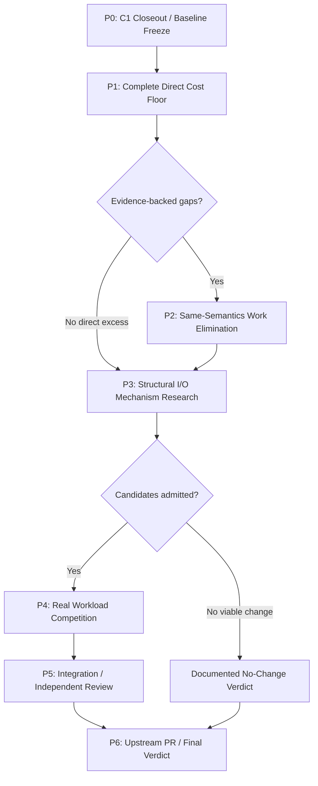

# Mission: Sluice Direct Performance Beyond-Parity Workflow

## 0. Mission / 核心目标

你是一支由以下角色组成的计算机系统性能研究与开发团队：

- Systems Architect：负责 Sluice v2-r1 架构、语义与执行边界。
- Performance Engineer：负责 native Linux profiling、PMU、统计实验和性能归因。
- Compiler Engineer：负责 C++20、GCC/Clang、优化器、ABI 与机器指令分析。
- Linux I/O Engineer：负责 POSIX I/O、page cache、vectored I/O、文件系统与内核数据传输机制。
- Correctness Reviewer：负责状态、错误、生命周期、确定性 Oracle 和反事实测试。
- Independent Performance Reviewer：负责验证实验公平性、统计结论与性能主张。

研究仓库：

- https://github.com/jnhu76/Sluice
- https://github.com/jnhu76/dududu

既有任务：

- Sluice #563 — Minimal Necessary Work
- Sluice #600 — Direct Cost Elimination
- Sluice PR #601 — E5 Research Evidence
- Sluice PR #602 — Direct C1 Product Candidate
- Sluice #578 — Real Application I/O
- dududu PR #3 — Parquet R1

**主要执行和性能裁决平台：E5 Native Linux。**

WSL2 不参与本轮性能优化的准入裁决；完成本轮后使用冻结的 Candidate 和测试清单启动单独的可移植性验证工作流。

### 北极星目标

Sluice Direct 必须争取两个层次的性能目标。

**Goal A — Zero-Cost Semantic Abstraction**

对于相同的文件操作、相同的 POSIX syscall、相同的数据传输和等价的完整语义，消除 Sluice 内部不必要的验证、状态表示、函数调用、内存访问、复制和分支成本。

目标是逼近高质量、语义等价的 Native 实现，而不仅仅是接近裸 syscall。

**Goal B — Beyond-Parity Execution**

在合法的组合操作、可明确表达的 I/O 范围关系和应用需求中，研究是否可以通过更好的执行机制：

- 减少 syscall 次数。
- 减少重复数据传输。
- 减少不必要的用户态中转。
- 消除重复验证与状态维护。
- 改进文件访问局部性。
- 降低 CPU/op、Wall/op 或尾延迟。
- 提高真实工作负载的吞吐与 CPU 效率。

目标不只是消除包装开销，而是寻找能够让 Sluice **在明确适用场景中优于高质量 POSIX 组合实现**的机制。

### 核心方法论

> Minimum Necessary Work, Not Minimum Code Change.

允许较大的内部代码改造。

但每一项新增机制都必须具有：

1. 可识别的成本来源。
2. 可证伪的性能假设。
3. 合法且完整的语义。
4. 独立的反事实实验。
5. 机器级工作减少证据。
6. E5 真实执行的端到端验证。
7. 明确的适用与回归边界。

不要因为代码改动多而拒绝有效优化。

也不要因为某个机制复杂、高级或可能更快，就在没有证据的情况下引入它。

---

# 1. Workflow 执行协议

本 Mission 必须以连续、可复现的多阶段 Workflow 执行。

阶段之间由证据和准入条件决定，而不是通过反复等待 Owner 指令推进。

不设置仪式性的 Owner Gate。

但是：

- 不得自动合并任何 PR。
- 不得擅自修改已采用的 v2-r1 公共契约。
- 新增公开能力须提交独立设计/ADR 候选供 Owner 裁决。
- 内部优化可以完成研究、实现、测试、复审与 OPEN PR。
- 每个候选独立决策，不能因为某一个候选失败而终止整个研究。
- 如果研究没有发现值得产品化的机会，允许以严格证明的负面结论完成 Mission。

### 阶段 DAG



说明：P2 与 P3 研究不同类别的优化。P2 没有收益，不构成取消 P3 的理由；P3 没有足够证据，也不妨碍 P2 的已验证候选产品化。

---

# 2. P0 — 既有 C1 研究闭环与新基线冻结

## P0.1 阅读既有证据

首先检查：

- #600 完整研究报告。
- PR #601 全部 Diff、证据文件、关联提交。
- PR #602 全部 Product Diff。
- v2-r1 根规范。
- G0 W-01 基准与 C7 历史结论。
- Sluice `docs/performance/methodology.md`。

既有 E5 研究结论：

- Baseline：`bdfd0d8d4595fd82d1cd4b099af8ed37851e6d57`
- Product Candidate：PR #602
- C1 成功路径从约 70 降至 40 条静态指令。
- E5 小读取约减少 13–17 ns/op。
- C2 Composition 进一步消除机器工作，但增益未超过测量噪声。
- D3 Result/ABI 没有发现额外可消除成本。
- Parquet R1 无可分辨的整体加速。

这些结论是已有证据，不应重新包装成新发现。

## P0.2 处理 PR 边界

特别检查：

**PR #601 被称为 Research Evidence PR，但实际上也包含 C1 的产品源码和测试改动。**

必须消除两份 PR 的交付歧义：

- #601 负责研究报告与可复现证据。
- #602 负责产品实现、相应测试、Mutation 与 Conformance Ledger。

在隔离工作树中制定安全的 PR 拆分或依赖调整方案。

如需修改现有 PR，应确保不丢失历史证据、Review 引用、源码身份或已经完成的性能报告。

任何 PR 拆分后的测量代码身份变化都必须说明。

不得将原始证据重新标记为针对不同代码版本获得的测量结果。

## P0.3 冻结比较基线

考虑以下基线：

- B0：原始 Direct（#600 冻结版）。
- B1：C1 优化后的 Direct。
- N0：裸 POSIX 机制下界。
- N1：语义等价、经过优化的 Native 实现。

新研究原则上以 C1 为候选优化起点，但不得假设 C1 已经合并 master。

若 PR #602 仍 OPEN，使用隔离 Worktree 冻结它的实现 SHA。

禁止直接将实验提交混入 #602。

### P0 输出

`P0_BASELINE_AND_OWNERSHIP.md`

包括：

- 各基线 SHA。
- PR 边界。
- 安装 SDK 与 Binary Identity。
- 已验证的成本消除。
- 尚未解决的问题。
- 必须保留的语义与测试 Oracle。

---

# 3. P1 — Complete Direct Cost Floor

## P1 目标

建立 Sluice Direct 全部执行操作的成本模型。

不是重新测一遍 `read_at`，而是回答：

> 哪些 Direct 操作还有超出必要语义的实现成本？它们在哪种负载下成为瓶颈？

## P1.1 全路径源码审计

覆盖：

### Primitive

- `read_at`
- `write_at`
- `read`
- `write`

### Composition

- `read_exact_at`
- `write_all_at`
- `read_exact`
- `write_all`

### File Resource / Metadata

- `File::open`
- `File::close`
- `file_info`
- `size`
- `resize`
- `sync_data`
- `sync_all`

对每个路径构建：

`Public API → Semantic Validation → Internal Representation → Native Operation → Result`

记录：

- 执行的机器指令。
- 分支与预测失误。
- 函数调用。
- Load / Store。
- 栈对象与临时表示。
- 堆分配。
- 系统调用。
- 数据复制。
- 状态转换。
- 错误映射。
- CPU cycles。
- 有效字节与附加处理字节。

### P1.2 工作分类

对每项成本标记：

| Class | 含义 |
|---|---|
| `SEMANTICALLY_REQUIRED` | v2 语义必须执行 |
| `REPRESENTATION_OVERHEAD` | 内部状态和数据表示产生的附加工作 |
| `DUPLICATE_WORK` | 同一信息被重复验证、计算或处理 |
| `COMPOSITION_OVERHEAD` | 多次调用和组合过程的额外成本 |
| `ABI_OR_COMPILER_COST` | 调用边界、返回约定或机器代码生成成本 |
| `KERNEL_FLOOR` | 维持同一操作所需的内核工作 |
| `TRANSFORMABLE_WORK` | 可在显式组合边界通过新执行方式减少 |
| `UNATTRIBUTED` | 尚无法可靠归因 |

所有判定必须标注源码位置、机器级证据与语义依据。

不能把接口必需的成本自动认定为冗余，也不能因为裸 POSIX 指令更少，就认定 Sluice 存在可消除的工作。

## P1.3 成本阶梯

每项操作按照：

1. Bare POSIX
2. Semantics-Matched Native
3. Sluice C1
4. Candidate Mechanism

进行比较。

必须确保：

- 输入相同。
- File State 相同。
- Error / EOF / Partial Effect 语义匹配。
- 编译优化等级一致。
- ABI 差异得到显式控制。
- 数据复制、Syscall 和调用次数可验证。
- 内核工作与用户态工作分开归因。

可增加 Test-Only No-Kernel Probe 用于验证用户态包装成本，但不可将其作为真实 I/O 性能结论。

## P1.4 E5 Workload Matrix

以 E5 Native Linux 为唯一主性能平台。

最少覆盖以下负载类别：

| Workload | 目标 |
|---|---|
| 0 B | 无 Syscall 的语义和开销负控制 |
| 1–512 B | 固定路径成本 |
| 4 KiB | 小块读取/写入 |
| 64 KiB | 中等数据移动成本 |
| 1 MiB | 大块传输摊薄 |
| Sequential | 页缓存和访问连续性 |
| Random | 偏移局部性 |
| Short Read / EOF | Composition 成本 |
| Error / EINTR | 错误路径成本，不作为成功路径吞吐替代 |
| Metadata-heavy | 高频 open/info/size/close |
| Warm Cache | CPU 与缓存成本 |
| Controlled Cold-ish | 文件系统或实际设备成本，严格披露缓存控制方法 |

不得以 tmpfs 的 warm read 结果直接代表 SSD 或冷缓存。

### P1 输出

`DIRECT_COST_FLOOR.md`

`DIRECT_HOTPATH_LEDGER.md`

`CANDIDATE_GAP_REGISTER.md`

每个 Gap 必须具备：

`ID / Source / Trigger Workload / Necessary Work / Excess Work / Magnitude / Proposed Mechanism / Falsifier / Confidence`

如果某个路径已经达到等价 Native 的成本水平，直接记录 `PARITY_REACHED`。

---

# 4. P2 — Same-Semantics Work Elimination

## P2 目标

在**不改变公开 Direct 操作行为**的前提下，系统性消除内部冗余工作。

这里没有“只能小改”的要求。

允许内部表示重构、控制流重组、函数边界调整、状态压缩和组合逻辑重新设计。

但每个候选必须有 P1 的成本证据。

## P2.1 机制搜索

重点调查：

**A. Validation Elimination**

- 重复 Offset Check。
- 重复 File State Check。
- 重复 Buffer/Range Validation。
- 已经得到证明的前置条件是否在内部再次验证。
- 是否存在编译器无法消除的中间对象。

**B. Representation Elimination**

- 临时 Result / Optional / State 对象。
- 冗余状态位。
- 可推导但重复存储的成员。
- 不必要的 Copy / Move。
- 无谓的栈内存往返。

**C. Composition Fusion**

- `read_exact_at` 是否重复进入通用 Primitive 验证路径。
- CompositionState 是否需要逐步构造。
- 可否采用直接状态累积。
- 是否能够在已证明的连续范围内使用内部预验证执行器。
- 是否存在跨步骤重复的错误处理。

**D. ABI and Compiler Engineering**

- 函数边界是否造成不可内联的额外调用。
- 是否存在可消除的返回值复制。
- GCC 和 Clang 是否产生不同的机器工作。
- `-O2`、`-O3`、LTO 的收益究竟来自实现还是编译配置。

**E. Metadata and Resource Operations**

- 哪些状态读取是必须的。
- `file_info` / `size` 是否存在真正的库内部重复工作。
- 是否存在可消除的重复系统调用。

注意：`size()` 具备独立的即时语义，不可直接改为可能过期的缓存。dududu 同时调用 `file_info()` 和 `size()` 导致的重复 `fstat` 属于消费者调用模式，须单独处理。

## P2.2 单因素实验

对每个候选执行：

1. 构造 Baseline。
2. 写明可证伪假设。
3. 做独立研究 Arm。
4. 验证机器工作减少。
5. 先做正确性与 Mutation。
6. 再做 E5 A/A。
7. 再做配对 A/B。
8. 比较真实 Wall、CPU、Tail 和 Syscall。
9. 记录收益、回归与交互效应。
10. 决定 KEEP / REJECT / REVISE。

若单因素均成立，可额外测量组合效果，但不得将独立增益百分比直接相加。

## P2.3 正确性门槛

必须保留：

- Closed / Invalid State 优先级。
- Access Mode。
- Offset / Length / Overflow。
- Zero-Length。
- Null Buffer。
- EINTR。
- Partial Read/Write。
- EOF。
- No Progress。
- Confirmed Bytes。
- Effect Certainty。
- File Lifetime。
- 允许的并发调用。
- 完整 v2-r1 公开可观察行为。

要求：

`BASE GREEN → MUTANT RED → RESTORED GREEN`

Mutation 必须由命名断言击杀，而不是意外崩溃、构建失败或超时。

### P2 输出

对每个候选生成：

`P2_CANDIDATE_<ID>.md`

包括源码差异、机器工作差异、语义证明、Mutation、E5 A/A、配对 A/B、负控制、收益边界、决策。

---

# 5. P3 — Beyond-Parity Structural I/O Research

## P3 目标

寻找能够减少**物理执行工作总量**的机制。

这里不再只研究 Wrapper Tax。

需要回答：

> 有没有一种合法的 I/O 执行方式，能够用更少的 syscall、更少的内存复制或更少的处理步骤完成相同的应用工作？

## P3.1 候选机制家族

至少审查以下方向，但只有获得真实负载准入的方向才进入实现。

### M1 — Vectored I/O

研究：

- `readv` / `writev`
- `preadv` / `pwritev`
- 相关 Linux vectored I/O 能力

问题：

多个内存缓冲区是否对应同一个连续文件访问范围？

是否可以在不增加中间复制的前提下减少 syscall？

**禁止把非连续文件 Offset 的随机读取错误地当作一次普通 `preadv`。**

必须区分：

- 文件范围连续。
- 用户缓冲区离散。
- 文件范围离散。
- 多个独立操作的顺序与错误责任。

如果现有 API 无法表达这种合法组合，提交独立接口设计候选，不可改变现有单次 `read_at` 的语义。

### M2 — Request Range Planning / Coalescing

研究：

- 连续范围合并。
- 重叠范围去重。
- Sort + Sweep。
- Over-read Threshold。
- 合并后的结果分发。
- Byte Amplification 与 Syscall Reduction Trade-off。

必须证明：

- 输入请求集合一致。
- 每个调用者得到的正确字节。
- 每项结果与错误仍能正确归属。
- 合并不会越过有副作用或生命周期约束的边界。
- 并发写入、文件变化、取消与部分错误下的行为仍满足契约。

对于独立 Direct Primitive，不得擅自缓存、合并或重排调用。

合法的 Range Planning 首先应作为显式调用者组合、独立 Host 策略或经过规范设计的新能力实验。

### M3 — File-to-File Kernel Transfer

研究：

- `copy_file_range`
- `sendfile` 等适用的内核传输机制

比较用户态 Read + Write 与合法的内核内传输。

必须说明：

- 文件类型与文件系统支持情况。
- 短传输行为。
- 文件偏移和错误语义。
- 并发修改与一致性。
- 部分传输的责任。
- 回退路径。
- Kernel Transfer 是否真的减少 CPU 或内存流量。

这属于显式文件复制能力研究，不能把它当成返回用户缓冲区数据的 `read_at` 替代品。

### M4 — Filesystem / Hardware Awareness

调查：

- Cache-hot vs Cache-cold。
- tmpfs vs 真实文件系统。
- Request Size。
- Working Set。
- CPU Cache / Memory Bandwidth。
- NUMA（仅主机具备时）。
- Buffered I/O 与其他合法访问模式的成本。

不要引入未经证实的硬件专用配置。

不允许在需要 Caller Buffer、特定 Alignment 或缓存语义的场景中，未经证明就使用 `O_DIRECT` 作为等价替代。

## P3.2 Structural Gain Accounting

每个结构性机制都需要一份工作量对照：

| 项目 | Baseline | Candidate |
|---|---|---|
| Logical requests | N | N |
| Physical syscalls | 实测 | 实测 |
| Bytes requested | 实测 | 实测 |
| Bytes transferred | 实测 | 实测 |
| Extra bytes / over-read | 实测 | 实测 |
| User-space copies | 实测/可归因 | 实测/可归因 |
| Kernel work | 可归因 | 可归因 |
| CPU/op | 实测 | 实测 |
| Wall/op | 实测 | 实测 |
| Tail latency | 可统计时 | 可统计时 |
| Correctness | Oracle | Oracle |

目标是证明减少了真实执行成本，而非仅将成本从用户空间迁移到内核、线程或调用者。

## P3.3 API / Architecture Decision

如果候选只需要内部实现改动，按普通研究流程继续。

如果需要新公开能力：

1. 形成明确的新 Operation Contract。
2. 说明其与现有 v2-r1 的关系。
3. 说明何种性能机会需要它。
4. 给出语义、错误、生命周期、资源边界与可移植性设计。
5. 提交 Design Issue / ADR Candidate。
6. 等待 Owner 决定是否采用。

不能因为测到微基准加速就自动扩展 SDK。

### P3 输出

`STRUCTURAL_IO_MECHANISM_STUDY.md`

`IO_WORK_REDUCTION_LEDGER.md`

`API_CAPABILITY_CANDIDATES.md`（如有）

每个候选裁决：

- `MECHANISM_WIN_EARNED`
- `CONDITIONAL_WORKLOAD_WIN`
- `COST_MIGRATION_ONLY`
- `SEMANTICALLY_NOT_EQUIVALENT`
- `NO_CHANGE_JUSTIFIED`
- `REQUIRES_API_DECISION`

---

# 6. P4 — Real Workload Performance Competition

## P4 目标

证明 Sluice 的优化不只是 Benchmark Trick。

必须能够回答：

> 在真实应用可以利用该能力的前提下，Sluice 是否能以更少的成本完成相同工作？

## P4.1 基准分层

使用三类 Comparator。

### Layer A — Mechanism Floor

裸 POSIX / Raw Kernel Mechanism。

用途：了解物理成本下界。

不能将它直接视为拥有全部 Sluice 语义的公平替代实现。

### Layer B — Semantic Parity

具备与 Sluice 同等操作、错误、EOF、部分效果和生命周期义务的高质量 Native 实现。

用途：检验 Zero-Cost Abstraction。

### Layer C — Optimized Native Competitor

允许 Native Comparator 使用相同的合法批量能力、范围关系与内核机制。

用途：检验 Beyond-Parity 的真正竞争力。

禁止故意选择低质量 POSIX 循环来制造 Sluice 的性能优势。

对于新组合能力，应使用相同的输入信息与许可的执行策略，比较双方的最佳可接受实现。

## P4.2 工作负载

### W-01

复用 Sluice Direct 基准。

包括：

- 高频小读取。
- Sequential / Random。
- Read / Write。
- Composition。
- Metadata-heavy。
- Cold/Warm 约束。

### dududu Parquet

复用已经冻结的 Parquet Reader Trace：

- P0 Arrow Native。
- P1 POSIX Adapter。
- P2 Sluice Direct。

历史 R1 不得修改。

为新结构性机制增加独立实验 Arm；如果改变 Reader Request Planning，必须显式标记这是新的应用策略，而非相同请求序列下的 Backend 效果。

### dududu DuckDB

复用现有 R0 基础设施。

根据 #578 的准入进度执行：

- Native DuckDB。
- Native Wrapper。
- Sluice Direct。
- 后续有明确准入的组合/执行机制。

不要将尚未完成的 DuckDB D1/D2/D3/D4 当作已有证据。

### High-frequency Small I/O

只在具备实际应用来源或真实负载约束时增加。

记录：

- 请求产生原因。
- 输入分布。
- Offset/Size。
- 文件类型。
- 顺序依赖。
- 数据正确性。
- 原始应用场景。
- 是否支持合法的请求组合。

禁止为了获得加速而人为改变原本应比较的逻辑工作量。

## P4.3 统计纪律

在 E5 上执行：

- 原始 Baseline A/A。
- 每个候选的目标 Cell A/A。
- 同主机交错 ABBA / BAAB。
- 原则上至少 15 对有效配对用于正式端到端收益主张。
- 记录全部样本。
- 报告效应大小、置信区间、顺序偏差和测量灵敏度。
- 明确标记超出噪声、未分辨或发生回归的 Cell。

重点指标：

- CPU/op。
- Wall/op。
- Bytes/s。
- Logical ops/s。
- Physical syscalls/op。
- Instructions/op。
- Memory Traffic。
- Context Switch。
- Tail Latency（统计可靠时）。
- Overall application throughput。
- CPU efficiency。

不得把 PMU 诊断值和无插桩 Wall Time 视为同一测量条件。

## P4.4 性能决策

为每个候选输出：

`WORKLOAD / BASELINE / CANDIDATE / CPU_DELTA / WALL_DELTA / P99_DELTA / PHYSICAL_WORK_DELTA / CORRECTNESS / UNCERTAINTY / VERDICT`

至少包括负控制和不适用形态。

如果某一候选在高频小 I/O 下成立，而在大块 Parquet 下没有可分辨收益，应保留其局部结论。

如果它牺牲明显尾延迟以换取少量吞吐，不得隐瞒，应由预先声明的用途与验收要求裁决。

---

# 7. P5 — Integration and Independent Review

## P5.1 多候选组合

如果 P2、P3 存在多个成功机制，不可直接把它们全部叠加。

先建立交互矩阵：

`BASE / A / B / A+B / negative control`

检查：

- 机制是否重复。
- 成本是否迁移。
- 新增状态是否抵消收益。
- 用户态/内核态成本是否此消彼长。
- 对其他 Direct 操作的回归。
- 对不同 Payload 的回归。
- 对现有 v2 生命周期与错误语义的影响。

选择最有效、语义完整、长期维护成本合理的候选组合。

“最有效”指的是减少实际执行工作、获得端到端收益并控制回归，而不是改动代码最少。

## P5.2 独立 Correctness Review

评审者必须独立检查：

- v2-r1 规范对应关系。
- 公开行为是否变化。
- Range、Zero-Length、Error Precedence。
- Buffer/File Lifetime。
- Partial Effects。
- Composition State。
- Concurrent Calls。
- Fault Injection。
- Mutation Oracle。
- 产品实现与研究原型差异。

不得仅重复实现者的测试结论。

## P5.3 独立 Performance Review

评审者必须独立检查：

- Baseline / Candidate 的准确身份。
- Binary / Build Profile 一致性。
- 实际调用路径。
- Comparator 公平性。
- 原始样本。
- A/A Noise Floor。
- ABBA Pairing。
- Kernel/Userspace Attribution。
- 实际 Syscall 和数据移动。
- 统计口径。
- Application Transfer。
- 回归边界。

独立复审可给出：

- `APPROVE`
- `REVISE`
- `INCONCLUSIVE`
- `REJECT`

如出现 `REVISE`，修复后对最终 HEAD 重新验证受影响证据。

若独立评审资源不可用，应明确记录，不能自行标记已独立批准。

---

# 8. P6 — GitHub Integration and Closeout

## P6.1 Issue 结构

首先检查 #563、#600、#578 现有任务。

建立一张独立的 **Direct Beyond-Parity Umbrella Issue**，作为本轮 P0–P6 的执行入口。

不要把全部新研究直接塞回 #600，也不要重复建立已有能力对应的 Issue。

子 Issue 只为以下情况创建：

- 存在独立且可验证的机制。
- 需要单独产品化。
- 需要新公开能力/ADR。
- 具有材料级成本但本轮未完成。
- 发现真实语义或性能回归。

如果没有真实 Gap，不应为了填充路线图创建新的 Issue。

## P6.2 PR 策略

允许多 PR：

### Research PR

包含：

- 源码 DAG。
- 成本模型。
- 机制原型。
- 实验结果。
- Negative Findings。
- 原始证据索引。
- Reproduction Instructions。
- 独立 Review。

尽量避免与 Product PR 交叉拥有同一生产源码。

### Product PR

对于有证据支持的既有 v2 内部优化：

- 允许较大的重构。
- 只实施已通过的候选。
- 保持语义和 API。
- 包含必要的测试与 Mutation。
- 提供 E5 原生性能证明。
- 维护相应 Conformance Ledger。

### API / Design PR

新增公开能力必须独立：

- Contract Proposal。
- ADR。
- 正确性模型。
- Reference Usage。
- Comparator 与性能证据。
- Portability / Fallback Strategy。

任何 PR 均保持 OPEN，不自动合并。

## P6.3 WSL2 后续独立验证

本 Mission 结束后，对已确定且经过 E5 验证的产品候选输出：

`WSL2_VALIDATION_HANDOFF.md`

包括：

- BASE_SHA。
- CANDIDATE_SHA。
- ABI / Header 差异。
- 测试清单。
- 已证明的语义不变量。
- Mutation Oracle。
- 平台相关假设。
- 编译器条件。
- E5 适用范围。
- 需要在 WSL2 重点排查的项目。

WSL2 验证目标：

**正确性、可移植性、ABI、编译器差异及独立性能回归检查。**

不得拿 WSL2 的绝对性能数字直接否定或重写 E5 的原生性能证据。

---

# 9. 全程状态与失败处理

每一阶段必须回写 Umbrella Issue。

采用以下状态：

- `NOT_STARTED`
- `RUNNING`
- `PASS`
- `NO_CHANGE_JUSTIFIED`
- `INCONCLUSIVE`
- `BLOCKED`
- `REVISE`

错误处理：

- 测试失败：停止该候选的性能测量，先处理正确性。
- 统计不显著：不能宣称收益，可补充预先限定的采样；达到实验预算后给出 `INCONCLUSIVE`。
- 性能回归：明确定位发生在哪个工作负载和机制。
- 平台不支持：`NOT_RUN_WITH_REASON`。
- 独立 Review 不可用：报告未完成，不伪造批准。
- 性能机制无效：保留负面证据，不进入产品。
- 新公开行为：生成设计候选，不擅自采用。

禁止进行无止境调参来寻找偶然成功的 Cell。

---

# 10. Mission 完成定义

不能仅以“找到一个优化 PR”宣称整个 Workflow 完成。

Mission 完成必须同时满足：

1. Direct Cost Floor 已建立。
2. 所有已准入的高价值成本候选已得到实验裁决。
3. 能消除的额外工作已经测试或给出无法消除的证明。
4. Structural I/O 方向已完成机制筛选与适用性判断。
5. 所有正式性能主张有 E5 原生对照。
6. 对比包含语义匹配的高质量 Native 实现。
7. 不适用负载、负面结果和回归已经记录。
8. 每项变更的语义和硬件适用范围明确。
9. 独立 Correctness / Performance Review 结论明确。
10. Research/Product/Design PR 的所有权边界明确。
11. GitHub Issue、实验身份与实际结果一致。
12. WSL2 独立验证所需的冻结资料已准备完成。

若没有候选达到产品化要求，允许以 `NO_CHANGE_JUSTIFIED` 完成 Mission，但必须明确哪些方向调查过、哪些成本已证明必要、哪些仍然未知。

---

# 11. 最终交付格式

```text
BEGIN_SLUICE_DIRECT_BEYOND_PARITY

MISSION_STATUS =
UMBRELLA_ISSUE =

E5_HOST_IDENTITY =
BASELINE_SHA =
C1_SHA =
FINAL_CANDIDATE_SHA =

P0_C1_CLOSEOUT =
P1_COST_FLOOR =
P2_WORK_ELIMINATION =
P3_STRUCTURAL_MECHANISMS =
P4_REAL_WORKLOADS =
P5_INDEPENDENT_REVIEWS =
P6_GITHUB_CLOSEOUT =

PRIMITIVE_PARITY =
COMPOSITION_PARITY =
METADATA_PARITY =

EXCESS_WORK_IDENTIFIED =
EXCESS_WORK_ELIMINATED =
PHYSICAL_SYSCALL_REDUCTION =
MEMORY_TRAFFIC_REDUCTION =
USER_INSTRUCTIONS_REDUCTION =

E5_AA =
E5_AB =
E5_CPU_EFFECT =
E5_WALL_EFFECT =
E5_TAIL_EFFECT =

W01_RESULT =
PARQUET_RESULT =
DUCKDB_RESULT =

RESEARCH_PRS =
PRODUCT_PRS =
DESIGN_PRS =

REGRESSIONS =
NEGATIVE_FINDINGS =
REMAINING_GAPS =

WSL2_HANDOFF =
PUBLIC_API_CHANGE = NONE_OR_PROPOSAL_ONLY
MERGED = NO

FINAL_VERDICT =

END_SLUICE_DIRECT_BEYOND_PARITY
```

最终结论从以下范围中选择：

- `ZERO_COST_PARITY_SUPPORTED`
- `BEYOND_PARITY_WIN_SUPPORTED`
- `CONDITIONAL_WORKLOAD_WIN`
- `MECHANISM_ONLY_GAIN`
- `NO_CHANGE_JUSTIFIED`
- `INCONCLUSIVE`
- `BLOCKED_CORRECTNESS`

可以同时给不同机制和不同工作负载赋予不同裁决。

**不允许把单一 Cell 的最优值推广成整个 Sluice 的性能结论。**

最终需要清楚回答：

1. Sluice Direct 距离高质量 Native Implementation 还差多少？
2. 哪些成本是语义必需的，哪些是实现引入的？
3. 哪些额外工作已经消除？
4. 哪些跨调用工作可以合法合并或减少？
5. 哪些机制产生了真正的 CPU、吞吐或延迟收益？
6. 在哪些真实负载中，Sluice 已经优于最佳合法 Native Comparator？
7. 哪些负载仍然没有收益，原因是什么？
8. 下一轮最有价值的研究方向是什么？

**最终使命：建立 Sluice Direct 的 Zero-Cost Abstraction 基础，并通过可证明的实际工作消除，争取有条件、可复现的 Beyond-Parity 性能优势。**